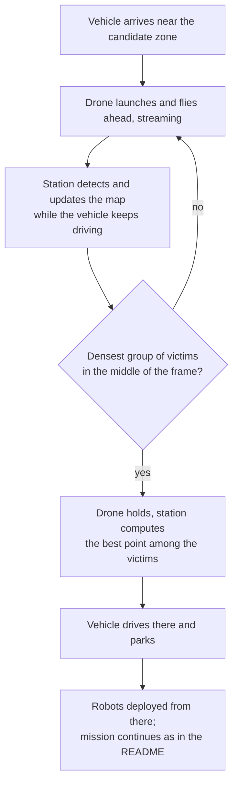

# Questions

Everything not yet settled. When something is decided, move it to [SPEC.md](SPEC.md) and delete it here.

## Next supervisors' meeting

### 1. Should the vehicle keep moving until the drone finds the victims?

Proposal: the current spec parks the vehicle at a known collapse site, and the drone hovers there. Instead, the drone would fly over the area and stream while the vehicle keeps driving. The drone holds once it finds the spot where the detected victims are most concentrated, with that spot in the middle of the frame. The station computes the best point among those victims, the vehicle drives there and parks, and it deploys the ground robots from that point.

For it:

- A fixed hover covers about 58 × 43 m and never grows. This drops the need for an operator to narrow the cell sector down to one building beforehand, which the current spec depends on.
- A parked vehicle near the victims shortens each robot's trip and keeps the robots inside WiFi range.
- The robots' drop point becomes wherever the vehicle parks, instead of a point known in advance.

Against it, or still to work out:

- Detection becomes part of the control loop: detect, move, detect again. Detector latency and false positives decide where the vehicle ends up, so a few false boxes could pull it the wrong way.
- "Closest to all victims" needs a definition. The centroid minimises squared distance, so one far-off victim pulls it a lot. The geometric median (the 1-median or Fermat-Weber problem) minimises total distance, which suits robots that drive out to victims one after another. The minimax centre (the 1-center problem) minimises the worst-case distance, which suits keeping every victim inside radio range. Research task in [TODO.md](TODO.md#research).
- The vehicle needs a way to get to that point. Until autonomy is in scope, a person drives it to the point the map shows (item 2).
- Does the vehicle have to stay in the drone's view? No, as long as the drone reports its own GPS: the station places everything on the map from that. The vehicle only has to stay within radio range, about 348 m in open air and much less through rubble.
- Can a vehicle drive through an earthquake site at all? Today's spec assumes it only reaches one predefined point.

Ask the supervisors: is this worth the extra scope, and should it replace or extend the fixed hover?

### 2. No autonomy yet: a person drives the vehicle, the operator drives the robot

Proposal: until detection works, nothing on site navigates by itself. Path planning would have two legs, the vehicle to its parking point (item 1) and the robot from the vehicle to each victim, and both are left out:

- a person drives the vehicle to the point the map shows;
- the operator drives the robot remotely from the station, steering by the robot's position on the drone footage.

The drone and the robot never talk to each other. Each reports its GPS to the station, and the station draws the robot's position on the drone footage. That is enough to steer it toward a victim marker. The robot's own video is optional for driving; the operator can switch to it up close.

The robot then needs drive commands over the existing WiFi, a stop when commands stop arriving, and a GPS module; the full list is the [robot interface](SPEC.md#robot-interface). That is simpler than any autonomous option and adds no new link.

Why leave planning out? The planning step itself is deterministic and cheap (A* or D* over a grid). The hard part is perception, meaning deciding which ground is passable. That takes either a segmentation model on the drone frames, running on the station next to the detectors, or sensors on the robot. Both are bigger than detection.

Later, if there is time, autonomy can be added in steps:

| Step | Robot needs | Trade-off |
| --- | --- | --- |
| Drive to a GPS point | A compass (GPS is already required) and a ToF or bump sensor | GPS is 2 to 5 m off, worse next to buildings, so the operator still covers the last metres. On a rolling sphere the compass needs a stabilised inner platform. |
| Station steers the robot from the drone frame | Nothing new beyond a marker that is easy to spot from the air | The robot must stay in the drone's frame, and frame-to-command delay must stay under about 500 ms. |
| Onboard obstacle avoidance | Depth camera or LiDAR, more compute | Real autonomy, but it is the Robotics team's work and expensive. |

Ask the supervisors: is operator control acceptable for the demo, with autonomy as later work?

## For the Robotics team

We send them our requirements (the [robot interface](SPEC.md#robot-interface)) and ask:

- Will they use the same Pi 5 and MT7921AUN USB adapter as the drone? Onboard WiFi (80 to 110 Mbit/s) is too tight, and a Pi Zero 2W has no 5 GHz.
- Where does the antenna go? A trace antenna next to a battery and motor detunes, and the robot works at ground level among walls.
- Size and weight.

## Open

| Question | Blocking? |
| --- | --- |
| What happens when the link drops? The station should keep working from its last detections, and the drone needs a return behaviour. Neither exists. | Yes |
| Which drone and cameras? Every resolution, frame rate, field of view and range number in [research/communication/](research/communication/) shifts if the hardware differs from what we assumed. | Yes |
| Pi and WiFi adapter for both platforms: is the recommended Pi 5 + MT7921AUN ([SPEC.md](SPEC.md#system)) what we buy? | Yes |
| Do the detectors work from the robot's ground-level view? They were trained only on drone footage looking down. If not, the robot's streams need ground-level training data or go only to the operator. See [SPEC.md](SPEC.md#streams). | No |
| Late fusion: which tracker to use, and calibrating the real camera pair once it is chosen. | No |
| Message formats: transport (`detect.py` writes a file, not a socket), timestamps in the payload, ground coordinates instead of pixels, behaviour on a dropped frame. Current state in [research/communication/](research/communication/#message-formats). | No |
| How does operator control grow into decisions made by an agent (RL or decision-theoretic planning)? Supervisors expect it. Research task in [TODO.md](TODO.md#research). | No |
| What structured signals does the audio / dialogue module output to the station? | No |
