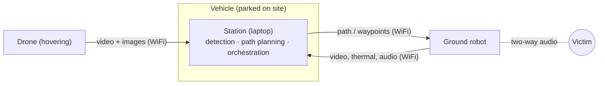
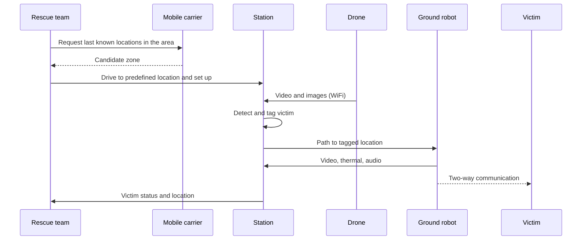

# Agentic Aerial-Ground Robot Collaboration for Victim Detection and Triage

> **Status:** Draft · **Updated:** 2026-10-18

CSCI 408 senior project (Group 19). A vehicle carrying a laptop **station**, a **drone** and a **ground robot** drives to a spot where victims are likely to be after an earthquake. The drone hovers and streams video to the station, which detects and tags victims, plans a path, and sends the robot to verify the victim's status and talk to them.

## System at a glance

## Concept of operations

1. **Pre-mission:** the team requests carrier location data and picks a site.
2. **Scene 1 (aerial):** the vehicle parks, the drone hovers and streams, the station detects and tags a victim.
3. **Scene 2 (ground):** the station plans a path, the robot follows it, verifies the victim's status, and communicates with them.

Roads, structures and communications are damaged after an earthquake, so sending humans into
unassessed areas is dangerous and slow.

## Scope

- [ ] Victim detection from drone imagery (RGB / thermal as available)
- [ ] Station-side path planning for the ground robot
- [ ] Station-side orchestration
- [ ] Robot-side verification (thermal, audio) and triage signals
- [ ] Evaluation against a baseline

**Out of scope:** robot locomotion and hardware design (Robotics team), carrier-side location services (assumed available).

## Repository map

| Path                                   | Purpose                                               |
| -------------------------------------- | ----------------------------------------------------- |
| [station/](station/)                   | Station: detection, path planning, orchestration      |
| [drone/](drone/)                       | Drone: hovering sensing platform                      |
| [ground-robot/](ground-robot/)         | Ground robot and Robotics team collaboration          |
| [src/](src/)                           | Source code                                           |
| [research/](research/)                 | Literature, datasets, and the communication link budget |
| [meeting-notes/](meeting-notes/)       | All meetings (supervisors, Robotics team, internal)   |
| [templates/](templates/)               | Templates for recurring files                         |
| [paper/](paper/)                       | Final report (LaTeX)                                  |
| [GLOSSARY.md](GLOSSARY.md)             | Every term the project uses, grouped by area          |
| [open-questions.md](open-questions.md) | Open questions and unverified assumptions             |
| [CHANGELOG.md](CHANGELOG.md)           | Decisions and changes, newest first                   |

## Status

- [x] Initial architecure decided – stationary drone, tumblweed robot deployed at site, station as orchestrator
- [ ] Concept of operations agreed by the team
- [ ] Station–robot interface agreed with the Robotics team
- [x] Datasets selected – HIT-UAV (thermal), C2A (RGB); see [research/datasets/datasets.md](research/datasets/datasets.md)
- [ ] Detection baseline running
- [ ] End-to-end demo (simulated or recorded data)
- [ ] Final report

## Contacts

### Team

| Name                 | Email                          | Role |
| -------------------- | ------------------------------ | ---- |
| Askar Matayev        | askar.matayev@nu.edu.kz        | -    |
| Ruslan Nagimov       | ruslan.nagimov@nu.edu.kz       | -    |
| Yelzhan Rakhimzhanov | yelzhan.rakhimzhanov@nu.edu.kz | -    |
| Bakhtiyar Yesbolsyn  | bakhtiyar.yesbolsyn@nu.edu.kz  | -    |
| Nurbek Baktygali     | nurbek.baktygali@nu.edu.kz     | -    |

### Supervisors

| Name                | Email                   | Role            |
| ------------------- | ----------------------- | --------------- |
| Adnan Yazici        | adnan.yazici@nu.edu.kz  | Main Supervisor |
| Enver Ever          | enverevermetu@gmail.com | Supervisor      |
| Muhammad Toaha Khan | khan@metu.edu.tr        | Supervisor      |

### Robotics team

| Name              | Email                       | Role       |
| ----------------- | --------------------------- | ---------- |
| Gourav Devappa    | gourav.devappa@nu.edu.kz    | Supervisor |
| Mirat Serik       | mirat.serik@nu.edu.kz       | -          |
| Adil Ismagambetov | adil.ismagambetov@nu.edu.kz | -          |
| Yevgeniy Dikun    | yevgeniy.dikun@nu.edu.kz    | -          |

<strong>Conventions</strong>

- Every Markdown doc starts with a title and a status line: `> **Status:** Draft | In review | Agreed · **Updated:** YYYY-MM-DD`.
- Dates use ISO format (`YYYY-MM-DD`). File names use `kebab-case`.
- Record every decision or change in [CHANGELOG.md](CHANGELOG.md), including its rationale.
- Add unresolved questions to **Open questions** in [open-questions.md](open-questions.md). Once answered, move them to **Resolved** and log the answer in the changelog.
- Add anything we are treating as true but have not verified to **Assumptions** in the same file, with the risk if it turns out false.
- Recurring files (meeting notes, literature notes) start from [templates/](templates/).
- Cite only keys that exist in [research/literature/references.bib](research/literature/references.bib).
- Define new terms in [GLOSSARY.md](GLOSSARY.md) rather than explaining them inline in several places.
- Do not copy the Robotics team's internals. Link to their docs and record dated facts in [ground-robot/](ground-robot/).

