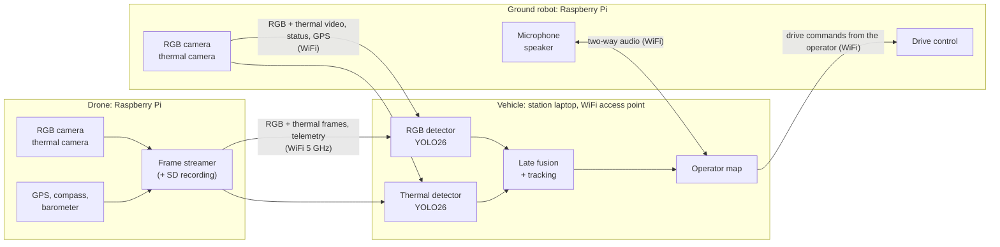
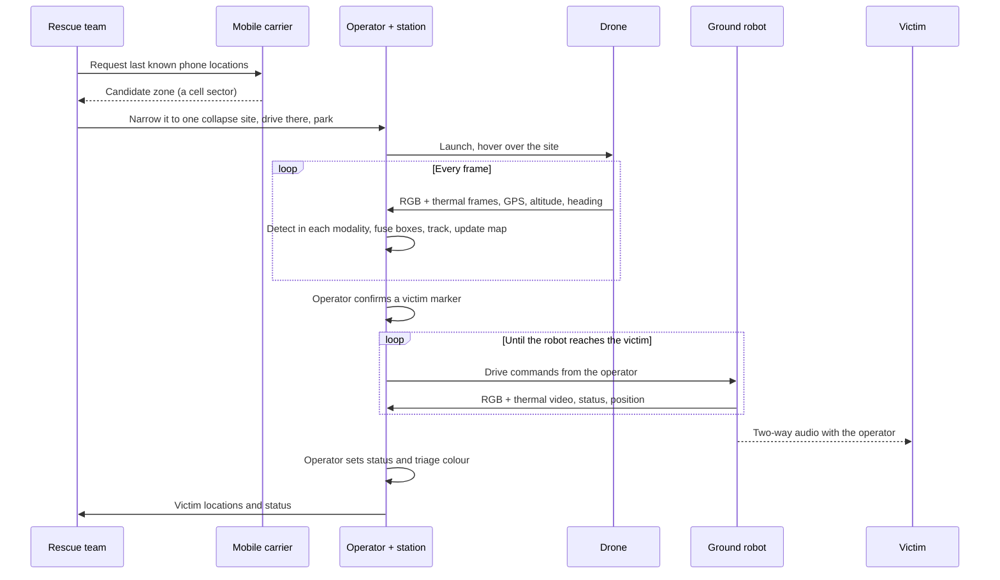
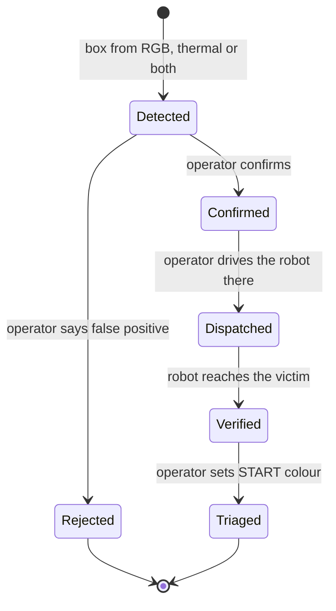

# Agentic Aerial-Ground Robot Collaboration for Victim Detection and Triage

CSCI 408 senior project, Group 19.

After an earthquake, roads, buildings and phone networks are damaged, and sending people into an unassessed area is slow and dangerous. A vehicle carries a laptop (the station), a drone and a ground robot to a collapse site. The drone streams RGB and thermal video to the station, which finds victims and shows them on a map. The operator drives the robot to a victim to check their state and talk to them.

| File | What's in it |
| --- | --- |
| [TODO.md](TODO.md) | What to do next. Start here |
| [SPEC.md](SPEC.md) | What we are building: agreed decisions, assumptions, interfaces, operator map |
| [QUESTIONS.md](QUESTIONS.md) | Everything not settled, with the agenda for the next supervisors' meeting on top |
| [research/datasets/](research/datasets/) | Training and test data, results, laptop test plan, earlier dataset audits |
| [research/communication/](research/communication/) | Link budget: frame sizes, coverage, WiFi range and setup |
| [research/literature/](research/literature/) | Literature review (CSV) |
| [src/detection/](src/detection/) | Code |
| [paper/](paper/) | Final report (LaTeX) and `references.bib` |

## Deployment diagram

What runs where, and what each WiFi link carries. Mermaid has no UML deployment syntax, so this is a flowchart drawn in that style.

## Sequence diagram: one mission

## State diagram: a victim marker

What the station tracks for each victim. A marker stays on the map after the person leaves the drone's frame, with the time they were last seen.

## Team

| Name | Email |
| --- | --- |
| Askar Matayev | askar.matayev@nu.edu.kz |
| Ruslan Nagimov | ruslan.nagimov@nu.edu.kz |
| Yelzhan Rakhimzhanov | yelzhan.rakhimzhanov@nu.edu.kz |
| Bakhtiyar Yesbolsyn | bakhtiyar.yesbolsyn@nu.edu.kz |
| Nurbek Baktygali | nurbek.baktygali@nu.edu.kz |

Supervisors: Adnan Yazici (main, adnan.yazici@nu.edu.kz), Enver Ever (enverevermetu@gmail.com), Muhammad Toaha Khan (khan@metu.edu.tr).

Robotics team, who build the ground robot: Gourav Devappa (supervisor, gourav.devappa@nu.edu.kz), Mirat Serik (mirat.serik@nu.edu.kz), Adil Ismagambetov (adil.ismagambetov@nu.edu.kz), Yevgeniy Dikun (yevgeniy.dikun@nu.edu.kz).
