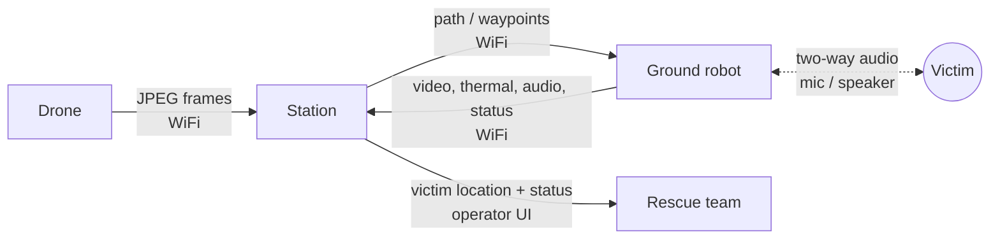

# Interfaces

> **Status:** Draft · **Updated:** 2026-10-18

Every link between components in one diagram. Links involving the robot must be reviewed by the Robotics team.

## Rates

Design against 100 Mbit/s per link, half the pessimistic real-world 5 GHz rate. Measured in
[research/communication/](../research/communication/), which also has the link budget, range figures
and the measurement plan.

| Link | Payload | Rate | Bytes/frame | Bandwidth |
| --- | --- | --- | --- | --- |
| Drone → station | Thermal JPEG 640×512 | 30 FPS | 139 KiB | 34 Mbit/s |
| Drone → station | RGB JPEG 1280×1024 | 10 FPS | 454 KiB | 37 Mbit/s |
| Drone → station | RGB JPEG 3840×2160 | 2 FPS | 1.8 MiB | 30 Mbit/s |
| Station → robot | Path / waypoints | On change | JSON | Negligible |
| Robot → station | Video, thermal, audio, status | TBD | TBD | **Unbudgeted** |
| Station → rescue team | Victim location and status | On detection | JSON | Negligible |

**The drone streams do not fit.** Thermal at 30 FPS plus RGB at 10 FPS comes to 71 Mbit/s, and
adding 4K puts it at 101. That is the whole budget, with nothing left for the robot or the operator.

Pick one of these before the interface is agreed:

- Thermal at 30 FPS only, 34 Mbit/s. Detection is the product; RGB stays an on-demand inspection mode.
- Thermal at 30 FPS plus RGB at 5 FPS, 53 Mbit/s. Leaves room for the robot.
- Encode the video. H.264 at 2 Mbit/s replaces the 4K stream, and the detector runs on keyframes.

The first option costs nothing in detection quality, because the thermal stream is the one with
AP50 0.872. Measure the robot's contribution before shrinking either stream.

## Message formats

Drone frames are JPEG over the station-hosted WiFi network, since every resolution from 128×128 to
4K transmits and the bytes are known. Undecided:

| Field | State | Note |
| --- | --- | --- |
| Frame container | Proposed | One JPEG per frame, filename carrying the timestamp. |
| Detection output | Agreed | JSON, `[{"image", "bbox_xyxy", "conf"}]`, as written by `src/detection/detect.py:16`. |
| Coordinate frame | Open | Whether `bbox_xyxy` is in image pixels or in ground metres. Pixels today. |
| Transport | Open | Plain TCP, or HTTP, or a stream protocol. Nothing implemented yet. |
| Timing | Open | No frame timestamp in the payload. Without one, latency is unmeasurable. |
| Loss behaviour | Open | What the station does with a dropped frame. See [open-questions.md](../open-questions.md). |

Nothing carries a timestamp yet, and `detect.py` writes results to a file rather than a socket, so
no transport exists. The format work starts when the drone is chosen.
