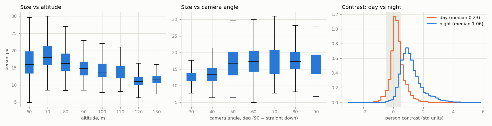
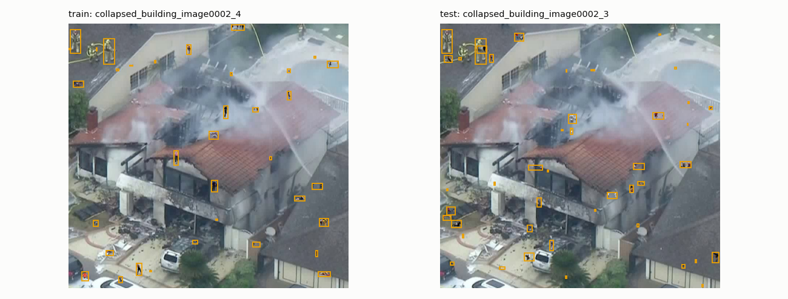
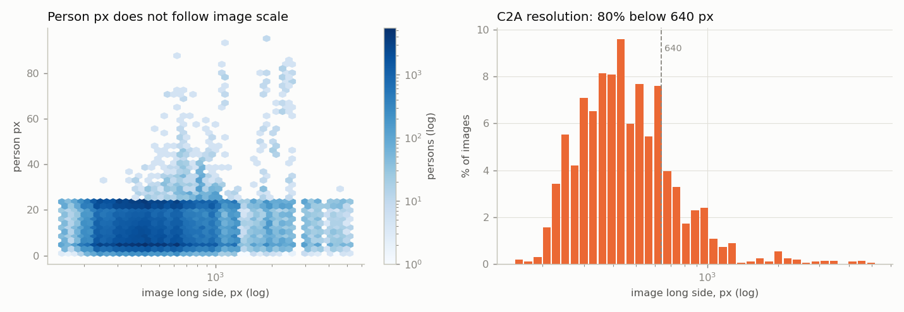

# Datasets and detection

Two YOLO26 models on the station, one RGB and one thermal, fused late. The design is in [SPEC.md](../../SPEC.md#detection). This file covers the data we train and test on, training and results, the laptop test, which datasets to add next, and what the earlier audits found.

## Training data

All three datasets are used raw and trained at `imgsz=640`. Datasets with both modalities are split by modality, and each model sees only its own.

| Dataset | Modality | What it is | License |
| --- | --- | --- | --- |
| [SARD](https://www.kaggle.com/datasets/nikolasgegenava/sard-search-and-rescue) (Kaggle copy; the [IEEE DataPort original](https://ieee-dataport.org/documents/search-and-rescue-image-dataset-person-detection-sard) needs a paid subscription) | RGB | Actors in search-and-rescue poses, including lying | Not stated |
| [NII-CU-MAPD](https://www.nii-cu-multispectral.org/) | RGB + thermal | 5,880 aligned pairs, drone at 20 to 50 m over a baseball field, Chiba, Japan, January 2020 | CC BY-NC-SA 3.0 |
| [RGBTDronePerson](https://nnnnerd.github.io/RGBTDronePerson/) ([code](https://github.com/NNNNerd/mmdet-rgbtdroneperson)) | RGB + thermal | 6,125 pairs of tiny persons: streets, campuses, parks, piers; day and night, top-down and oblique | Not verified |

### SARD

Details TBD: image count, resolution, splits and pose classes of the Kaggle copy.

### NII-CU-MAPD

The zip (9.1 GB) has two variants:

- `4-channel` is the authors' cleaned subset. It keeps only boxes visible in both modalities, drops motion-blurred frames and crops thermal to the RGB field of view, so the normalised box coordinates are the same for both. Train: 2,653 images, 10,144 boxes, 55 with no person. Val: 485 images, 891 boxes, 71 with no person.
- `rgb-t` has all 5,880 pairs and about 35% more boxes (19,764 in train). Boxes seen in only one modality are marked with a `type` field, and thermal has black margins that need cropping. Worth it if we need more real data.

Native size is RGB 2706×1980 and thermal 701×513. At `imgsz=640` the RGB image shrinks about 4×, and its people with it. If RGB recall is poor on small people, train or run inference on tiles instead.

Which variant we trained on: TBD.

### RGBTDronePerson

| | Train | Val |
| --- | --- | --- |
| Pairs | 4,900 | 1,225 |
| person | 43,169 | 11,009 |
| rider | 4,633 | 1,447 |
| crowd | 7,172 | 2,004 |
| uncertain | 1,340 | 106 |

Both modalities are 640×512. People are tiny: median side √(w·h) about 11 px, p95 about 17 px, and crowd boxes (a few people too close to separate) have a median of 14 px.

- The labels are drawn on the thermal image. RGB is only weakly aligned: the person is often 10 to 30 px from its box, more than the person's own size. A per-frame shift can't fix it, because phase correlation finds a confident shift on only about 3% of frames, and neighbouring frames disagree by 3 to 12 px. About 35% of RGB frames are night shots where nobody is visible. The thermal labels are exact; the RGB labels are not usable for an RGB-only model. If the RGB model was trained on this set, retrain it without it.
- person, rider and crowd are all people and collapse to `person`. `uncertain` is neither a person nor background, so mask those regions rather than dropping them as negatives.
- Three train XMLs (`00065`, `00067`, `00076`) say 630×500 for 640×512 images. Take the size from the image; the boxes fit as drawn.
- Thermal JPGs are three identical grey channels.
- The authors' train/val split comes from videos, and about 5% of val frames have a near-identical train frame.
- Augmentation worth trying: a smaller `scale` (0.2 to 0.3 instead of 0.5, which can shrink an 11 px person to 5 px) and `flipud=0.5`, since most views are top-down.

## Test data

WiSARD and HERIDAL are the held-out real-SAR tests. No training set comes from them, so their scores show whether the models work on footage they have never seen. The target score gets set from these results ([TODO.md](../../TODO.md#research)). If we ever train on them, pick a different test set first.

- WiSARD sample: one synchronised flight, `210417_MtErie_Enterprise` (Mt Erie, Washington, 17 April 2021). 264 frames of the same four volunteers on forest and rocky clearing in daylight, RGB 3840×2160 and thermal 640×512, 1,022 and 1,006 persons. The full set is 40.5 GB with 15,453 synced pairs.
- HERIDAL: real SAR in Croatian karst, maquis, pine forest, ravines, snow and one city park; volunteers stand, walk, sit and lie. We have the Roboflow export ["Heridal Human Detection" v4](https://universe.roboflow.com/drone-internship/heridal-human-detection) (167 MB, CC BY 4.0), which stretch-resized every frame to 640×640. The 8.3 GB [Zenodo original](https://zenodo.org/records/5662351) (about 4000×3000, CC BY 3.0) would carry about 29× more pixels per person. In the export, all 3,073 boxes use category id 1; map everything to `person`.

Both need care. HERIDAL's shipped split leaks: 44 of its 101 test images have a near-identical frame in train or valid. Test on the 57 without a twin, or re-split by location code. Its test split also has no empty images, so measure image-level false positives on valid. WiSARD is one site and four actors, so read it as a sanity check, not a benchmark.

## Conversion and training

TBD: the scripts and commands used to convert each raw dataset to YOLO format and to train, the hardware, epochs and other settings. Add the scripts to `src/detection/`.

## Results

| Model | Modality | Own val | WiSARD | HERIDAL |
| --- | --- | --- | --- | --- |
| YOLO26n | RGB | TBD | TBD | TBD |
| YOLO26n | Thermal | TBD | TBD | n/a (RGB only) |
| YOLO26s | RGB | TBD | TBD | TBD |
| YOLO26s | Thermal | TBD | TBD | n/a |

Report AP50, recall at confidence 0.25, and recall for persons under 16 px. `src/detection/eval_sizes.py` does all three, with and without tiling. Weights location: TBD.

## Test on the station laptop

Nano first, then small.

1. Latency per frame for each model alone: thermal at 640×512, and RGB at 1280×1024 tiled into six 640 crops.
2. Both models running at the same time on all four streams (drone thermal 30 FPS, drone RGB 10 FPS, robot thermal and RGB 5 FPS each), which is the real load.
3. Sustained rate over at least 10 minutes. A laptop without a fan throttles, so the first minute overstates it.
4. Memory use with both models loaded.
5. PyTorch on the GPU against an exported model (`yolo export`, in the laptop's native format).

These numbers replace the predicted frame rates in [SPEC.md](../../SPEC.md#streams) and [communication/](../communication/).

## If we need more data

Only if the held-out scores fall short. In order:

1. HIT-UAV (thermal, CC0, 2,898 images at 640×512, 60 to 130 m, campus and roads, day and night). `src/detection/prepare.py` already converts it. It has no disaster scenes, its daytime people barely stand out, and 31% of val/test images are near-duplicates of train images.
2. C2A (RGB, MIT, 10,215 synthetic images: people pasted onto AIDER disaster photos of rubble, fire and flood, 19% lying). Re-split before use: each AIDER photo appears five times (`<disaster>_imageNNNN_<0-4>`), and the authors' split puts 98% of val/test photos in train too. Keep all five variants in one split, 60/20/20 within each disaster type. About a quarter of people stay under 8 px even at 640, and no image is empty, so negatives have to come from another set.
3. AIResQ (thermal, real SAR, 9,788 images). Full set on request.
4. NOMAD (RGB, real, 100 actors walking, lying and hiding at 10 to 90 m, 42,825 frames). License unclear.
5. NII-CU-MAPD's `rgb-t` variant, for about 35% more boxes.
6. BIRDSAI (thermal, savanna, mostly night, CDLA-Permissive) as a thermal backup, and VisDrone for generic pretraining.

No dataset we know of has real people in real rubble. Our own staged clips would fill that: actors lying on rubble or a construction site, day and night, 20 to 60 m, both cameras. Even 200 to 500 labelled frames would be the most valuable test set we could have.

### All candidates

"?" means not verified from the source page. Licenses marked "?" must be confirmed with the authors before anything trained on them is published.

| Name | Modality | Disaster-relevant | License | Size | Link | Status |
| --- | --- | --- | --- | --- | --- | --- |
| SARD (2021) | RGB | Yes: actors, pose classes incl. lying | Not stated | 4.4 GB | [Kaggle](https://www.kaggle.com/datasets/nikolasgegenava/sard-search-and-rescue) | Training (RGB) |
| NII-CU-MAPD | RGB + thermal | No: baseball field, 20 to 50 m | CC BY-NC-SA 3.0 | 9.1 GB | [project](https://www.nii-cu-multispectral.org/) | Training (RGB, thermal) |
| RGBTDronePerson (2023) | RGB + thermal | No: tiny persons, day + night | ? | 1.9 GB | [project](https://nnnnerd.github.io/RGBTDronePerson/) | Training (thermal; RGB labels misaligned) |
| WiSARD (2022) | RGB + thermal | Partly: real wilderness SAR, day/night | Permissive notice, not a named license | 40.5 GB (sample 0.97 GB) | [project](https://sites.google.com/uw.edu/wisard/) | Test (sample) |
| HERIDAL (2019) | RGB | Partly: real SAR, wilderness, lying/hidden people | CC BY 3.0 (Zenodo) / CC BY 4.0 (Roboflow) | 8.3 GB (export 167 MB) | [Zenodo 5662351](https://zenodo.org/records/5662351) | Test (Roboflow export) |
| HIT-UAV (2023) | Thermal | No: campus/roads, 60 to 130 m | CC0 (Zenodo API; GitHub says CC BY 4.0) | 815 MB | [Zenodo 7633134](https://zenodo.org/record/7633134) | Analysed; next thermal set. Ships COCO json + VOC xml |
| C2A (2024) | RGB | Yes: synthetic people on AIDER disaster scenes | MIT (Kaggle page) | 4.9 GB | [GitHub](https://github.com/Ragib-Amin-Nihal/C2A), [Kaggle](https://www.kaggle.com/datasets/rgbnihal/c2a-dataset) | Analysed; next RGB set, after re-split |
| AIResQ (2025) | Thermal | Yes: SAR, 9,788 images | ? | ? | [Nature Sci. Data](https://www.nature.com/articles/s41597-026-07663-9) | Candidate; full set on request |
| NOMAD (2024) | RGB | Partly: real, 100 actors, 10 to 90 m, 42,825 frames | ? | ? | [GitHub](https://github.com/ArtRuss/NOMAD) | Candidate; license and size unknown |
| BIRDSAI (2020) | Thermal | No: savanna anti-poaching, mostly night | CDLA-Permissive | 3.7 GB real | [LILA](https://lila.science/datasets/conservationdrones/) | Candidate: thermal backup |
| VisDrone-DET (2018) | RGB | No: urban crowds | Academic use ? | 1.8 GB | [GitHub](https://github.com/VisDrone/VisDrone-Dataset) | Candidate: generic pretraining |
| TinyPerson (2020) | RGB | No: beach/sea, under 20 px | ? | ? | [GitHub](https://github.com/ucas-vg/PointTinyBenchmark) | Candidate |
| Okutama-Action (2017) | RGB video | No: actions on a field | Non-commercial ? | ? | [GitHub](https://github.com/miquelmarti/Okutama-Action) | Rejected: action labels, not SAR |
| AIDER (2019) | RGB | Yes | ? | ? | Zenodo 3888300 | Rejected: image-level labels only (used inside C2A) |
| DroneVehicle | RGB + IR | No | ? | ? | | Rejected: no person class |
| LLVIP (2021) | RGB + IR | No | ? | ? | [GitHub](https://github.com/bupt-ai-cz/LLVIP) | Rejected: street cameras, not aerial |
| Caltech Aerial RGB-T (2024) | RGB + thermal | No | ? | ? | [GitHub](https://github.com/aerorobotics/caltech-aerial-rgbt-dataset) | Rejected: segmentation only |

## What the earlier audits found

Before YOLO26 we audited HIT-UAV, C2A, the WiSARD sample and HERIDAL, with inference only: `best.pt` (YOLO11n trained on HIT-UAV for 14 of 50 planned epochs) and COCO-pretrained `yolo11n.pt`, person class only. The datasets have changed since, but these findings still shape the design.

### Measures

- Person size: √(box w × h) in native pixels. Detectors mostly miss people below about 8 px; 16 to 32 px is workable; above 32 is comfortable.
- Contrast: (mean grey inside the box − mean grey of a ring one box-size wide around it) ÷ grey std of the whole image. +1 means one std brighter than the ground next to them (warmer, in thermal). |c| < 0.5 counts as low contrast. It is grey level only, so on RGB it is a lower bound: colour often still separates people.
- Sharpness: variance of the Laplacian, after resizing to a 640 px long side so datasets compare. Under 100 is soft, 100 to 1,000 normal, above 1,000 crisp or heavily textured. It also rises with texture and noise.
- Crowding: distance from a person's centre to the nearest other centre, in that person's body sizes. Under 1 touch, 1 to 2 a tight group, 2 to 5 a loose group, above 5 isolated.
- Distinct backgrounds: images grouped by metadata (C2A source photo, HIT-UAV recording clip, WiSARD frame), then merged when their ResNet-50 embeddings are within cosine distance 0.3.
- Near-duplicate: a 64-bit difference hash within 4 bits of some train image.
- AP50 and recall: greedy matching at IoU ≥ 0.5, recall at confidence 0.25.

### Snapshot

| | HIT-UAV | C2A | WiSARD IR | WiSARD RGB | HERIDAL |
| --- | --- | --- | --- | --- | --- |
| Modality | Thermal, 8-bit grey | RGB, synthetic | Thermal, 8-bit grey | RGB | RGB, real SAR |
| Images (train / val / test) | 2,029 / 290 / 579 | 6,129 / 2,043 / 2,043 | 264 (eval) | 264 (eval) | 1,258 / 220 / 101 |
| Persons | 12,312 | 360,467 | 1,006 | 1,022 | 3,073 |
| Resolution | 640×512 | 123×152 to 5184×3456, median long side 430 | 640×512 | 3840×2160 | 640×640, stretched from 4:3 |
| Distinct backgrounds | about 20 scenes (264 clips) | 2,043 photos (about 400 scenes) | 1 site | 1 site | about 15 sites, 11 scene types |
| Images with no person | 41.6% | 0% | 1.1% | 1.1% | 35.5% |
| Persons per image, median (p95, max) | 2 (16, 33) | 34 (49, 240) | 4 (4, 4) | 4 (4, 4) | 1 (8, 35) |
| Person px p5 / p50 / p95 | 9.9 / 14.9 / 24.4 | 3.5 / 12.0 / 23.2 | 13.3 / 17.2 / 24.9 | 49.3 / 66.7 / 105.0 | 6.8 / 11.2 / 17.7 |
| Persons under 8 px (native) | 0.5% | 34.6% | 0% | 0% | 13.6% |
| Person contrast, p50 | +0.90 | −0.19 | +1.12 | +0.21 | −0.09 |
| Low-contrast persons | 25.7% | 68.2% | 2.9% | 88.6% | 70.0% |
| Person sharpness at 640, p50 | 437 | 662 | 3,046 | 4,058 | 3,818 |
| Persons with a neighbour within 2 sizes | 53.3% | 38.1% | 48.6% | 49.9% | 23.4% |
| Overlapping another person | 19.4% | 5.1% | 23.0% | 23.1% | 7.5% |
| Val/test near-duplicates of train | 31% | 72% | n/a | n/a | 44% |

Figure 1: how big people are in each dataset. Each line is the share of all labelled people at each size, measured as √(box area) in native pixels. The dashed line is the 8 px floor below which detectors mostly miss people. HIT-UAV and WiSARD thermal sit at 10 to 25 px, C2A has a large share under 8 px, and only WiSARD's 4K RGB has people at a comfortable 50 to 100 px.

### People are tiny objects

Figure 2: random people cropped from each dataset at native resolution, with their size in pixels above each crop. Rows: HIT-UAV thermal, C2A synthetic RGB, WiSARD thermal, WiSARD RGB. Most people are 10 to 20 px across and are a light blob at best; C2A's are pasted in at 3 to 22 px whatever the scene. This is what the detector has to find.

- Median 15 to 17 px on thermal, 11 px in HERIDAL RGB. In HERIDAL, people cover 0.11% of a frame on average, 90% are under 16×16 px, and the difficulty is finding a few tiny people in large cluttered scenes rather than separating crowds. Favour recall: a low confidence threshold, small-object heads and tiling.
- Thermal downscaling floor is about 480 px. On HIT-UAV test: AP50 0.664 at 320, 0.840 at 480, 0.872 at 640, 0.851 at 960, 0.754 at 1280. Recall falls once a person drops to about 6 px at the model input. Keep at least 8 px, ideally 10.
- Upscaling a model trained at 640 hurts: 16 to 24 px recall drops from 0.90 to 0.57 at 1280, because the model has never seen people that large. Train at the size you run at.
- On 4K RGB, tiling beats resizing about 10×: AP50 0.030 resized to 640, 0.127 at 1280, 0.132 at 1920, 0.324 with 640 tiles at 20% overlap. Resizing 4K to 640 shrinks a 67 px person to about 11 px. Absolute numbers are low because COCO weights rarely see people from directly above.
- A P2 (stride-4) head is worth trying where people are under 12 px. RT-DETR-type models are usually weaker under 16 px and slower.

### Models don't transfer between datasets

| Model → data | AP50 | Recall |
| --- | --- | --- |
| HIT-UAV model → HIT-UAV test | 0.872 | 0.888 |
| HIT-UAV model → WiSARD IR | 0.010 | 0.012 |
| HIT-UAV model → WiSARD IR, IoU ≥ 0.25 | 0.063 | 0.040 |
| COCO model → HIT-UAV test | 0.099 | 0.035 |
| COCO model → WiSARD IR | 0.059 | 0.007 |

The thermal model collapsed on WiSARD even though WiSARD people are larger and higher contrast; it only fired tiny low-confidence boxes on hot spots. Likely causes: textured hot rock against flat warm pavement, sharp against soft images (HIT-UAV's median sharpness is 9× lower on the same sensor format, likely camera gain control and JPEG), whole-body against tight boxes, and a partial 14-epoch run. COCO weights cannot detect people in thermal, so a thermal model must be trained on thermal data. Normalising the thermal look (histogram equalisation, blur and sharpen jitter) may help close the gap. This is why held-out tests matter.

### Thermal

Figure 3: HIT-UAV thermal. Left: person size against flight altitude; the median falls from about 16 px at 60 m to about 11 px at 120 to 130 m. Middle: person size against camera angle (90° is straight down); oblique 30 to 40° views give the smallest people. Right: how much a person stands out from the ground around them, by day and by night. The grey band is low contrast (|c| < 0.5). By day most people fall inside it (median 0.23); at night they stand out (median 1.06). Thermal is much weaker in daylight.

- HIT-UAV filenames encode `time_altitude_angle_weather_id`. Flag 1 is night (median person contrast 1.06 at night, 0.23 by day): in daytime the ground warms up and people almost vanish. Night is 68% of images and 78% of persons. Weather is always sunny. All 56 altitude × angle combinations (60 to 130 m, 30° to 90°) have at least 18 images.
- Both thermal sets are 8-bit white-hot JPEGs with no temperature data, so body temperature, which would help triage, can't be learned from them.
- In WiSARD IR, sunlit rocks reach body temperature, so false positives are a risk. Thermal does not see through concrete or rubble; it helps in darkness and light dust.

### Density and negatives

Figure 4: how many people each image holds. HIT-UAV's tallest bar is at 0: 42% of images are empty. Every C2A image has at least about 18 people (median 34). Almost every WiSARD frame shows the same four volunteers.

- HIT-UAV is the most realistic: 42% of images have no person, which teaches the model what background looks like.
- C2A is a crowd: every image has people, 99% have more than 20. Real earthquake victims are few and scattered, so a model trained only on C2A expects people everywhere and raises false alarms on empty rubble. Add rubble with no people as hard negatives. HERIDAL's 561 empty frames are real hard negatives.

### Leakage and synthetic artefacts

- C2A: each AIDER background is reused five times with different pasted people, spread across splits; 98% of val/test backgrounds appear in train. Re-split by background before trusting any score. People are pasted at an absolute 4 to 24 px whatever the image resolution, so their scale doesn't match the scene: a 4 px person can sit next to a three-storey building. 81% of C2A images are 640 px or smaller, so `imgsz=640` upscales them without adding detail.
- HIT-UAV: 31% of val/test are near-duplicates of train; the 2,898 images come from 43,470 video frames, split per frame rather than per flight. 148 DontCare boxes in 103 images become background when dropped.
- HERIDAL: 360 near-duplicate pairs across splits; test-only location codes MOB and GRO are the same sites as BLA and GOR in train. ZRI, an urban park, holds 42% of all persons. Shrubland and snow have no test images. Report per scene type.

Figure 5: a C2A leak. Left is a train image, right a test image. Both are the same AIDER photo of a burning house (`collapsed_building_image0002`), with different people pasted in (orange boxes). A model can score well on C2A's own test split by remembering backgrounds.

Figure 6: C2A's pasted people ignore the scene's scale. Left: person size against image size (log scale; darker means more people). Most people are 4 to 24 px whether the image is 200 px or 4,000 px wide. Right: C2A image sizes. 80% are under 640 px, left of the dashed line, so training at `imgsz=640` scales them up without adding detail.

Figure 7: how varied HERIDAL's backgrounds are. Left: images per location code (the filename prefix). VRD alone has about 340, and the last five locations have under 15 each. Right: our attempt to count distinct backgrounds by clustering ResNet-50 image embeddings (k-means) for k from 2 to 30. The silhouette score measures how cleanly images separate into k groups. It peaks at k = 29 but never passes 0.24, so the backgrounds don't form clean groups. The "about 15 sites" in the snapshot comes from the location codes instead.

### RGB and thermal together

From the 264 WiSARD pairs:

| Measure | Value |
| --- | --- |
| Linear map, RGB-normalised → IR-normalised | x: 1.511·x − 0.273, y: 1.040·y − 0.038 |
| IR footprint inside the RGB frame | x 0.18 to 0.84, y 0.04 to 1.00, 63.6% of RGB area |
| Median error after the linear fit | 7.7 IR px, about half a person |
| Person size ratio, RGB px ÷ IR px | 3.9× |

- The cameras see overlapping but different areas, with a parallax that depends on height. A fixed linear map aligns them to about half a person, fine for matching boxes and too coarse for stacking pixels. Hence late fusion.
- RGB carries about 15× more pixels per person and gives shape. Thermal gives figure-ground separation, especially at night. Trust thermal more at night and RGB more by day.
- WiSARD's actors wear bright clothing. Dust-covered victims will look grey, which makes thermal more valuable for us than WiSARD suggests.
- Pixel- or feature-level fusion would need thousands of registered pairs (the full WiSARD could provide them). A cascade, where thermal hot spots are confirmed by an RGB crop, is a cheap alternative to plain late fusion.

Figure 8: one WiSARD frame from both cameras. Left, the 3840×2160 RGB frame; the green dashed box is the part the thermal camera also sees. Right, the 640×512 thermal frame. The orange boxes are the same four people. The thermal camera covers only part of the RGB view, and the people sit at different positions in each image, so the station has to map boxes from one camera to the other before it can match them (late fusion, step 2 in [SPEC.md](../../SPEC.md#late-fusion)).

### How high the drone can fly

A standing person is about 0.45 m across from above (√area), a lying one about 0.9 m. A person is detectable down to 8 px (10 to be safe), so:

`max altitude ≈ person size (m) × image width (px) ÷ (8 × 2·tan(HFOV/2))`

With the assumed cameras (thermal 640×512 at 40° HFOV, RGB 1280×1024 at 72°), both give the same person size at every altitude, about 400 ÷ altitude px for a standing person. Camera specs are assumptions until we have the real drone.

| Altitude | Ground per pixel | Thermal native, or RGB 1280 tiled (standing / lying px) | RGB resized to 640 |
| --- | --- | --- | --- |
| 20 m | 2.3 cm | 20 / 40 | 10 / 20 |
| 30 m | 3.4 cm | 13 / 26 | 7 / 13 |
| 40 m | 4.5 cm | 10 / 20 | 5 / 10 |
| 50 m | 5.7 cm | 8 / 16 | 4 / 8 |
| 60 m | 6.8 cm | 7 / 13 | 3 / 7 |
| 80 m | 9.1 cm | 5 / 10 | 2 / 5 |
| 100 m | 11.4 cm | 4 / 8 | 2 / 4 |

So the ceiling is about 49 m for standing people (40 m at 10 px) and about 80 m for lying ones. Resized RGB fails above about 25 m, which is why the station tiles it. A narrower lens raises the ceiling but covers less ground.

No paper gives a maximum altitude, since it depends on the lens. This table compares each dataset's people to what our cameras would see:

| Dataset | Flight altitude | Source | What it means for us |
| --- | --- | --- | --- |
| HIT-UAV (thermal) | 60 to 130 m | Paper; our audit | People are 16 px at 60 m and 11 px at 120 to 130 m (Figure 3), so its lens is much narrower than ours (about 17°). Those sizes match our thermal camera at about 25 to 36 m, inside our hover band. The altitudes themselves don't carry over. |
| HERIDAL (RGB, real SAR) | 40 to 65 m, 4K cameras | [Paper](https://arxiv.org/pdf/2111.09406) | At native 4K people are several times bigger than in our 1280 stream. The 640×640 Roboflow export we test on shrinks them to a median 11 px, about what our tiled 1280 RGB sees at 40 m, so the export is a fair test for our hover height. |
| NII-CU-MAPD | 20 to 50 m | Project page | Same altitude band as ours. At `imgsz=640` its 2706 px RGB shrinks about 4×, so its RGB people are smaller than ours after tiling; thermal (701 px) is close to ours. |
| RGBTDronePerson | 50 to 80 m, 45 to 60° tilt (unverified) | [Secondary blog](https://zeeklog.com/gou-jian-ji-yu-wu-ren-ji-rgb-hong-wai-rgbt-shuang-mo-tai-xiao-mu-biao-xing-ren-jian-ce-xi-tong-wu-ren-ji-shi-jiao-xia-rgb-hong-wai-dui-qi-xing-ren-xiao-mu-biao-jian-ce-shu-ju-ji-hang-pa-4), not the paper | Its median 11 px thermal person equals ours at about 36 m, so the thermal data matches a 40 m hover. Its oblique views are not what a hovering drone looking down sees. |
| SARD | Not found | | Unknown. Check its person sizes against ours instead. |
| Archangel | 15 to 50 m, in 5 m steps | [Paper](https://arxiv.org/pdf/2209.00128) | Spans our whole hover band, and the paper reports accuracy by altitude. Its results would show how much we lose between 30 and 49 m. Not read yet. |
| NOMAD | 10 to 90 m | [Paper](https://ar5iv.labs.arxiv.org/html/2309.09518) | Goes past our 49 m ceiling, so it could test where our detector actually stops. A candidate, see [All candidates](#all-candidates). |
| Lacmus (forest SAR) | About 50 m | Competition description | Right at our ceiling. Real SAR teams fly about this high. |

Real SAR datasets fly at about 40 to 65 m, the same as our estimate. Going higher only works with a narrower lens, which covers less ground: at a fixed resolution, every extra metre needs a proportionally narrower field of view. Lying victims, the likely case after an earthquake, allow about twice the altitude of standing ones.

## Scripts

In [src/detection/](../../src/detection/). Each docstring has full usage. Raw data goes in `data/` and weights in `runs/`, both git-ignored. Setup: `python3 -m venv .venv && .venv/bin/pip install ultralytics`.

| Script | Does |
| --- | --- |
| `detect.py` | Runs a model on an image or folder and writes the station's JSON detections. `python src/detection/detect.py best.pt FOLDER --out detections.json` |
| `prepare.py` | Converts a YOLO- or COCO-labelled dataset to single-class `person` YOLO under `data/yolo/`. `python src/detection/prepare.py hit-uav --person-ids 0 --split train=IMG_DIR:COCO.json ...` |
| `eval_sizes.py` | AP50, recall and recall per person size across `imgsz` values and tiling, on a `data/yolo/` split. `python src/detection/eval_sizes.py MODEL.pt wisard-vis val --imgsz 640 1280 --tile 640 --out OUT.json` |
