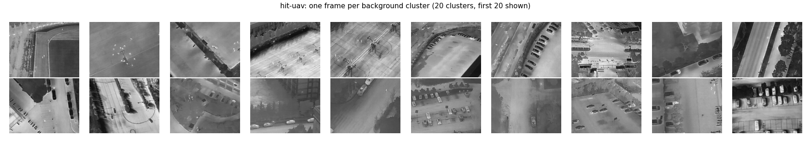
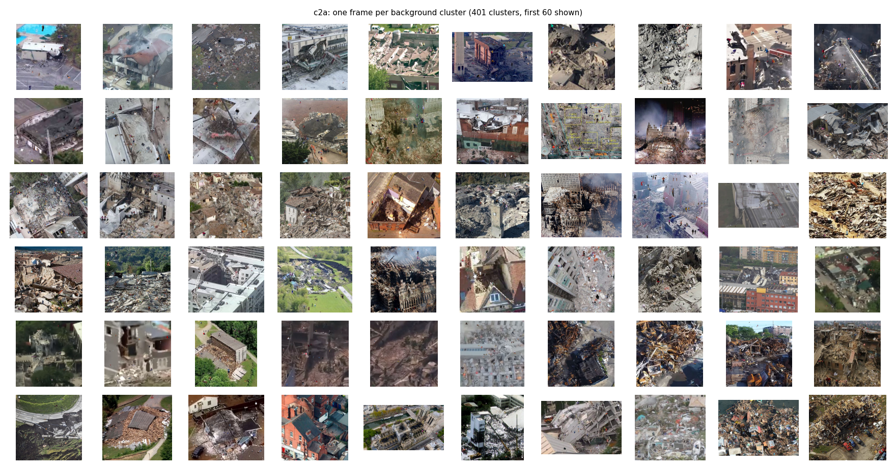
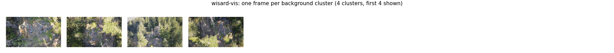

# Dataset Profiles

Profiles of the four downloaded datasets (two modalities of WiSARD counted separately), in the same eight points each:
summary, size, distinct backgrounds, people per image, pixels per person, contrast, sharpness, crowding.
Every number is mean plus the 5th / 25th / 50th / 75th / 95th percentiles (written `p5 / p25 / p50 / p75 / p95`)
over all images or all annotated persons. Numbers come from `research/datasets/assets/audit/audit.json` and
`research/datasets/assets/audit/backgrounds.json`; see [Reproduce](#reproduce).

## At a glance

| | HIT-UAV | C2A | WiSARD IR | WiSARD RGB |
|---|---|---|---|---|
| Modality | thermal | RGB, synthetic | thermal | RGB |
| Images | 2,898 | 10,215 | 264 | 264 |
| Persons | 12,312 | 360,467 | 1,006 | 1,022 |
| Resolution | 640×512 | 123×152 – 5184×3456 | 640×512 | 3840×2160 |
| Distinct backgrounds | ≈20 scenes (264 clips) | 2,043 photos (≈400 scenes) | 1 site | 1 site |
| Persons / image, mean (p50) | 4.25 (2) | 35.3 (34) | 3.81 (4) | 3.87 (4) |
| Pixels / person, mean (p50) | 271 (221) | 230 (144) | 328 (297) | 5,147 (4,446) |
| Person contrast, mean (p50) | +1.00 (+0.90) | −0.21 (−0.19) | +1.13 (+1.12) | +0.23 (+0.21) |
| Low-contrast persons (\|c\| < 0.5) | 25.7% | 68.2% | 2.9% | 88.6% |
| Person sharpness at 640, p50 | 437 | 662 | 3,046 | 4,058 |
| Nearest neighbour, p50 (body sizes) | 1.82 | 2.72 | 2.06 | 2.00 |
| Persons with a neighbour < 2 sizes | 53.3% | 38.1% | 48.6% | 49.9% |

## How the metrics are measured

**Pixels per person.** Box width × height in pixels at the image's native resolution, from the YOLO labels.
The "side" is √(w·h), the edge of a square with the same area. Detectors break down below ≈8 px side
(≈64 px²); 16–32 px side is workable; 32+ is comfortable.

**Contrast (person vs surroundings).** For each box:
`(mean grey inside box − mean grey of a ring one box-width around it) / grey std of the whole image`.
- **+1** means the person is one image-standard-deviation *brighter* than the ground right next to them.
  In thermal that means warmer.
- **−1** means one std *darker*.
- **Near 0** means the person has the same brightness as their surroundings and is camouflaged in grey level.

We call |c| < 0.5 *low contrast*. The measure is on the grey image only, so colour differences in RGB
(a red jacket on green grass of equal brightness) do not count. RGB numbers are a lower bound on how
separable a person really is. **Image RMS contrast** is the plain grey std of the whole frame (0–255 scale)
and describes the scene, not the person.

**Sharpness.** Variance of the Laplacian (second derivative) of the grey image. It is high when there are
crisp edges and fine texture, and low when the image is blurred or smooth. It is not normalised, so it
also rises with contrast and with sensor noise. It is also scale dependent: the same scene downscaled
looks sharper per pixel. Three variants are reported:
- **person, native**: Laplacian variance of the box grown by 25% per side, at the file's own resolution.
- **person @640**: the same after resizing the image so its long side is 640 px. That is what a detector
  at `imgsz=640` sees, and it is the number to compare across datasets.
- **image @640**: the whole frame at 640 long side.

As a rough guide at the 640 scale: under 100 is visibly soft, 100–1,000 is normal, and 1,000+ is crisp or
heavily textured.

**Crowding.** For each person, the distance from its box centre to the nearest other person's centre,
divided by its own side length ("body sizes").
- **< 1**: boxes touch or overlap.
- **1–2**: shoulder to shoulder, a tight group.
- **2–5**: a loose group.
- **> 5**: isolated.

Also reported: the share of persons whose box overlaps another (IoU > 0), and the number of other persons
within 3 body sizes. Lone persons (one per image) have no neighbour and are left out of the distance
statistics.

**Distinct backgrounds.** Images are first grouped by metadata that identifies one background:
- **C2A**: the AIDER source photo in the filename.
- **HIT-UAV**: a recording *clip*, a run of consecutive frame ids with the same day/night, altitude and angle.
- **WiSARD**: each frame on its own.

Each group's ImageNet ResNet-50 embedding is averaged. Groups closer than a cosine distance threshold are
then merged into one "scene". The headline uses 0.3; 0.2 (strict) and 0.4 (loose) give the range. The
montages below show one frame per cluster and were checked by eye.

---

## 1. HIT-UAV (thermal)

**1. Summary.** Real long-wave infrared footage from a DJI drone, captured by the Harbin Institute of
Technology. The README lists the scenes as schools, parking lots, roads and playgrounds.
- **Frames**: 640×512, 8-bit greyscale. 917 day frames and 1,981 night frames.
- **Flight metadata in every filename**: altitude 60–130 m in 10 m steps, camera angle 30–90° in 10° steps,
  and weather (all "sunny").
- **Classes**: Person, Car, Bicycle, OtherVehicle and DontCare. We use Person only.
- **Fit for us**: the closest match to our drone's IR camera in sensor, resolution and altitude. The
  weakness is the scenes: urban and campus, with no rubble and nobody lying or partly buried.

**2. Size.**

| | |
|---|---|
| Images | 2,898 (train 2,029 / val 290 / test 579) |
| Persons | 12,312 |
| Archive | 815 MB zip; 196 MB of images |
| Resolution | 640×512 = 0.33 MP, every frame |
| Images with no person | 41.6%, useful as hard negatives |

**3. Distinct backgrounds: ≈20 scenes** (range 9 at loose to 55 at strict threshold), recorded as 264
clips. Each scene is flown many times at different altitudes and angles. The scenes are a sports field
with a running track, a paved plaza, basketball courts, several parking lots, roads and building edges.
Many frames are neighbours from the same clip: 31% of val/test frames are near-duplicates of a train
frame.



**4. People per image.**

| | mean | p5 | p25 | p50 | p75 | p95 | max |
|---|---|---|---|---|---|---|---|
| all images | 4.25 | 0 | 0 | 2 | 7 | 16 | 33 |
| images with ≥1 person | 7.28 | 1 | 2 | 6 | 10 | 22 | 33 |

Distribution of images by number of persons: 41.6% empty, 8.1% one person, 19.7% 2–5, 27.0% 6–20,
3.6% more than 20. Groups of pedestrians are typical, and lone people are rare.

**5. Pixels per person.**

| | mean | p5 | p25 | p50 | p75 | p95 |
|---|---|---|---|---|---|---|
| area, px² | 271 | 99 | 153 | 221 | 345 | 594 |
| side √(w·h), px | 15.8 | 9.9 | 12.4 | 14.9 | 18.6 | 24.4 |

A typical person is about 10×22 px (width/height ≈ 0.48), which is 0.07% of the frame.
- **By side length**: 0.5% are under 8 px, 58% are 8–16 px, 41% are 16–32 px and almost none are larger.
- **Small targets**: the whole dataset sits in the "small object" regime.
- **Altitude**: people shrink from a median side of 16 px at 60 m to 11–12 px at 120–130 m.

**6. Contrast.**

| | mean | p5 | p25 | p50 | p75 | p95 |
|---|---|---|---|---|---|---|
| person contrast | +1.00 | −0.05 | +0.46 | +0.90 | +1.37 | +2.53 |
| image RMS contrast | 36.2 | 16.9 | 26.5 | 34.5 | 44.3 | 59.9 |

- **Typical person**: about one image-std brighter (warmer) than the ground around them. That is the heat
  signature a thermal detector relies on.
- **Low contrast**: the bottom quarter (p25 = 0.46) is already low contrast, 25.7% of persons in all, and
  at p5 the person is as bright as the ground.
- **Day vs night**: low contrast is concentrated in daytime frames. The median person contrast is
  **0.23 by day** and **1.06 by night**, so most daytime persons are low contrast: sun-heated asphalt and walls reach body temperature.

So, for us: thermal victim detection is reliable at night and in the cool morning, and weak in the
midday sun.

**7. Sharpness.**

| | mean | p5 | p25 | p50 | p75 | p95 |
|---|---|---|---|---|---|---|
| person @640 (= native) | 524 | 173 | 307 | 437 | 641 | 1,147 |
| image @640 | 56 | 20 | 35 | 50 | 64 | 123 |

- **Softest dataset of all**: whole frames are smooth (image p50 = 50) because microbolometer optics and
  thermal diffusion give no fine texture.
- **Person areas**: they are about 8× sharper than the background only because the warm body edge is the
  strongest edge in the frame.
- **What a detector sees**: a soft blob with a clear outline, but no limbs or clothing detail. Detection
  rests on blob shape and heat contrast.
- **Spread**: it is narrow, so the quality is consistent.

**8. Crowding.**

| | mean | p5 | p25 | p50 | p75 | p95 |
|---|---|---|---|---|---|---|
| nearest neighbour, body sizes | 3.39 | 0.66 | 1.11 | 1.82 | 3.73 | 12.0 |
| other persons within 3 sizes | 1.6 | 0 | 0 | 1 | 3 | 5 |

- **Tight groups**: half of the persons have someone within 1.8 body sizes (53.3% within 2), and 19.4% of
  boxes overlap another box.
- **Typical scene**: pedestrians walking in pairs and small groups. A quarter are practically touching
  (< 1.1 sizes).
- **Isolated people**: only the top 5% are truly alone (> 12 sizes).
- **Effect on the detector**: it has to split adjacent ~15 px blobs. That is the first thing to fail when
  the input is downscaled.

---

## 2. C2A (RGB, synthetic disaster)

**1. Summary.** The *Combination to Application* dataset is synthetic. Real disaster photos from AIDER
(collapsed building, fire, flood, traffic incident) have human figures cut out of other images and pasted
on top. Every person carries a pose label: upright, bent, kneeling, sitting or lying (each 19–24%).
- **Strengths**: it has the backgrounds we care about, including rubble, and every person has a pose
  label.
- **Weaknesses**:
  - The people are not real victims.
  - Paste size is not tied to scene scale, so a 4 px person can sit next to a 3-storey building.
  - Paste edges are artificially crisp.

**2. Size.**

| | |
|---|---|
| Images | 10,215 (train 6,129 / val 2,043 / test 2,043) |
| Persons | 360,467 |
| Archive | 4.9 GB zip; 4.6 GB of images |
| Resolution | 123×152 – 5184×3456 |
| Image size, MP | mean 0.34; p5 0.05, p50 0.18, p95 0.74 |
| Long side | p5 234 px, p50 430 px, p95 1,008 px; 81% of images are ≤640 px |
| Images with no person | 0% |

Most images are small web photos, so at `imgsz=640` they are *upscaled*, not downscaled.

**3. Distinct backgrounds: 2,043 unique source photos, ≈400 distinct scenes.**
- **Reuse**: each AIDER photo appears 5 times with different pasted people (10,215 = 5 × 2,043).
- **By disaster**: 511 collapsed building, 521 fire, 526 flood and 485 traffic incident photos.
- **Visual similarity**: many photos come from the same event or video. At the 0.3 threshold they fall
  into ≈400 visually distinct scenes (126 at loose, 1,035 at strict).
- **Leakage**: 98% of val/test background photos also appear in train, so C2A val/test scores measure
  memorised backgrounds.



**4. People per image.**

| | mean | p5 | p25 | p50 | p75 | p95 | max |
|---|---|---|---|---|---|---|---|
| all images | 35.3 | 23 | 28 | 34 | 40 | 49 | 240 |

Every image has at least about 20 people (98.8% have more than 20) and none is empty. That is far denser
than any real post-earthquake frame, and a model trained on it never learns to say "nobody here".

**5. Pixels per person.**

| | mean | p5 | p25 | p50 | p75 | p95 |
|---|---|---|---|---|---|---|
| area, px² | 230 | 12 | 33 | 144 | 440 | 540 |
| side √(w·h), px | 13.1 | 3.5 | 5.7 | 12.0 | 21.0 | 23.2 |

The distribution is bimodal:
- **Too small**: 34.6% of persons are under 8 px side. A quarter are under 6 px (≈33 px², a few pixels
  each way), which no detector can resolve.
- **Workable**: 35.8% sit at 16–24 px.
- **Large**: almost none are above 32 px.

The small tail is a paste artefact. In the real scenes, those people would be bigger.

**6. Contrast.**

| | mean | p5 | p25 | p50 | p75 | p95 |
|---|---|---|---|---|---|---|
| person contrast | −0.21 | −1.05 | −0.50 | −0.19 | +0.10 | +0.59 |
| \|person contrast\| | 0.41 | 0.03 | 0.15 | 0.33 | 0.59 | 1.10 |
| image RMS contrast | 44.4 | 24.5 | 35.9 | 44.8 | 52.6 | 64.4 |

- **Darker than surroundings**: pasted people are on average slightly darker than the ground around them
  (median −0.19), and the sign varies.
- **Low contrast**: 68.2% of persons have |c| < 0.5. In grey level they blend into rubble, ash and water.
  The middle half sits between −0.50 and +0.10, close to zero.
- **High-contrast persons**: only the outer 5% on each side (≤ −1.05 or ≥ +0.59) stand out.

So in RGB, people must be found by colour and shape rather than brightness, and that is much harder at
12 px.

**7. Sharpness.**

| | mean | p5 | p25 | p50 | p75 | p95 |
|---|---|---|---|---|---|---|
| person, native | 3,329 | 413 | 1,219 | 2,182 | 3,892 | 9,748 |
| person @640 | 1,227 | 116 | 343 | 662 | 1,375 | 4,178 |
| image @640 | 445 | 41 | 102 | 211 | 467 | 1,620 |

- **Widest spread of any dataset** (40× between p5 and p95):
  - Some backgrounds are blurry, upscaled video frames (image p5 = 41).
  - Others are crisp high-resolution photos (p95 = 1,620).
- **Native vs @640**: native person values are high because the hard cut-out edges of pasted figures are
  artificial step edges. At 640 the values drop because 81% of images are upscaled to get there, and
  upscaling smooths.
- **Domain risk**: the paste edges themselves are the issue. A model can learn "a crisp silhouette on a
  softer background", a shortcut that real victims do not provide.

**8. Crowding.**

| | mean | p5 | p25 | p50 | p75 | p95 |
|---|---|---|---|---|---|---|
| nearest neighbour, body sizes | 4.87 | 0.73 | 1.41 | 2.72 | 5.59 | 15.6 |
| other persons within 3 sizes | 1.8 | 0 | 0 | 1 | 2 | 8 |

- **Scattered, not grouped**: despite 35 people per image, the median neighbour is 2.7 body sizes away.
  Only 38.1% are within 2 sizes, and just 5.1% of boxes overlap.
- **Unrealistic layout**: people are pasted at random positions, so they rarely form realistic groups
  (fewer contacts than HIT-UAV). Yet a few dense clumps exist (p95 = 8 neighbours within 3 sizes).

---

## 3. WiSARD IR (thermal, sample)

**1. Summary.** WiSARD is a wilderness search-and-rescue dataset with real drone footage of volunteers
playing lost persons. We downloaded a **sample**: one synchronised flight, `210417_MtErie_Enterprise`
(Mt Erie, Washington, 17 April 2021). This part is the thermal stream: 640×512, 8-bit greyscale, forest
and rocky clearing in daylight.
- **Labels**: converted to YOLO, all in a single `val` split.
- **Best use**: the most realistic search-and-rescue imagery we have, but far too small and uniform to
  train on. Use it as a field-like test set.

**2. Size.**

| | |
|---|---|
| Frames | 264 (val only) |
| Persons | 1,006 |
| Images | 32 MB (the 1.02 GB sample zip holds both IR and RGB) |
| Resolution | 640×512 = 0.33 MP |
| Frames with no person | 1.1% |

**3. Distinct backgrounds: 1 site.** It is one continuous flight over one hillside clearing. Clustering
finds 6 views at the 0.3 threshold (3 at loose, 21 at strict) as the drone moves, but the terrain,
vegetation and lighting are the same throughout.

**4. People per image.**

| | mean | p5 | p25 | p50 | p75 | p95 | max |
|---|---|---|---|---|---|---|---|
| all frames | 3.81 | 2 | 4 | 4 | 4 | 4 | 4 |

It is always the same four volunteers, so the number of people is effectively fixed. 95.8% of frames have
2–5 people.

**5. Pixels per person.**

| | mean | p5 | p25 | p50 | p75 | p95 |
|---|---|---|---|---|---|---|
| area, px² | 328 | 176 | 217 | 297 | 394 | 622 |
| side √(w·h), px | 17.7 | 13.3 | 14.7 | 17.2 | 19.9 | 25.0 |

Persons are slightly bigger than in HIT-UAV (median 17 vs 15 px side): 40% are 8–16 px and 59% are
16–32 px. The scale is similar to HIT-UAV, so the thermal model's scale prior transfers.

**6. Contrast.**

| | mean | p5 | p25 | p50 | p75 | p95 |
|---|---|---|---|---|---|---|
| person contrast | +1.13 | +0.57 | +0.82 | +1.12 | +1.39 | +1.77 |
| image RMS contrast | 45.0 | 41.1 | 41.9 | 44.7 | 47.1 | 50.9 |

- **Strongest and most uniform of all**: even the weakest 5% of persons are +0.57 std warmer than their
  surroundings, and only 2.9% are low contrast.
- **Cool scene**: a spring forest floor and rock stay cool, so bodies stand out. This is the best case
  for thermal, and close to what we expect at dawn over rubble.

**7. Sharpness.**

| | mean | p5 | p25 | p50 | p75 | p95 |
|---|---|---|---|---|---|---|
| person @640 (= native) | 3,869 | 732 | 1,697 | 3,046 | 5,374 | 9,415 |
| image @640 | 539 | 244 | 402 | 459 | 760 | 801 |

- **Compared with HIT-UAV**: about 7–10× sharper at the same 640×512 resolution.
- **Likely causes**: the camera processing applies strong edge enhancement and contrast stretching (the
  dynamic range uses nearly the whole 0–255 range, p50 = 201), and rocks and trees add texture.
- **Domain gap**: the same "thermal 640×512" label hides very different image statistics. A HIT-UAV model
  sees much busier textures here. That is consistent with its collapse from AP50 0.87 on HIT-UAV test to
  0.01 on WiSARD IR (detection-data-analysis.md §7.3).

**8. Crowding.**

| | mean | p5 | p25 | p50 | p75 | p95 |
|---|---|---|---|---|---|---|
| nearest neighbour, body sizes | 2.56 | 0.57 | 1.14 | 2.06 | 3.60 | 6.53 |
| other persons within 3 sizes | 1.2 | 0 | 0 | 1 | 2 | 3 |

- **One loose group**: the four volunteers stay near each other.
- **Contact and overlap**: half have a neighbour within 2 body sizes (48.6%), and 23% of boxes overlap. A
  quarter are in contact (< 1.14 sizes).
- **No isolated people**: the p95 of 6.5 sizes is small next to HIT-UAV's 12.

---

## 4. WiSARD RGB (visible, sample)

**1. Summary.** The visible-light stream of the same WiSARD flight: a 4K RGB camera, the same hillside and
the same four volunteers, recorded alongside the IR stream.
- **Pairing with IR**: 263 frames are shared, and the IR field of view covers about 64% of the RGB frame.
- **Best use**: the only aligned RGB + IR pair we have. It is suitable for testing fusion and tiling,
  not for training.

**2. Size.**

| | |
|---|---|
| Frames | 264 (val only) |
| Persons | 1,022 |
| Images | 942 MB |
| Resolution | 3840×2160 = 8.3 MP, every frame |
| Frames with no person | 1.1% |

**3. Distinct backgrounds: 1 site** (4 views at the 0.3 threshold; 2 at loose, 11 at strict), the same
clearing as WiSARD IR.



**4. People per image.**

| | mean | p5 | p25 | p50 | p75 | p95 | max |
|---|---|---|---|---|---|---|---|
| all frames | 3.87 | 4 | 4 | 4 | 4 | 4 | 4 |

**5. Pixels per person.**

| | mean | p5 | p25 | p50 | p75 | p95 |
|---|---|---|---|---|---|---|
| area, px² | 5,147 | 2,430 | 3,240 | 4,446 | 6,336 | 11,025 |
| side √(w·h), px | 69.8 | 49.3 | 56.9 | 66.7 | 79.6 | 105 |

At native 4K every person is large (all ≥32 px side), about 3.9× the IR size of the same person.

The catch is resizing: shrinking the frame to 640 divides the side by 6, to a median of **≈11 px side
(≈120 px²)**. That is smaller than in the thermal stream. Use tiling or a larger `imgsz` with 4K RGB, not
a plain resize.

**6. Contrast.**

| | mean | p5 | p25 | p50 | p75 | p95 |
|---|---|---|---|---|---|---|
| person contrast | +0.23 | −0.06 | +0.08 | +0.21 | +0.34 | +0.73 |
| \|person contrast\| | 0.25 | 0.02 | 0.10 | 0.21 | 0.34 | 0.73 |
| image RMS contrast | 53.5 | 48.8 | 51.2 | 53.2 | 55.9 | 58.9 |

- **Lowest grey-level contrast of all**: 88.6% of persons are low contrast, and the median person is only
  0.21 std brighter than their surroundings.
- **Why**: clothing has about the same brightness as sunlit rock and dry grass.
- **Same people in thermal**: they reach +1.12, five times more.

This is the strongest argument for fusion: in RGB the volunteers are visible by colour and shape but
nearly invisible in brightness, while in IR they are bright blobs without shape detail.

**7. Sharpness.**

| | mean | p5 | p25 | p50 | p75 | p95 |
|---|---|---|---|---|---|---|
| person, native 4K | 373 | 53 | 199 | 387 | 549 | 651 |
| person @640 | 4,081 | 1,068 | 2,571 | 4,058 | 5,472 | 7,151 |
| image @640 | 3,377 | 1,045 | 2,658 | 3,730 | 4,355 | 4,400 |

- **Native vs @640**: at native 4K the per-pixel value is low because each edge spreads over several
  pixels, as the image is oversampled. Shrunk to 640, it is the **sharpest dataset by far**: 8× WiSARD IR
  at the image level and ≈75× HIT-UAV.
- **Blur**: the camera is well focused and motion blur is rare; even p5 is above 1,000.
- **Detail is not the limit**: the bottleneck for 4K RGB is the pixel budget (resize vs tiling), not image
  detail.

**8. Crowding.**

| | mean | p5 | p25 | p50 | p75 | p95 |
|---|---|---|---|---|---|---|
| nearest neighbour, body sizes | 2.59 | 0.56 | 1.18 | 2.00 | 3.66 | 6.56 |
| other persons within 3 sizes | 1.1 | 0 | 0 | 1 | 2 | 3 |

This is the same group as in IR, and the same picture: 49.9% of persons have a neighbour within 2 sizes,
and 23.1% of boxes overlap. The numbers match the IR stream within noise, which confirms the two sets of
labels agree.

---

## What the profiles say together

- **Only HIT-UAV is trainable for thermal.** It is real, has the right sensor and enough images, but only
  ≈20 urban scenes. Every result on it is bounded by that background diversity.
- **C2A has the right backgrounds and the wrong people.**
  - 2,043 disaster photos, but pasted, mostly tiny, low-contrast figures and 35 people per frame.
  - Its val/test reuse train backgrounds, so they are not an honest test.
  - Use it for pretraining or augmentation sources, not as evidence of field accuracy.
- **WiSARD is one site.** Good for an honest field-like test of RGB, IR and fusion, but its 264 frames are
  one background and one group of four.
- **Thermal vs RGB is a contrast vs detail trade.**

  | | Persons stand out | Edges at 640 | Resolution |
  |---|---|---|---|
  | Thermal | clearly at night (p50 +0.9 to +1.1), weakly in midday sun (+0.23) | soft | low |
  | RGB | barely, in brightness (p50 +0.21) | sharp | high, but needs tiling to keep people above 16 px |

  This is the case for fusing the two cameras on our drone.
- **Crowding is moderate everywhere.** About half of the persons have a neighbour within 2 body sizes, so
  NMS and input resolution must keep adjacent ~15 px people apart.

## Reproduce

```bash
# per-person / per-image metrics (sizes, contrast, sharpness, crowding) -> research/datasets/assets/audit/audit.json
python src/detection/audit.py --out research/datasets/assets/audit
# distinct backgrounds (ResNet-50 embeddings + clustering) -> backgrounds.json + backgrounds_<name>.png
python src/detection/backgrounds.py --out research/datasets/assets/audit
```
