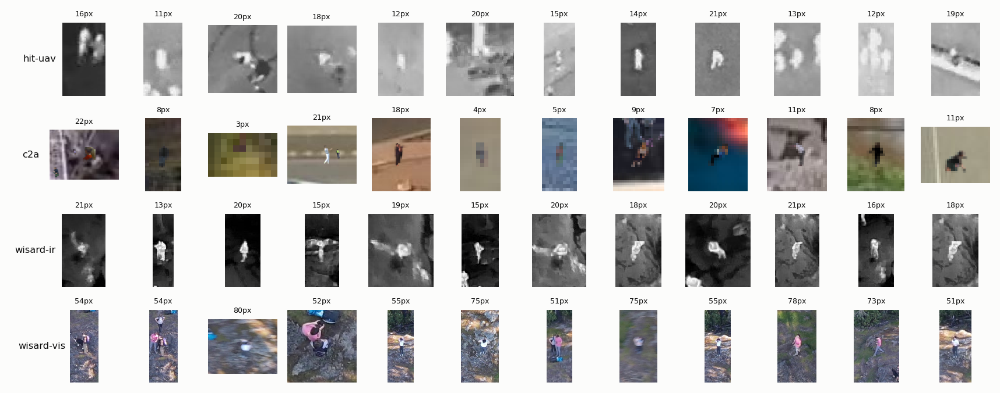
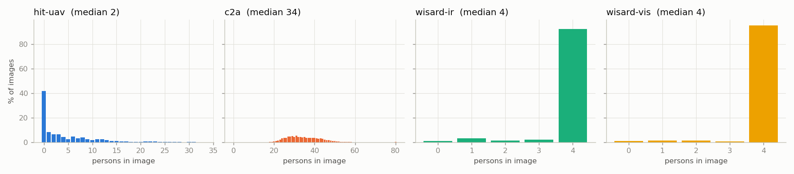
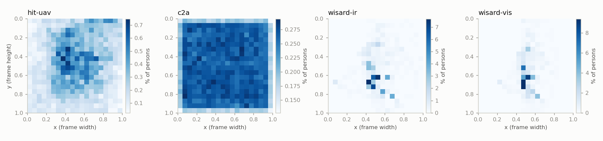

# Dataset Suitability for Post-Earthquake Victim Detection

> **Status:** Draft · **Updated:** 2026-10-18

This analysis covers the **downloaded** datasets: HIT-UAV (thermal), C2A (RGB, synthetic disaster) and the WiSARD sample (paired RGB + thermal, real search-and-rescue). For each one it asks whether it suits a hovering drone with **both RGB and infrared (IR) cameras** looking for victims after an earthquake. It covers person quality, density, size, downscaling, image quality, coverage, data leakage, how RGB and IR combine, and which models fit.

No model was trained. All model numbers come from inference only, using existing weights:
- `best.pt`: YOLO11n trained earlier on HIT-UAV for 14 of 50 planned epochs.
- `yolo11n.pt`: COCO-pretrained, person class only.

## TL;DR

| Dataset | Use it for | Do not use it for | Main problems |
| --- | --- | --- | --- |
| **HIT-UAV** (thermal) | Training the thermal detector | Judging real-world performance alone | No disaster scenes; 60–130 m altitude is higher than we will hover; daytime persons barely stand out; 31% of val/test images are near-duplicates of train images |
| **C2A** (RGB) | RGB pre-training and pose variety (19% lying) | Any reported metric: its splits leak | 98% of val/test background scenes also appear in train; persons are pasted at a fixed 4–24 px whatever the image scale; 35% are under 8 px; no images without persons |
| **WiSARD sample** (RGB + IR) | A real-world sanity check; measuring RGB–IR geometry | Training or benchmarking | One flight, the same 4 actors, 264 frames |

Key numbers:
- Thermal persons are a **tiny-object problem**: median 15–17 px.
- Thermal downscaling floor is **480 px**: AP50 0.87 at 640, 0.84 at 480, 0.66 at 320.
- On 4K RGB, **tiling raised AP50 about 10×** (0.03 → 0.32) compared with resizing to 640.
- The HIT-UAV model **does not transfer** to real wilderness thermal footage: AP50 0.87 on its own test set, 0.01 on WiSARD IR.
- The two cameras line up only roughly: IR sees **64% of the RGB frame**, with a median 7.7 IR-px error after a linear fit. Combining their **detection boxes** (late fusion) is feasible now; merging pixels or features is not.

## 1. Method

| Step | Script | Output |
| --- | --- | --- |
| Per-image and per-person statistics, plots, leakage, RGB/IR pairing | `src/detection/audit.py` | [assets/audit/audit.json](assets/audit/audit.json), plots in [assets/audit/](assets/audit/) |
| Inference sweep: AP50 and recall per person size across input sizes and tiling | `src/detection/eval_sizes.py` | [assets/audit/eval/](assets/audit/eval/) |

Definitions:
- **Person size**: √(box w × h) in native pixels.
- **Contrast**: (mean brightness inside the box − mean of a ring one box-size wide around it) ÷ image brightness std. |contrast| < 0.5 counts as low contrast. This is a grey-level measure, so it fits thermal well and is only a rough proxy for RGB, where colour also separates people.
- **Sharpness**: variance of the Laplacian after resizing every image to a 640 px long side, so datasets compare.
- **Near-duplicate**: a 64-bit difference hash within 4 bits of some train image.
- **AP50, recall**: greedy matching at IoU ≥ 0.5; recall measured at confidence 0.25.
- Hardware: Apple M4 (MPS), run at nice 10 with 3 CPU threads.

## 2. Snapshot

| | HIT-UAV | C2A | WiSARD IR | WiSARD RGB |
| --- | --- | --- | --- | --- |
| Modality | Thermal, 8-bit grey | RGB | Thermal, 8-bit grey | RGB |
| Images (train / val / test) | 2,029 / 290 / 579 | 6,129 / 2,043 / 2,043 | 264 (eval) | 264 (eval) |
| Persons | 12,312 | 360,467 | 1,006 | 1,022 |
| Resolution | 640×512 (all) | 230–4000 px, median long side 428 | 640×512 | 3840×2160 |
| Images with no person | **41.6%** | **0%** | 1.1% | 1.1% |
| Persons per image, median (p95, max) | 2 (16, 33) | 34 (49, 240) | 4 (4, 4) | 4 (4, 4) |
| Person px p5 / p50 / p95 | 9.9 / 14.9 / 24.4 | 3.5 / 12.0 / 23.2 | 13.3 / 17.2 / 24.9 | 49.3 / 66.7 / 105.0 |
| Persons < 8 px (native) | 0.5% | **34.6%** | 0% | 0% |
| Low-contrast persons | 25.7% | 68.2%* | 2.9% | 88.6%* |
| Overlapping another person | 19.4% | 5.1% | 23.0% | 23.1% |
| Val/test near-duplicates of train | **31%** | **72%** | n/a | n/a |
| License | CC0 | unclear | permissive notice | permissive notice |

\* RGB low contrast is in grey level only; colour often still separates people (see §3).


## 3. Person quality



**HIT-UAV.**
- Persons are 10–25 px warm blobs with no visible limbs.
- 62% of boxes are elongated (aspect ratio > 1.5 or < 0.67), consistent with standing or walking people seen at an angle.
- **Day versus night is the biggest quality factor.** Median person contrast is 0.23 std by day and 1.06 std at night. In daytime the ground warms up and people almost vanish into the background.
- The dataset ships an undocumented filename flag. The order in `tools/info/scenario.txt` (day, night) together with this contrast gap confirms that **flag 0 = day and flag 1 = night**. Night makes up 68% of images and 78% of persons.


**C2A.**
- People are cut out and pasted onto real disaster photos (AIDER).
- At p5 (3.5 px) a person is a few coloured pixels with no human shape: these labels carry almost no signal.
- Persons are pasted at absolute sizes of about 4–24 px **regardless of image resolution**. Median size is 11.7 px on 240 px images and 13.4 px on 4K images, so relative size varies 5×, from 4.4% to 0.8% of the frame. A person's scale therefore doesn't match the scene's ground resolution, which is physically wrong and lets a model learn "small blob = person" rather than scale-consistent cues.
- The size histogram is bimodal (peaks around 6 px and 22–24 px) with a hard cutoff at 24 px. This is a generator artifact.
- Grey-level contrast is slightly negative (median −0.19): pasted people tend to be darker than their surroundings and are separated mainly by colour.

**WiSARD.**
- These are real people (actors) on rock and forest.
- In IR they are clear white shapes with visible limbs: median contrast 1.12, only 2.9% low contrast.
- However, sunlit rocks reach the same temperature (see the pair image in §8), so false positives are a risk.
- RGB persons are 50–105 px. Some frames show motion blur (visible in the crops). Clothing is bright (pink, blue, white), which makes RGB detection easier than for dust-covered victims in rubble.

## 4. Density and sparsity



- **HIT-UAV is the most realistic**:
  - 42% of images have no person, which teaches the model what background looks like and supports precision.
  - 8% have exactly 1 person; 20% have 2–5.
  - 53% of persons stand less than 2 body-sizes from another person (groups of pedestrians).
- **C2A is a crowd, not a disaster scene**:
  - Every image has persons: 99% have more than 20, with a median of 34 and a maximum of 240.
  - Real earthquake victims are few and scattered. A model trained only on C2A learns a high prior that people are present and gets no negatives, so it will raise false alarms on empty rubble.
- **WiSARD**: always the same 4 actors walking together.

Spatial bias:



- C2A persons are uniform over the frame with an empty 3–5% border, so the paste positions are random. Context such as roads or buildings plays no role.
- HIT-UAV has a mild centre bias, from the drone framing its subjects.
- WiSARD clusters in the centre (one group).
- Only 0.1–4.3% of persons are cut off by the image edge, so truncation is not an issue.

## 5. Image quality

| | Brightness p50 | RMS contrast p50 | Dynamic range p50 (p99−p1) | Sharpness p5 / p50 / p95 |
| --- | --- | --- | --- | --- |
| HIT-UAV | 126 | 34 | 143 | 20 / 50 / 123 |
| C2A | 113 | 45 | 192 | 41 / 211 / 1620 |
| WiSARD IR | 86 | 45 | 201 | 244 / 459 / 801 |
| WiSARD RGB | 111 | 53 | 204 | 1045 / 3730 / 4400 |

**HIT-UAV.**
- Low dynamic range: 143 of 255 grey levels used.
- Soft images: median sharpness 50, 9× lower than WiSARD IR on the same 640×512 sensor format. The images look smoothed by the camera's automatic gain control (AGC) and JPEG.
- A model trained here expects soft, low-texture thermal. WiSARD IR is sharper and higher in contrast, and has rock textures as hot as people. This is one plausible cause of the transfer failure in §8.

**C2A.**
- Sharpness spans 40× (p5 to p95): small source images were upscaled and look blurry, large ones are crisp. Image quality is very uneven.

**Thermal format.**
- Both thermal sets are 8-bit, 3-channel JPEGs with identical channels, white-hot palette.
- There is **no radiometric (temperature) data**, so absolute body temperature, which would help triage, cannot be learned from these datasets.

## 6. Coverage versus our scenario

| Requirement (post-earthquake, hovering drone) | HIT-UAV | C2A | WiSARD sample |
| --- | --- | --- | --- |
| Rubble or collapsed buildings | ✗ campus, roads | ✓ synthetic (25% collapsed_building) | ✗ rock, forest |
| Lying, partly buried, occluded victims | ✗ not labelled; mostly walking | ~ pose labels: 19% lying, 19% sitting, 19% kneeling, 19% bent, 24% upright; pasted, not buried | ✗ actors standing or walking |
| Night | ✓ 68% night | ✗ | ✗ day |
| Hover altitude 20–60 m | ~ 60 m (30% of images) up to 130 m | unknown | unknown (low; persons 67 px in 4K) |
| View angle | ✓ 30–90°, all 7 angles × 8 altitudes covered | unknown | nadir or near-nadir |
| Weather | ✗ sunny only (rainy flag never used) | ~ fire, flood, smoke scenes | ✗ |
| Paired RGB + IR | ✗ | ✗ | ✓ 264 pairs |
| Images with no person | ✓ 42% | ✗ 0% | ✗ 1% |
| Real disaster imagery | ✗ | ✗ (real backgrounds, fake people) | ✗ (real search and rescue, no disaster) |
| Same disaster types on all splits | n/a | ✓ about 25% each: collapsed building, fire, flood, traffic incident | n/a |

**Gap:** no downloaded dataset has real people in real rubble, at any modality. C2A's pose sizes are flat (11.5–13.0 px median for every pose) because size was set by the generator, not by pose.

## 7. Downscaling and input resolution

### Measured on HIT-UAV test (thermal, 640×512, YOLO11n trained at 640)

| Input size | AP50 | Recall | Recall 8–12 px | Recall 12–16 px | Recall 16–24 px | ms/img (M4) |
| --- | --- | --- | --- | --- | --- | --- |
| 320 | 0.664 | 0.678 | 0.368 | 0.688 | 0.851 | 9.3 |
| 480 | 0.840 | 0.849 | 0.760 | 0.867 | 0.891 | 10.7 |
| **640 (native)** | **0.872** | **0.888** | 0.868 | 0.900 | 0.900 | 12.4 |
| 960 | 0.851 | 0.833 | 0.828 | 0.855 | 0.834 | 18.9 |
| 1280 | 0.754 | 0.644 | 0.691 | 0.718 | 0.567 | 26.7 |

- **Downscaling:** 480 costs 3 AP points; 320 costs 21. Recall falls off once a person drops to about 6 px at the model input (8–12 px persons at 0.5× scale). **Keep at least 8 px at the input**, and ideally at least 10 px.
- **Upscaling a 640-trained model hurts.** Larger persons lose the most (16–24 px recall drops from 0.90 to 0.57 at 1280) because the model has never seen them that large. To benefit from 960, **train at 960**.

### Measured on 4K RGB (WiSARD RGB, COCO YOLO11n, zero-shot)

| Mode | AP50 | Recall | Recall 32–64 px | Recall > 64 px | ms/img |
| --- | --- | --- | --- | --- | --- |
| Resize to 640 | 0.030 | 0.007 | 0.000 | 0.012 | 48 |
| Resize to 1280 | 0.127 | 0.036 | 0.025 | 0.045 | 57 |
| Resize to 1920 | 0.132 | 0.066 | 0.114 | 0.028 | 73 |
| **640 tiles, 20% overlap** | **0.324** | **0.356** | **0.591** | 0.174 | 494* |

\* 40 tiles run one at a time at low priority; batching the tiles would cut this sharply.

- Resizing 4K to 640 shrinks a 67 px person to about 11 px and deletes it. Tiling keeps full detail.
- Absolute numbers are low because COCO weights have rarely seen people from directly above. The ratio between the modes is what matters here.

### C2A test (COCO YOLO11n, zero-shot)

AP50 is 0.151 at 640 and 0.205 at 1280. Recall for persons under 8 px is 0.02 at 640 and 0.12 at 1280.

Note: YOLO's letterbox resizing **upscales** small images to the input size. 80% of C2A images are smaller than 640, so at imgsz 640 they are enlarged: more pixels, but no new detail. Native px (§2) is the true information content. The earlier `analyze.py` tables assume no upscaling and understate input-pixel size for small C2A images.

### What this means for our drone

Expected person size by altitude, using √area for a person seen from directly above: standing ≈ 0.45 m, lying ≈ 0.9 m.

The camera specs are **assumptions**; replace them with the real drone's specs. HIT-UAV measured 16 px at 60 m (narrower lens, oblique view, heat halo), so these figures are conservative.

| Altitude | Thermal 640×512, 40° HFOV (standing / lying px) | RGB 4000×3000, 72° HFOV, native | RGB resized to 640 | RGB resized to 1280 |
| --- | --- | --- | --- | --- |
| 20 m | 20 / 40 | 62 / 124 | 10 / 20 | 20 / 40 |
| 30 m | 13 / 26 | 41 / 83 | 7 / 13 | 13 / 26 |
| 40 m | 10 / 20 | 31 / 62 | 5 / 10 | 10 / 20 |
| 60 m | 7 / 13 | 21 / 41 | 3 / 7 | 7 / 13 |
| 100 m | 4 / 8 | 12 / 25 | 2 / 4 | 4 / 8 |

- **Hover at about 40 m or lower** to keep thermal persons at 10 px or more.
- RGB at native resolution (tiled) stays detectable up to about 100 m. RGB resized to 640 fails above about 30 m.
- Pick the hover altitude together with the camera's field of view (a narrower lens means bigger persons but less ground covered).

## 8. Generalisation (domain gap)

| Model → data | AP50 | Recall |
| --- | --- | --- |
| HIT-UAV model → HIT-UAV test | 0.872 | 0.888 |
| HIT-UAV model → WiSARD IR (640) | **0.010** | 0.012 |
| HIT-UAV model → WiSARD IR (IoU ≥ 0.25) | 0.063 | 0.040 |
| COCO model → HIT-UAV test | 0.099 | 0.035 |
| COCO model → WiSARD IR | 0.059 | 0.007 |

- The thermal model collapses on real wilderness search-and-rescue footage, even though WiSARD IR persons are larger and higher-contrast than HIT-UAV ones.
- It does fire on WiSARD persons, but only with tiny low-confidence boxes on hot spots (for example a 5×11 px box inside a 27×35 px person).
- Likely causes:
  1. Background: textured hot rock versus flat warm pavement.
  2. Sensor and AGC look: sharp versus soft (§5).
  3. Box style: WiSARD boxes wrap the whole body, HIT-UAV boxes are tight.
  4. A partial 14-epoch run.
- **A 0.87 HIT-UAV score says little about field performance.** HIT-UAV test scores are also inflated by the 31% near-duplicates (§9).
- COCO weights cannot detect people in thermal (AP50 < 0.1). A thermal model must be trained on thermal data.


## 9. Data integrity and leakage

1. **C2A splits leak.**
   - Each AIDER background is reused up to 5 times (`scene_N_0..4`) with different pasted people, and the copies are spread across splits.
   - 98% of val and test background scenes also appear in train, and 72% of val/test images are near-duplicates of a train image.
   - **Any C2A val/test score is optimistic. Re-split by scene** (group k-fold on `scene`) before using it for model selection.
2. **HIT-UAV near-duplicates:** 31% of val/test images are near-duplicates of train images. The 2,898 images were taken from 43,470 video frames and appear to be split per frame, not per flight.
   - Re-splitting by `(time, altitude, angle)` sequence would be ideal.
   - At minimum, report WiSARD as the out-of-domain check.
3. **HIT-UAV labels**:
   - 148 "DontCare" boxes in 103 images are dropped by `prepare.py`, so those regions train as background. This is small (1.2% of person count), but ambiguous people may be among them.
   - The rainy flag is never used.
4. **C2A pose file:** pose labels sit in a separate folder. All 360k persons matched a pose, so the files line up.

## 10. Combining infrared and RGB

From the 264 WiSARD pairs (frames share an index; 247 of 263 have the same person count in both):

| Measure | Value |
| --- | --- |
| Linear map, RGB-normalised → IR-normalised | x: 1.511·x − 0.273, y: 1.040·y − 0.038 |
| IR footprint inside the RGB frame | x 0.18–0.84, y 0.04–1.00, **63.6% of RGB area** |
| Median error after the linear fit | 0.012 normalised = **7.7 IR px** (about 0.45 of a person) |
| Person size ratio, RGB px ÷ IR px | 3.9× |

What this means:
- The cameras look at overlapping but different areas, with different resolutions and a parallax that depends on height. A fixed per-flight linear map aligns them to about half a person: **fine for matching boxes, too coarse for stacking pixels.**
- RGB carries about 15× more pixels per person (3.9² ≈ 15×), so it gives the shape and detail. IR gives figure–ground separation, especially at night (HIT-UAV night contrast is 4.6× day contrast).
- Light dust or debris and darkness are where thermal helps. Thermal does **not** see through concrete or rubble.
- Bright clothing on WiSARD actors gives RGB an easy cue. Dust-covered victims will look grey (low contrast and colour), which makes thermal more valuable in our scenario than WiSARD suggests.

Fusion options:

| Strategy | Needs | Fits our data now? |
| --- | --- | --- |
| **Late fusion**: separate RGB and IR detectors, IR boxes mapped into RGB with a calibrated homography, merged by weighted box fusion | Unpaired training data (HIT-UAV for IR, C2A for RGB) plus one calibration per camera rig | **Yes. Recommended first.** |
| **Cascade**: IR hot-spot proposals, then an RGB crop classifier confirms | Same as above; cheap; explainable to operators | Yes, good for triage |
| Mid-level feature fusion (dual-backbone YOLO, cross-attention) | Thousands of registered RGB–IR pairs | No: 264 pairs, one scene (the full 15k-pair WiSARD would enable it) |
| Early fusion (4-channel input) | Pixel-level registration | No: 7.7 px median error, height-dependent parallax |

**Weighting:** trust IR more at night and RGB more by day. HIT-UAV's day contrast (0.23 std) shows daytime thermal is weak on warm ground.

## 11. Model recommendations

| Option | Why | Caveat |
| --- | --- | --- |
| **YOLO11n/s, thermal at native 640** | 12 ms per image on M4 at AP50 0.87 in-domain; fits the station laptop | Train at the size you will run at |
| **YOLO11s/m RGB with 640 tiles over the full frame** | Tiling was the only way to keep 4K persons (AP50 ×10) | About 40 tiles per 4K frame: batch them, or tile only the IR-proposed regions |
| **P2 (stride-4) head variant** (e.g. `yolov8-p2.yaml`, or YOLO11 with an added P2 head) | 35% of C2A and the 8–12 px band are where recall drops | More compute; validate on real data |
| RT-DETR / DETR family | Strong on medium objects | Usually weaker on persons under 16 px and slower; low priority |
| Late-fusion ensemble (weighted box fusion) | Uses both cameras without paired training data | Needs camera calibration |

Training implications from the data (for later):
- Keep negative images, and add rubble with no people as hard negatives (needed for C2A).
- Re-split C2A by scene.
- Normalise thermal look across sensors (histogram equalisation or AGC-style augmentation, blur and sharpen jitter) to close the HIT-UAV → WiSARD gap.
- Keep night and day balance, and report metrics per condition.
- Always report a cross-dataset score (WiSARD) next to the in-domain one.

## 12. Recommended data plan

1. **Thermal:** train on HIT-UAV, re-split by flight sequence. Evaluate on HIT-UAV test **and** WiSARD IR, and report both.
2. **RGB:** pre-train on C2A, re-split by scene, with persons under 4 px dropped or ignored. Evaluate on WiSARD RGB with tiling.
3. **Fusion:** calibrate the drone's RGB↔IR mapping on our own hardware. Late fusion first.
4. **Fill the gap:** no downloaded set has real people in real rubble, lying or partly covered. Record our own staged clips (actors lying on rubble or a construction site, day and night, 20–60 m, both cameras). Even 200–500 labelled frames would be the most valuable evaluation set. Next downloads in priority order: full WiSARD (paired RGB-T), HERIDAL (real RGB search and rescue).

## Reproduce

```bash
.venv/bin/python src/detection/audit.py --out research/datasets/assets/audit
r() { nice -n 10 .venv/bin/python src/detection/eval_sizes.py --threads 3 "$@"; }
r runs/runs/hituav-n-640/weights/best.pt hit-uav test --imgsz 320 480 640 960 1280 --out research/datasets/assets/audit/eval/hituav-model_hituav-test.json
r runs/runs/hituav-n-640/weights/best.pt wisard-ir val --imgsz 640 960 1280 --out research/datasets/assets/audit/eval/hituav-model_wisard-ir.json
r models/yolo11n.pt wisard-vis val --imgsz 640 1280 1920 --tile 640 --out research/datasets/assets/audit/eval/coco-model_wisard-vis.json
r models/yolo11n.pt c2a test --imgsz 640 1280 --out research/datasets/assets/audit/eval/coco-model_c2a-test.json
```
