# Detection Data Analysis

> **Status:** Draft · **Updated:** 2026-10-18

This document holds the full evidence for the station's victim detector: what persons look like in each downloaded dataset, how many there are per image, image quality, metadata coverage, leakage between splits, how far images can be downscaled, and how RGB and infrared (IR) line up.

The verdict and recommendations built on this evidence are in [dataset-suitability.md](dataset-suitability.md).

No model was trained for this analysis. Detection numbers come from inference only, using existing weights:

- `best.pt`: YOLO11n trained earlier on HIT-UAV, 14 of 50 planned epochs.
- `yolo11n.pt`: COCO-pretrained, person class only.

**Contents**

1. [Data and method](#1-data-and-method)
2. [Overview across datasets](#2-overview-across-datasets)
3. [HIT-UAV (thermal)](#3-hit-uav-thermal)
4. [C2A (RGB, synthetic disaster)](#4-c2a-rgb-synthetic-disaster)
5. [WiSARD sample (real SAR, RGB + IR)](#5-wisard-sample-real-sar-rgb--ir)
6. [Cross-dataset comparison](#6-cross-dataset-comparison)
7. [Detection vs person size and input size](#7-detection-vs-person-size-and-input-size)
8. [What this means for our drone](#8-what-this-means-for-our-drone)
9. [Reproduce](#9-reproduce)

## 1. Data and method

| Dataset        | Modality                          | Source                                                   | Role here                  | License           |
| -------------- | --------------------------------- | -------------------------------------------------------- | -------------------------- | ----------------- |
| HIT-UAV v1.2.1 | Thermal, 640×512                 | Real; campus and roads; 60–130 m                        | Thermal training candidate | CC0               |
| C2A            | RGB, mixed sizes                  | Synthetic: people pasted onto real AIDER disaster photos | RGB training candidate     | unclear           |
| WiSARD sample  | RGB 3840×2160 + thermal 640×512 | Real search and rescue; one flight, Mt Erie, 2021-04-17  | Evaluation only            | permissive notice |

**Preparation** (`src/detection/prepare.py`):

- Every dataset is converted to a single class, `person`.
- Images without persons are kept as negatives.
- HIT-UAV categories Car, Bicycle, OtherVehicle and DontCare are dropped.
- C2A pose labels are read separately from `All labels with Pose information/`.

**Scripts**

| Script                          | What it measures                                                                                                                |
| ------------------------------- | ------------------------------------------------------------------------------------------------------------------------------- |
| `src/detection/analyze.py`    | Person size vs model input size (`imgsz`), per dataset                                                                        |
| `src/detection/audit.py`      | Density, size, shape, crowding, position, contrast, image quality, metadata, near-duplicates, RGB↔IR pairing, all charts below |
| `src/detection/eval_sizes.py` | Inference-only AP50 and recall per person size, across `imgsz` and tiling                                                     |

**Definitions**

| Term           | Meaning                                                                                                                                                                                                          |
| -------------- | ---------------------------------------------------------------------------------------------------------------------------------------------------------------------------------------------------------------- |
| Person size    | √(box width × box height) in native pixels                                                                                                                                                                     |
| Small / tiny   | Fewer than 8 px: below this, detectors mostly miss persons                                                                                                                                                       |
| Contrast       | (mean grey inside box − mean grey of a ring one box-size wide around it) ÷ image grey std. \|value\| < 0.5 = low contrast. Strong signal for thermal; only a proxy for RGB, where colour also separates people |
| Sharpness      | Variance of the Laplacian after resizing to a 640 px long side, so datasets compare                                                                                                                              |
| Crowding       | Distance from a person's centre to the nearest other person's centre, in units of that person's size                                                                                                             |
| Near-duplicate | 64-bit difference hash within 4 bits of some train image                                                                                                                                                         |
| AP50 / recall  | Greedy matching at IoU ≥ 0.5; recall at confidence 0.25                                                                                                                                                         |

**Charts:** each dataset keeps one colour throughout: HIT-UAV blue, C2A orange, WiSARD IR aqua, WiSARD RGB yellow. Label boxes on images are drawn in yellow.

**Compute:** Apple M4 (MPS), nice 10, 3 CPU threads.

## 2. Overview across datasets

|                                        | HIT-UAV                         | C2A                                 | WiSARD IR                        | WiSARD RGB                        |
| -------------------------------------- | ------------------------------- | ----------------------------------- | -------------------------------- | --------------------------------- |
| Images (train / val / test)            | 2,029 / 290 / 579               | 6,129 / 2,043 / 2,043               | 264                              | 264                               |
| Persons                                | 12,312                          | 360,467                             | 1,006                            | 1,022                             |
| Resolution                             | 640×512                        | 152–4000+ px, median long side 428 | 640×512                         | 3840×2160                        |
| Images with no person                  | 41.6%                           | 0%                                  | 1.1%                             | 1.1%                              |
| Persons per image: mean / median / max | 4.25 / 2 / 33                   | 35.3 / 34 / 240                     | 3.8 / 4 / 4                      | 3.9 / 4 / 4                       |
| Person px p5 / p25 / p50 / p75 / p95   | 9.9 / 12.4 / 14.9 / 18.6 / 24.4 | 3.5 / 5.7 / 12.0 / 21.0 / 23.2      | 13.3 / 14.7 / 17.2 / 19.9 / 24.9 | 49.3 / 56.9 / 66.7 / 79.6 / 105.0 |
| Median person area, % of image         | 0.067%                          | 0.082%                              | 0.091%                           | 0.054%                            |
| Persons < 8 px (native)                | 0.5%                            | 34.6%                               | 0%                               | 0%                                |
| Width:height, median                   | 0.60                            | 0.82                                | 0.57                             | 0.63                              |
| Elongated (> 1.5:1 either way)         | 61.6%                           | 57.4%                               | 59.0%                            | 54.8%                             |
| Cut off by image edge                  | 4.3%                            | 3.1%                                | 0.4%                             | 0.1%                              |
| Overlapping another person             | 19.4%                           | 5.1%                                | 23.0%                            | 23.1%                             |
| Nearest person < 2 body sizes away     | 53.3%                           | 38.1%                               | 48.6%                            | 49.9%                             |
| Contrast median (low-contrast share)   | 0.90 (25.7%)                    | −0.19 (68.2%)                      | 1.12 (2.9%)                      | 0.21 (88.6%)                      |
| Val/test near-duplicates of train      | 31%                             | 72–73%                             | n/a                              | n/a                               |

### Person size


Share of persons per size bin (native px):

| Bin    | HIT-UAV | C2A             | WiSARD IR | WiSARD RGB |
| ------ | ------- | --------------- | --------- | ---------- |
| < 8    | 0.5%    | **34.6%** | 0%        | 0%         |
| 8–12  | 19.9%   | 15.6%           | 1.7%      | 0%         |
| 12–16 | 38.2%   | 12.8%           | 38.4%     | 0%         |
| 16–24 | 35.8%   | 35.8%           | 54.0%     | 0%         |
| 24–32 | 5.2%    | 0.6%            | 4.8%      | 0%         |
| 32–64 | 0.2%    | 0.4%            | 1.2%      | 43.7%      |
| ≥ 64  | 0%      | 0.1%            | 0%        | 56.3%      |

- Both thermal sets are a **tiny-object problem**: 94% (HIT-UAV) and 92% (WiSARD IR) of persons are 8–24 px.
- C2A splits into two groups: a third under 8 px and a third at 16–24 px, with almost nothing above 24 px. This is how the generator pasted people (§4.3), not a property of real scenes.
- WiSARD RGB persons are about 4× larger in pixels than the same people in WiSARD IR (3.9× median ratio), because the RGB sensor has 6× more pixels across a similar view.

### What persons look like

Random crops at native resolution; the number is person size in px:


- **HIT-UAV:** warm blobs with no visible limbs; often soft and smeared.
- **C2A:** below about 8 px a person is a few coloured pixels with no human shape. Larger pastes have visible edges and lighting that doesn't match the scene.
- **WiSARD IR:** white human shapes with limbs, against textured rock.
- **WiSARD RGB:** clear people in bright clothing; some frames have motion blur.

## 3. HIT-UAV (thermal)

### 3.1 Composition

| Split           | Images          | With persons            | Persons          |
| --------------- | --------------- | ----------------------- | ---------------- |
| train           | 2,029           | 1,165                   | 8,533            |
| val             | 290             | 171                     | 1,168            |
| test            | 579             | 355                     | 2,611            |
| **total** | **2,898** | **1,691 (58.4%)** | **12,312** |

- Original categories: Person 12,312, Car 7,311, Bicycle 4,980, OtherVehicle 148, DontCare 148 (in 103 images).
- The 2,898 images were taken from 43,470 video frames.

### 3.2 Metadata from filenames

Filenames follow `time_altitude_angle_weather_id`, e.g. `1_130_90_0_04077`. The dataset README doesn't document the fields; the order comes from `tools/info/scenario.txt` (`day`, `night`) and `weather.txt` (`sunny`, `rainy`).

**Flag 1 = night is confirmed by the data:** median person contrast is 1.06 for flag 1 and 0.23 for flag 0. In thermal, people stand out much more at night, when the ground is cold.

| Condition | Images | Persons | Median person px | Median contrast | Median brightness |
| --------- | ------ | ------- | ---------------- | --------------- | ----------------- |
| Day       | 917    | 2,739   | 15.9             | **0.23**  | 124.8             |
| Night     | 1,981  | 9,573   | 14.5             | **1.06**  | 126.2             |
| Sunny     | 2,898  | 12,312  | 14.9             | 0.90            | 126.1             |
| Rainy     | 0      | 0       | –               | –              | –                |

Coverage of altitude × camera angle (images per cell):

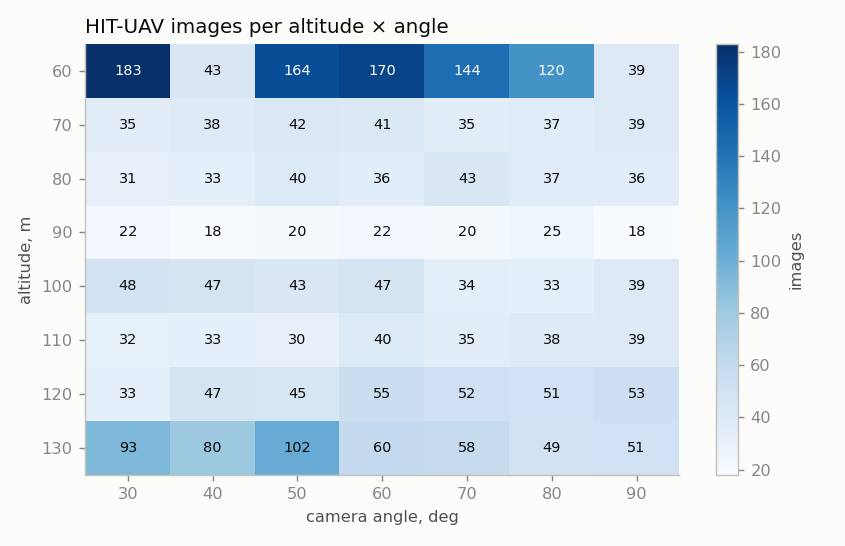

- Every one of the 56 altitude × angle combinations has at least 18 images.
- 60 m has the most images (30%), followed by 130 m (17%). The 90 m row is thinnest (145 images).
- The camera angle runs from 30° (oblique) to 90° (straight down).

### 3.3 Person size

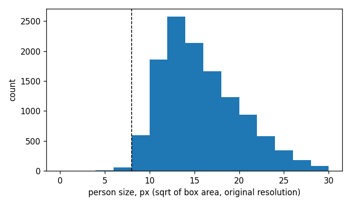

| Altitude | Images | Night share | Persons | Median px | Median contrast |
| -------- | ------ | ----------- | ------- | --------- | --------------- |
| 60 m     | 863    | 82%         | 6,268   | 16.0      | 1.13            |
| 70 m     | 267    | 62%         | 994     | 18.0      | 0.33            |
| 80 m     | 256    | 63%         | 1,316   | 16.2      | 0.44            |
| 90 m     | 145    | 100%        | 429     | 14.7      | 0.61            |
| 100 m    | 291    | 45%         | 811     | 13.7      | 0.60            |
| 110 m    | 247    | 58%         | 833     | 13.5      | 0.74            |
| 120 m    | 336    | 53%         | 663     | 11.0      | 1.03            |
| 130 m    | 493    | 72%         | 998     | 11.7      | 1.08            |

| Camera angle | Images | Persons | Median px | Median contrast |
| ------------ | ------ | ------- | --------- | --------------- |
| 30°         | 477    | 3,300   | 12.6      | 0.97            |
| 40°         | 339    | 988     | 13.4      | 0.56            |
| 50°         | 486    | 1,738   | 16.7      | 0.76            |
| 60°         | 471    | 1,648   | 17.2      | 0.72            |
| 70°         | 421    | 1,210   | 17.1      | 0.71            |
| 80°         | 390    | 2,647   | 17.3      | 1.61            |
| 90°         | 314    | 781     | 16.0      | 0.58            |


- Size falls with altitude: about 16–18 px at 60–80 m, 11–12 px at 120–130 m.
- Oblique views (30–40°) give smaller persons (12.6–13.4 px). The view is longer, and people further from the camera shrink.
- Contrast varies most with **time of day** (0.23 day vs 1.06 night). Per altitude it shows no clear trend, and it doesn't simply follow the night share either: 90 m is 100% night but has contrast 0.61. Each altitude is a different set of flights and scenes, so altitude and scene are mixed together.

### 3.4 Density and position

- 41.6% of images have no person, 8.1% have one, 19.7% have 2–5, 27.0% have 6–20 and 3.6% have more than 20. Median 2, mean 4.25, max 33.
- People appear in groups: 53% stand less than 2 body sizes from someone else, and 19% of boxes overlap another box.
- There's a mild centre bias in position (§6).

### 3.5 Image quality

- Brightness median 126; RMS contrast 34; dynamic range (p99 − p1) 143 of 255 levels.
- Median sharpness 50, the lowest of all four sets and 9× lower than WiSARD IR on the same 640×512 format. Images look smoothed by the camera's automatic gain control and JPEG.
- 8-bit, 3-channel JPEG with identical channels, white-hot palette. **No temperature data** (not radiometric).

### 3.6 Samples (day top, night bottom)


Daytime: sunlit pavement is as warm as people, and persons are dark or grey shapes that barely stand out. At night they are bright blobs on a cold background.

### 3.7 Input size

| imgsz        | Median person px at model input | Persons < 8 px |
| ------------ | ------------------------------- | -------------- |
| 320          | 7.4                             | 59%            |
| 640 (native) | 14.9                            | 1%             |
| 960 / 1280   | 14.9 + upscaling                | 1%             |

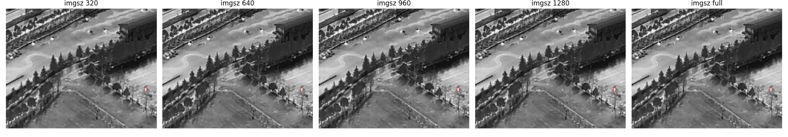

The measured effect of input size on detection is in §7.

### 3.8 Data integrity

- **31% of val and test images are near-duplicates** of a train image. Video frames from the same flight appear to be split frame by frame, so in-domain test scores are optimistic.
- The 148 DontCare boxes become background after preparation (1.2% of person count).
- Weather is always sunny, and there are no disaster scenes (campus, roads, playgrounds, parking lots).

## 4. C2A (RGB, synthetic disaster)

### 4.1 Composition

| Split | Images | Persons | Distinct background scenes |
| ----- | ------ | ------- | -------------------------- |
| train | 6,129  | 215,821 | 2,018                      |
| val   | 2,043  | 72,123  | 1,353                      |
| test  | 2,043  | 72,523  | 1,399                      |

| Disaster type      | Images | Persons |
| ------------------ | ------ | ------- |
| collapsed_building | 2,555  | 92,417  |
| fire               | 2,605  | 89,000  |
| flood              | 2,630  | 89,900  |
| traffic_incident   | 2,425  | 89,150  |

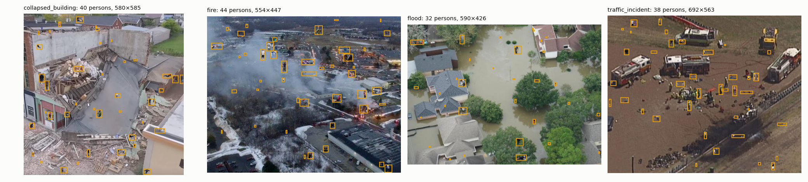

Some people already in the AIDER background photos (for example firefighters) are labelled too, alongside the pasted ones.

### 4.2 Pose

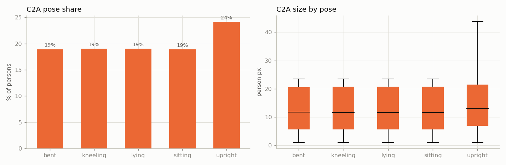

| Pose     | Share | Median px |
| -------- | ----- | --------- |
| bent     | 18.9% | 11.7      |
| kneeling | 19.0% | 11.5      |
| lying    | 19.0% | 11.6      |
| sitting  | 18.9% | 11.6      |
| upright  | 24.2% | 13.0      |

- Every one of the 360,467 persons has a pose label.
- Poses are balanced by design. **Lying (19%) is the only lying-victim data we have**, but it is pasted, not real.
- Size is the same for every pose (median 11.5–13 px, identical quartiles). A lying body is about twice as long as a crouched one from above, so the generator scaled people independently of pose.

### 4.3 Scale artifact


| Image long side (train) | Median person px | Median person, % of long side |
| ----------------------- | ---------------- | ----------------------------- |
| < 320                   | 11.7             | 4.44%                         |
| 320–640                | 11.7             | 2.64%                         |
| 640–1000               | 12.6             | 1.64%                         |
| ≥ 1000                 | 13.4             | 0.79%                         |

- People were pasted at roughly fixed pixel sizes (about 2–24 px) **whatever the image resolution or camera height**. A person is 4.4% of a 240 px frame but 0.8% of a 4K frame.
- The same body therefore appears at 5× different scales relative to the scene, which a real camera can't produce.
- Only a few large images have persons above 24 px.
- Resolution is small and scattered: 80% of images are under 640 px on the long side (median 428). The most common sizes are 240×240 (165 images), 300×300 (140) and 230×230 (125).

### 4.4 Input size and upscaling

| imgsz | Median person px (no upscaling) | Persons < 8 px |
| ----- | ------------------------------- | -------------- |
| 320   | 7.7                             | 52%            |
| 640   | 11.0                            | 38%            |
| 960   | 11.6                            | 36%            |
| 1280  | 11.8                            | 35%            |
| full  | 12.0                            | 35%            |

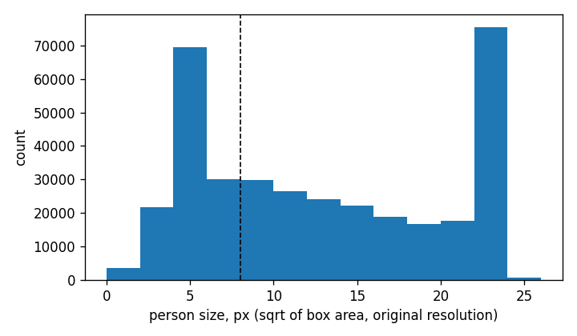


- The table assumes images are never enlarged. YOLO's letterbox resizing **does enlarge** small images to `imgsz`, so most C2A images grow at 640. Persons get more pixels but no more detail.
- **35% of persons are under 8 px even at full resolution**, so recall on C2A is capped whatever the `imgsz`.

### 4.5 Density, contrast, quality

- Every image has persons: 98.8% have more than 20 (median 34, max 240). Real earthquake scenes have a few scattered victims, not crowds.
- Only 5% of boxes overlap, but 38% of persons are within 2 body sizes of another.
- Grey-level contrast is slightly negative (median −0.19): pasted people are often darker than their surroundings and differ mainly in colour.
- Quality varies widely: brightness 68–152 (p5–p95); sharpness 41–1620, a 40× spread from blurry upscaled sources to crisp large ones.
- Position is uniform across the frame with an empty 3–5% border: random paste locations that ignore scene context (§6).

### 4.6 Leakage between splits


- Each AIDER background is reused up to 5 times (`<scene>_0` … `_4`) with different pasted people.
- **98.2% of val scenes and 98.3% of test scenes also appear in train.** 72–73% of val/test images are near-duplicates of a train image.
- Val/test scores on C2A as distributed measure memorised backgrounds. Split by scene before using it for model selection.

## 5. WiSARD sample (real SAR, RGB + IR)

### 5.1 Composition

| Modality           | Frames | Persons | Resolution | Median person px | Persons < 8 px |
| ------------------ | ------ | ------- | ---------- | ---------------- | -------------- |
| RGB (`VIS_0003`) | 264    | 1,022   | 3840×2160 | 66.7             | 0%             |
| IR (`IR_0004`)   | 264    | 1,006   | 640×512   | 17.2             | 0%             |

- One flight, Mt Erie, 2021-04-17, daytime, rock and conifer forest.
- The same 4 actors appear in 92–96% of frames, walking or standing together.
- Labels ship in YOLO format, one class (human).

### 5.2 Input size

| imgsz | RGB: median px at input | RGB: < 8 px | IR: median px at input | IR: < 8 px |
| ----- | ----------------------- | ----------- | ---------------------- | ---------- |
| 320   | 5.6                     | 94%         | 8.6                    | 40%        |
| 640   | 11.1                    | 4%          | 17.2 (native)          | 0%         |
| 960   | 16.7                    | 0%          | 17.2                   | 0%         |
| 1280  | 22.2                    | 0%          | 17.2                   | 0%         |
| full  | 66.7                    | 0%          | 17.2                   | 0%         |

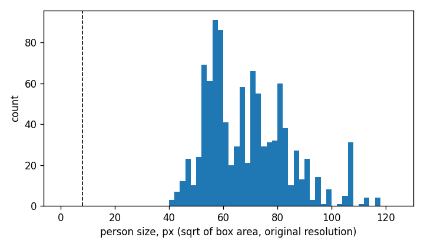


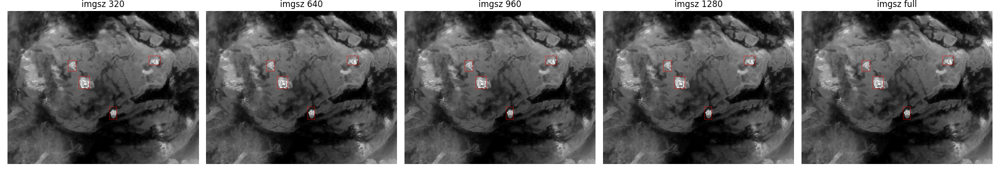

Resizing 4K to 640 shrinks people 6×, from 67 px to about 11 px. Tiling the full frame keeps all the detail (measured in §7).

### 5.3 RGB ↔ IR pairing

Frames share an index: 263 indexes exist in both, and 247 of those have the same person count in both modalities. Pairing persons by x order and fitting a linear map gives:

| Measure                            | Value                                                           |
| ---------------------------------- | --------------------------------------------------------------- |
| IR x (normalised)                  | 1.511 · RGB x − 0.273                                         |
| IR y (normalised)                  | 1.040 · RGB y − 0.038                                         |
| IR footprint inside RGB frame      | x 0.18–0.84, y 0.04–1.00 → **63.6% of RGB area**       |
| Median error after fit             | 0.012 normalised = **7.7 IR px** (about 0.45 of a person) |
| Person size ratio, RGB px ÷ IR px | 3.9× (about 15× more pixels per person in RGB)                |

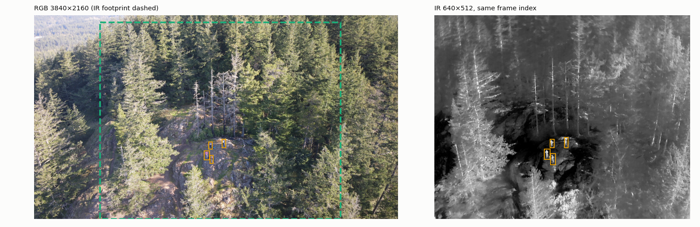


- The IR camera sees the middle two-thirds of the RGB frame's width and almost all of its height.
- A per-flight linear map aligns them to about half a person. That's enough to **match detection boxes** between the cameras, but not to stack pixels into one image.
- The parallax between the two cameras changes with height above ground, so the map must be calibrated per rig and checked per altitude.

### 5.4 Quality and contrast

|            | Brightness p50 | RMS contrast p50 | Dynamic range p50 | Sharpness p50 | Person contrast p50 |
| ---------- | -------------- | ---------------- | ----------------- | ------------- | ------------------- |
| WiSARD IR  | 86             | 45               | 201               | 459           | 1.12 (2.9% low)     |
| WiSARD RGB | 111            | 53               | 204               | 3,730         | 0.21 (88.6% low)    |

- IR persons stand out clearly in grey level. Sunlit rock reaches the same temperature, though (see the first-frame image), so hot rocks are a false-positive risk.
- RGB persons hardly differ from their surroundings in grey level (88.6% low). They are found by colour and shape; the actors' bright clothes help a lot. Dust-covered victims would be harder to see in RGB, which is where thermal adds most.

## 6. Cross-dataset comparison

### 6.1 Persons per image


| Persons in image | HIT-UAV | C2A   | WiSARD IR | WiSARD RGB |
| ---------------- | ------- | ----- | --------- | ---------- |
| 0                | 41.6%   | 0%    | 1.1%      | 1.1%       |
| 1                | 8.1%    | 0%    | 3.0%      | 1.5%       |
| 2–5             | 19.7%   | 0%    | 95.8%     | 97.3%      |
| 6–20            | 27.0%   | 1.2%  | 0%        | 0%         |
| > 20             | 3.6%    | 98.8% | 0%        | 0%         |

### 6.2 Where persons are in the frame


- HIT-UAV: mild centre bias (the pilot framed the subjects).
- C2A: uniform, with an empty border (random pasting).
- WiSARD: one tight cluster (one group of actors).

### 6.3 Box shape and crowding


- In all real datasets, boxes are mostly taller than wide (median width:height 0.57–0.63): standing or walking people seen at an angle.
- C2A is squarer (0.82) and has a long tail of wide boxes, consistent with its bent and lying pastes.
- Crowding: around half of real persons have a neighbour within 2 body sizes. Detection must separate people standing close together (non-maximum suppression settings matter).

### 6.4 Contrast

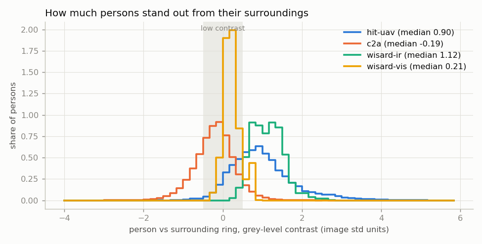

|            | p5     | p25    | p50    | p75  | p95  | Low (\|c\| < 0.5) |
| ---------- | ------ | ------ | ------ | ---- | ---- | ----------------- |
| HIT-UAV    | −0.05 | 0.46   | 0.90   | 1.37 | 2.53 | 25.7%             |
| C2A        | −1.05 | −0.50 | −0.19 | 0.10 | 0.59 | 68.2%             |
| WiSARD IR  | 0.57   | 0.82   | 1.12   | 1.39 | 1.77 | 2.9%              |
| WiSARD RGB | −0.06 | 0.08   | 0.21   | 0.34 | 0.73 | 88.6%             |

### 6.5 Image quality

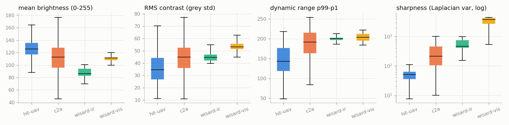

| p5 / p50 / p95 | Brightness      | RMS contrast | Dynamic range   | Sharpness             |
| -------------- | --------------- | ------------ | --------------- | --------------------- |
| HIT-UAV        | 102 / 126 / 153 | 17 / 34 / 60 | 77 / 143 / 212  | 20 / 50 / 123         |
| C2A            | 68 / 113 / 152  | 25 / 45 / 64 | 111 / 192 / 240 | 41 / 211 / 1,620      |
| WiSARD IR      | 74 / 86 / 97    | 41 / 45 / 51 | 189 / 201 / 216 | 244 / 459 / 801       |
| WiSARD RGB     | 103 / 111 / 115 | 49 / 53 / 59 | 193 / 204 / 221 | 1,045 / 3,730 / 4,400 |

The two thermal sets look very different: HIT-UAV is soft with low dynamic range, WiSARD IR is sharp with high dynamic range. A model trained on one sees the other as a new sensor (§7.3).

## 7. Detection vs person size and input size

Inference only. AP50 and recall are measured at IoU ≥ 0.5; recall at confidence 0.25.

### 7.1 Thermal: how far can we downscale?

HIT-UAV test (579 images, 2,611 persons), YOLO11n trained at 640:

| imgsz         | AP50            | Precision | Recall          | Recall < 8 px | 8–12 | 12–16 | 16–24 | 24–32 | ms/img |
| ------------- | --------------- | --------- | --------------- | ------------- | ----- | ------ | ------ | ------ | ------ |
| 320           | 0.664           | 0.646     | 0.678           | 0.06          | 0.37  | 0.69   | 0.85   | 0.90   | 9.3    |
| 480           | 0.840           | 0.709     | 0.849           | 0.31          | 0.76  | 0.87   | 0.89   | 0.88   | 10.7   |
| **640** | **0.872** | 0.696     | **0.888** | 0.50          | 0.87  | 0.90   | 0.90   | 0.87   | 12.4   |
| 960           | 0.851           | 0.711     | 0.833           | 0.63          | 0.83  | 0.86   | 0.83   | 0.73   | 18.9   |
| 1280          | 0.754           | 0.777     | 0.644           | 0.38          | 0.69  | 0.72   | 0.57   | 0.44   | 26.7   |

(The < 8 px bin holds only 16 persons, so its recall values are noisy.)


- **Downscaling:** 480 costs 3 AP points and 320 costs 21. Recall drops once a person is about 6 px at the model input (8–12 px persons at half scale: 0.37). **Floor: about 8 px at input; aim for 10 px or more.**
- **Upscaling a 640-trained model hurts large persons most** (24–32 px recall drops from 0.87 to 0.44 at 1280): the model never saw people that big. Upscaling only helps if the model is trained at that size.
- 640 is the best trade-off: 12 ms per frame on the M4.

### 7.2 4K RGB: resize vs tiling

WiSARD RGB (264 frames, 1,022 persons), COCO YOLO11n zero-shot, person class only:

| Mode                             | AP50            | Precision | Recall          | Recall 32–64 px | Recall ≥ 64 px | ms/img |
| -------------------------------- | --------------- | --------- | --------------- | ---------------- | --------------- | ------ |
| Resize to 640                    | 0.030           | 0.64      | 0.007           | 0.00             | 0.01            | 48     |
| Resize to 1280                   | 0.127           | 0.55      | 0.036           | 0.03             | 0.05            | 57     |
| Resize to 1920                   | 0.132           | 0.54      | 0.066           | 0.11             | 0.03            | 73     |
| **640 tiles, 20% overlap** | **0.324** | 0.65      | **0.356** | **0.59**   | 0.17            | 494    |


- Tiling is **10× better** than resizing to 640 and 2.5× better than resizing to 1920. Tiles were run one at a time at low priority; batching all 40 tiles of a frame would cut the 494 ms sharply.
- Absolute values are low because COCO weights have rarely seen people from directly above. The comparison between modes is the useful part.

### 7.3 Domain gap

| Model → data                           | imgsz      | AP50            | Precision   | Recall        |
| --------------------------------------- | ---------- | --------------- | ----------- | ------------- |
| HIT-UAV model → HIT-UAV test           | 640        | 0.872           | 0.70        | 0.888         |
| HIT-UAV model → WiSARD IR              | 640        | **0.010** | 0.04        | 0.012         |
| HIT-UAV model → WiSARD IR              | 960 / 1280 | 0.010 / 0.003   | –          | 0.006 / 0.002 |
| HIT-UAV model → WiSARD IR, IoU ≥ 0.25 | 640        | 0.063           | 0.14        | 0.040         |
| COCO model → HIT-UAV test              | 640 / 960  | 0.099 / 0.120   | 0.45 / 0.41 | 0.035 / 0.044 |
| COCO model → WiSARD IR                 | 640 / 960  | 0.059 / 0.096   | 0.88 / 0.63 | 0.007 / 0.005 |
| COCO model → C2A test                  | 640 / 1280 | 0.151 / 0.205   | 0.46 / 0.40 | 0.122 / 0.254 |


- The HIT-UAV model **does not transfer** to real wilderness thermal footage, even though WiSARD IR persons are larger (17 vs 15 px) and stand out more (contrast 1.12 vs 0.90).
- It does fire on them, but only with tiny low-confidence boxes on hot spots inside the person (e.g. 5×11 px inside a 27×35 px box).
- Likely causes:
  1. Background: textured hot rock versus flat pavement.
  2. Sensor look: sharp, high dynamic range versus soft (§6.5).
  3. Box style: whole-body boxes versus tight ones.
  4. The model is a partial 14-epoch run.
- COCO weights don't detect people in thermal at all. A thermal detector needs thermal training data.
- On C2A, recall of a zero-shot model doubles from 640 to 1280 (0.12 → 0.25), and recall under 8 px rises from 0.02 to 0.12. Small RGB persons need more input pixels.

## 8. What this means for our drone

Expected person size by hover altitude, using √area for a person seen from directly above: standing ≈ 0.45 m, lying ≈ 0.9 m.

The camera specs below are **assumptions** until we have the real drone's. HIT-UAV measured 16 px at 60 m, larger than this table predicts (a narrower lens, an oblique view, and the heat halo around the body), so treat these figures as conservative.

| Altitude | Thermal GSD | Thermal 640×512, 40° HFOV | RGB GSD   | RGB 4000×3000, 72° HFOV, native/tiled | RGB resized to 640 | RGB resized to 1280 |
| -------- | ----------- | --------------------------- | --------- | --------------------------------------- | ------------------ | ------------------- |
| 20 m     | 2.3 cm/px   | 20 / 40 px                  | 0.7 cm/px | 62 / 124 px                             | 10 / 20 px         | 20 / 40 px          |
| 30 m     | 3.4         | 13 / 26                     | 1.1       | 41 / 83                                 | 7 / 13             | 13 / 26             |
| 40 m     | 4.5         | 10 / 20                     | 1.5       | 31 / 62                                 | 5 / 10             | 10 / 20             |
| 50 m     | 5.7         | 8 / 16                      | 1.8       | 25 / 50                                 | 4 / 8              | 8 / 16              |
| 60 m     | 6.8         | 7 / 13                      | 2.2       | 21 / 41                                 | 3 / 7              | 7 / 13              |
| 80 m     | 9.1         | 5 / 10                      | 2.9       | 15 / 31                                 | 2 / 5              | 5 / 10              |
| 100 m    | 11.4        | 4 / 8                       | 3.6       | 12 / 25                                 | 2 / 4              | 4 / 8               |
| 120 m    | 13.6        | 3 / 7                       | 4.4       | 10 / 21                                 | 2 / 3              | 3 / 7               |

GSD (ground sampling distance) = 2 · altitude · tan(HFOV / 2) ÷ image width. Person px = person size in metres ÷ GSD × (model input ÷ image width).

Combined with the 8–10 px floor from §7.1:

- **Thermal works up to about 40 m** for standing people, and up to about 80 m for lying people.
- **RGB tiled at native resolution** works up to about 100 m.
- **RGB resized to 640 fails above about 30 m.**

## 9. Reproduce

```bash
# Size vs imgsz per dataset
.venv/bin/python src/detection/analyze.py data/yolo/hit-uav/images data/yolo/hit-uav/labels --out research/datasets/assets/hit-uav-analysis
# Full audit + all charts in research/datasets/assets/audit/ (charts in §7 need the eval JSONs below)
.venv/bin/python src/detection/audit.py --out research/datasets/assets/audit
# Inference-only sweeps (low priority, 3 threads)
r() { nice -n 10 .venv/bin/python src/detection/eval_sizes.py --threads 3 "$@"; }
r runs/runs/hituav-n-640/weights/best.pt hit-uav test --imgsz 320 480 640 960 1280 --out research/datasets/assets/audit/eval/hituav-model_hituav-test.json
r runs/runs/hituav-n-640/weights/best.pt wisard-ir val --imgsz 640 960 1280 --out research/datasets/assets/audit/eval/hituav-model_wisard-ir.json
r runs/runs/hituav-n-640/weights/best.pt wisard-ir val --imgsz 640 1280 --iou 0.25 --out research/datasets/assets/audit/eval/hituav-model_wisard-ir_iou25.json
r models/yolo11n.pt hit-uav test --imgsz 640 960 --out research/datasets/assets/audit/eval/coco-model_hituav-test.json
r models/yolo11n.pt wisard-ir val --imgsz 640 960 --out research/datasets/assets/audit/eval/coco-model_wisard-ir.json
r models/yolo11n.pt wisard-vis val --imgsz 640 1280 1920 --tile 640 --out research/datasets/assets/audit/eval/coco-model_wisard-vis.json
r models/yolo11n.pt c2a test --imgsz 640 1280 --out research/datasets/assets/audit/eval/coco-model_c2a-test.json
```
