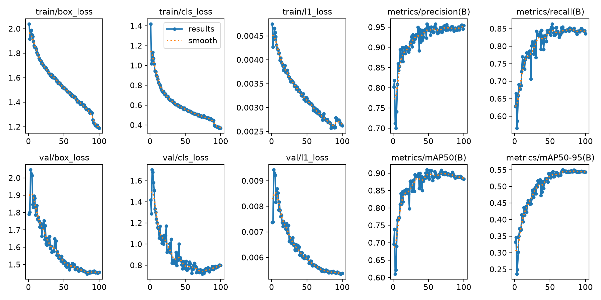
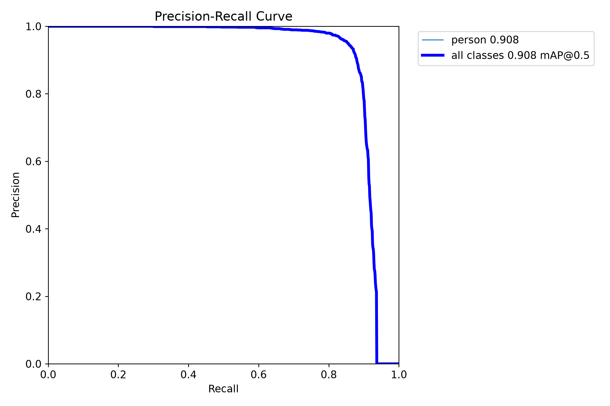
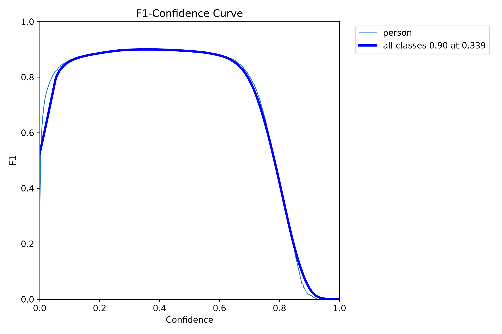
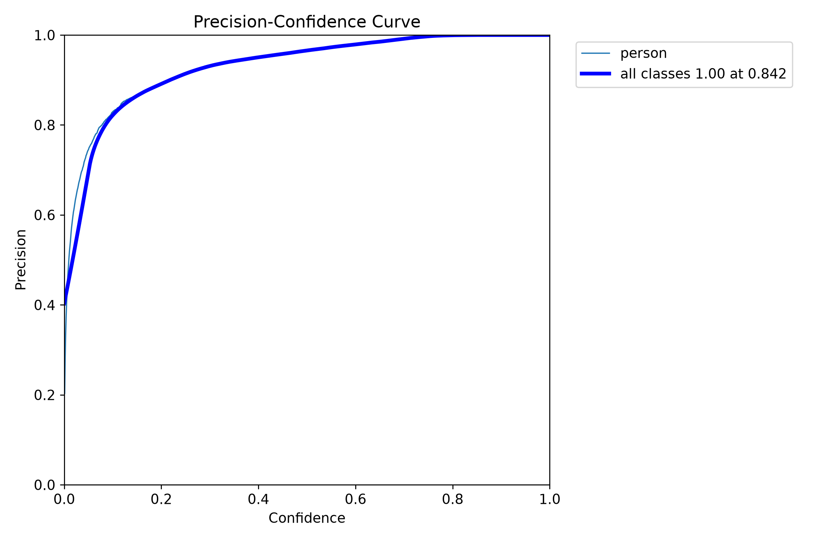
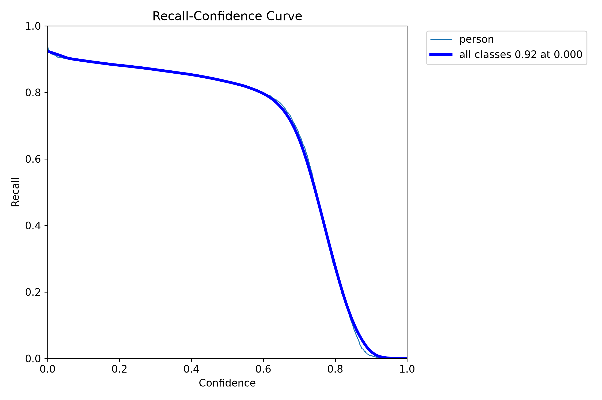
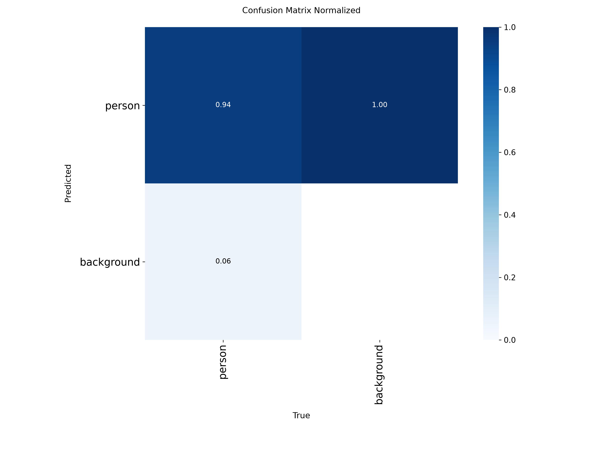
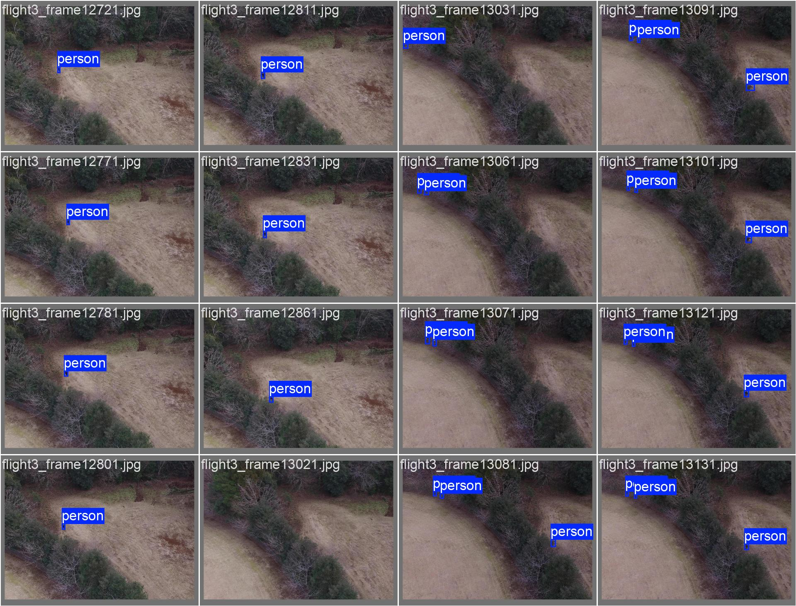
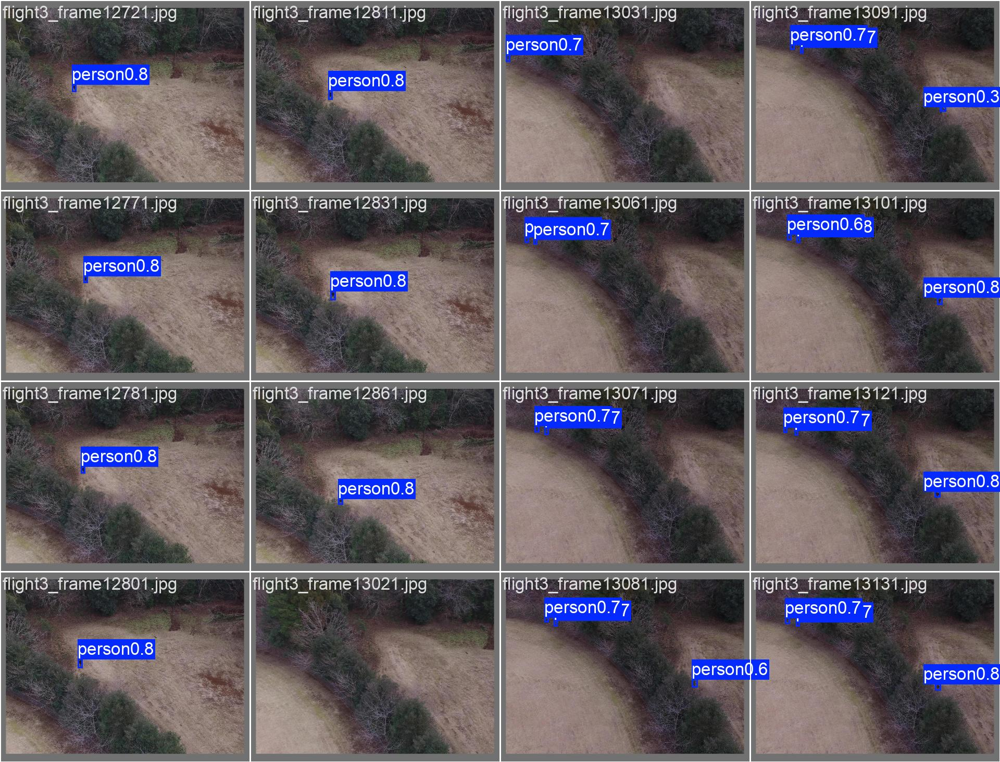

# rgb / yolo26n_e100

Generated by `src/detection/report.py` from the files in this folder. Metric definitions: [research/datasets/README.md](../../../research/datasets/README.md#reading-the-metrics).

## Setup

- Model: `yolo26n.pt`, imgsz 640, batch 32, 100 epochs, seed 0
- Weights: `runs/rgb/yolo26n_e100/weights/best.pt` (git-ignored)
- Data: sard, nii-cu-mapd-rgb

## Training

- Epochs run: 100
- best.pt from epoch: 68 (val AP50 0.908, AP50-95 0.550)
- Highest val AP50: 0.910 at epoch 48
- Last epoch: AP50 0.883, AP50-95 0.544
- Training time: 34 min

Val metrics (combined val set) every few epochs:

|   epoch |   AP50 |   AP50-95 |     P |     R |
|--------:|-------:|----------:|------:|------:|
|      10 |  0.81  |     0.415 | 0.894 | 0.728 |
|      20 |  0.844 |     0.45  | 0.898 | 0.768 |
|      30 |  0.848 |     0.478 | 0.928 | 0.767 |
|      40 |  0.891 |     0.515 | 0.937 | 0.829 |
|      50 |  0.901 |     0.532 | 0.943 | 0.846 |
|      60 |  0.899 |     0.535 | 0.958 | 0.841 |
|      68 |  0.908 |     0.55  | 0.948 | 0.855 |
|      70 |  0.902 |     0.547 | 0.942 | 0.846 |
|      80 |  0.896 |     0.547 | 0.947 | 0.848 |
|      90 |  0.888 |     0.545 | 0.942 | 0.844 |
|     100 |  0.883 |     0.544 | 0.954 | 0.835 |

## Scores (ultralytics, best.pt)

P and R at the confidence with the best F1. `all` is every val set together.

| dataset         | split   |   AP50 |   AP50-95 |     P |     R |
|:----------------|:--------|-------:|----------:|------:|------:|
| all             | val     |  0.907 |     0.55  | 0.948 | 0.854 |
| sard            | val     |  0.952 |     0.644 | 0.971 | 0.908 |
| sard            | test    |  0.945 |     0.644 | 0.962 | 0.902 |
| nii-cu-mapd-rgb | val     |  0.834 |     0.379 | 0.898 | 0.774 |

## eval_sizes.py

AP50 by `eval_sizes.py`; P and R at confidence 0.25; recall by person size (√area in px at the model input, or native px when tiled), with the number of persons in brackets.

#### heridal-test

HERIDAL's held-out locations (MED, BRA, CAP, SB, BLI, CAB), whole 853×640 frames.

|   imgsz | tiled   |   IoU |   images |   persons |   AP50 |   P@0.25 |   R@0.25 | R 0-8 px   | R 8-12 px   | R 12-16 px   | R 16-24 px   | R 24-32 px   |
|--------:|:--------|------:|---------:|----------:|-------:|---------:|---------:|:-----------|:------------|:-------------|:-------------|:-------------|
|     640 | no      |   0.5 |      303 |       582 |  0.011 |    0.265 |    0.015 | 0.00 (49)  | 0.00 (210)  | 0.01 (195)   | 0.04 (119)   | 0.33 (9)     |
|     640 | 640     |   0.5 |      303 |       582 |  0.015 |    0.187 |    0.024 | 0.00 (49)  | 0.00 (210)  | 0.01 (195)   | 0.08 (119)   | 0.33 (9)     |

#### heridal-v1-roboflow-test

First HERIDAL conversion, before the location split: Roboflow's 101-image test split.

|   imgsz | tiled   |   IoU |   images |   persons |   AP50 |   P@0.25 |   R@0.25 | R 0-8 px   | R 8-12 px   | R 12-16 px   | R 16-24 px   | R 24-32 px   |
|--------:|:--------|------:|---------:|----------:|-------:|---------:|---------:|:-----------|:------------|:-------------|:-------------|:-------------|
|     640 | no      |   0.5 |      101 |       337 |  0.007 |    0.19  |    0.012 | 0.00 (18)  | 0.00 (155)  | 0.01 (116)   | 0.07 (46)    | 0.00 (2)     |
|    1280 | no      |   0.5 |      101 |       337 |  0.013 |    0.212 |    0.021 | 0.00 (18)  | 0.00 (155)  | 0.02 (116)   | 0.11 (46)    | 0.00 (2)     |
|     640 | 640     |   0.5 |      101 |       337 |  0.012 |    0.204 |    0.03  | 0.00 (18)  | 0.00 (155)  | 0.03 (116)   | 0.15 (46)    | 0.00 (2)     |

#### heridal-v1-unique

First HERIDAL conversion, before the location split: one frame per distinct view over all 1,579 frames.

|   imgsz | tiled   |   IoU |   images |   persons |   AP50 |   P@0.25 |   R@0.25 | R 0-8 px   | R 8-12 px   | R 12-16 px   | R 16-24 px   | R 24-32 px   |
|--------:|:--------|------:|---------:|----------:|-------:|---------:|---------:|:-----------|:------------|:-------------|:-------------|:-------------|
|     640 | no      |   0.5 |     1275 |      2462 |  0.003 |    0.12  |    0.01  | 0.00 (118) | 0.00 (796)  | 0.00 (959)   | 0.03 (561)   | 0.21 (28)    |
|    1280 | no      |   0.5 |     1275 |      2462 |  0.004 |    0.101 |    0.017 | 0.00 (118) | 0.00 (796)  | 0.01 (959)   | 0.05 (561)   | 0.25 (28)    |
|     640 | 640     |   0.5 |     1275 |      2462 |  0.007 |    0.114 |    0.019 | 0.00 (118) | 0.00 (796)  | 0.01 (959)   | 0.05 (561)   | 0.29 (28)    |

#### nii-cu-mapd-rgb-val

|   imgsz | tiled   |   IoU |   images |   persons |   AP50 |   P@0.25 |   R@0.25 | R 32-64 px   | R 64-1e+09 px   |
|--------:|:--------|------:|---------:|----------:|-------:|---------:|---------:|:-------------|:----------------|
|     640 | no      |   0.5 |      485 |       891 |  0.839 |    0.901 |     0.78 | 0.80 (424)   | 0.77 (467)      |

#### sard-test

|   imgsz | tiled   |   IoU |   images |   persons |   AP50 |   P@0.25 |   R@0.25 | R 0-8 px   | R 8-12 px   | R 12-16 px   | R 16-24 px   | R 24-32 px   | R 32-64 px   | R 64-1e+09 px   |
|--------:|:--------|------:|---------:|----------:|-------:|---------:|---------:|:-----------|:------------|:-------------|:-------------|:-------------|:-------------|:----------------|
|     640 | no      |   0.5 |      570 |       732 |  0.953 |    0.934 |    0.932 | 0.00 (3)   | 0.00 (1)    | 0.25 (4)     | 0.64 (28)    | 0.84 (80)    | 0.95 (336)   | 0.99 (280)      |

#### sard-val

|   imgsz | tiled   |   IoU |   images |   persons |   AP50 |   P@0.25 |   R@0.25 | R 0-8 px   | R 8-12 px   | R 12-16 px   | R 16-24 px   | R 24-32 px   | R 32-64 px   | R 64-1e+09 px   |
|--------:|:--------|------:|---------:|----------:|-------:|---------:|---------:|:-----------|:------------|:-------------|:-------------|:-------------|:-------------|:----------------|
|     640 | no      |   0.5 |     1144 |      1463 |  0.955 |    0.936 |    0.934 | 0.00 (2)   | 0.00 (5)    | 0.00 (9)     | 0.50 (46)    | 0.84 (146)   | 0.96 (730)   | 0.98 (525)      |

## Plots

Losses and val metrics per epoch:

Precision against recall on the combined val set:

F1 against confidence threshold:

Precision against confidence threshold:

Recall against confidence threshold:

Confusion matrix (person against background), normalised:

Training labels: box positions and sizes:

Val batch 0, labels:

Val batch 0, predictions:

