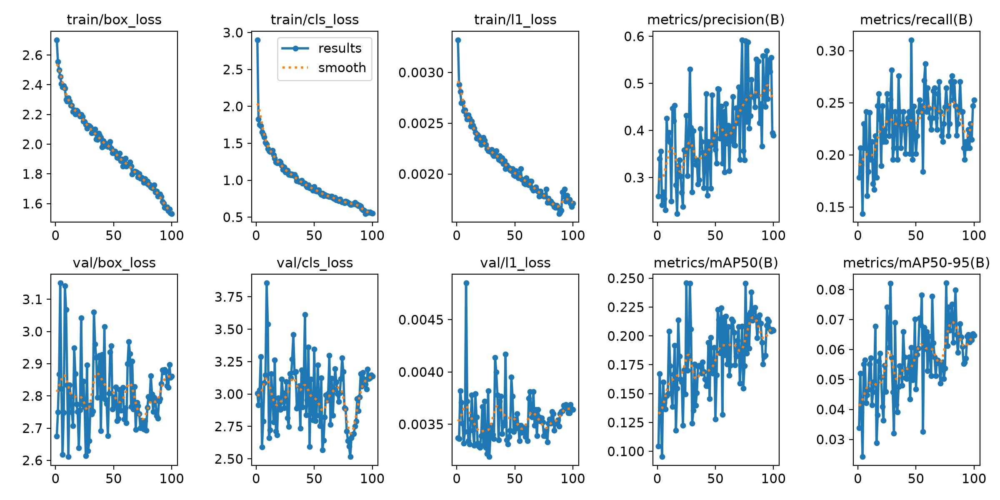
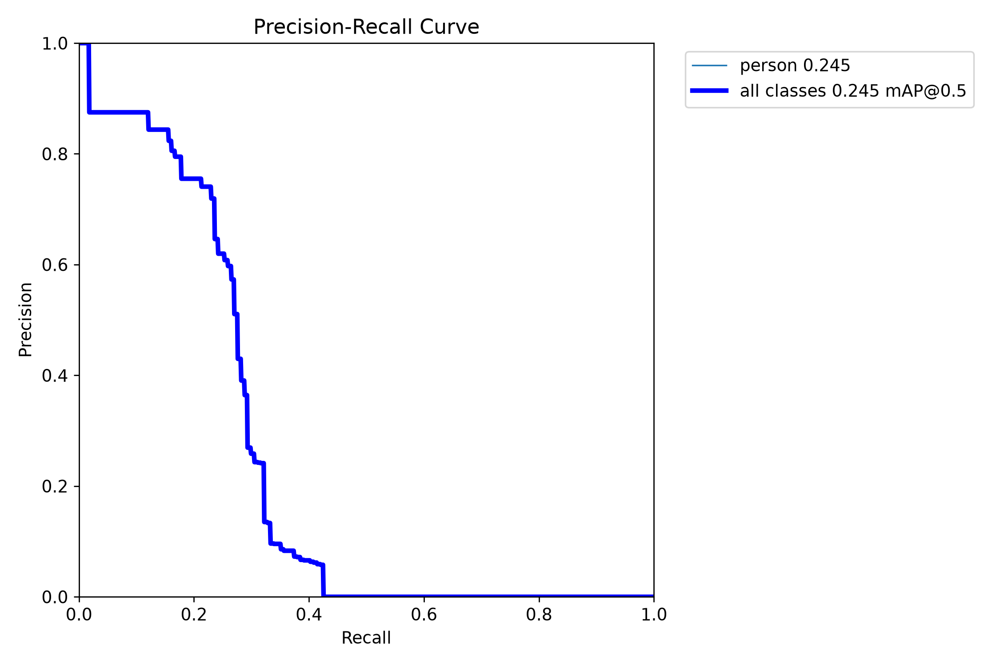
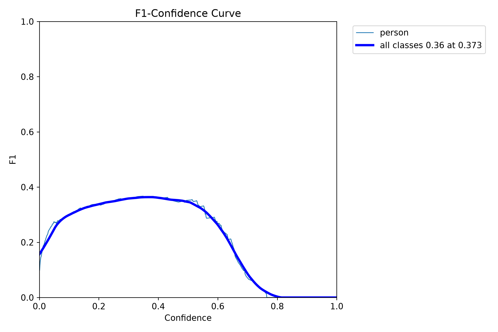
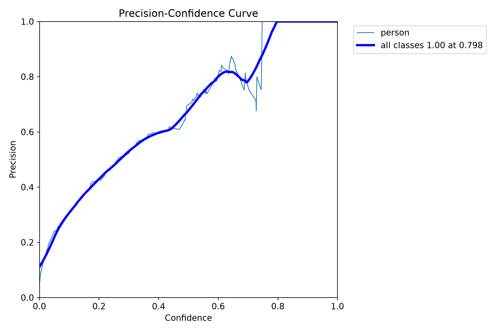
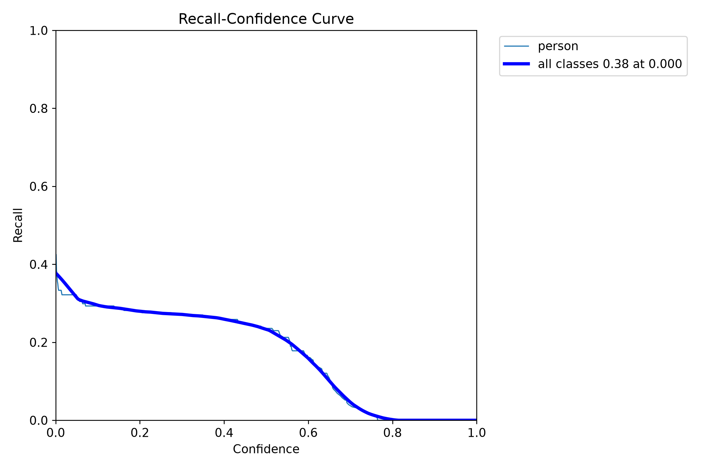
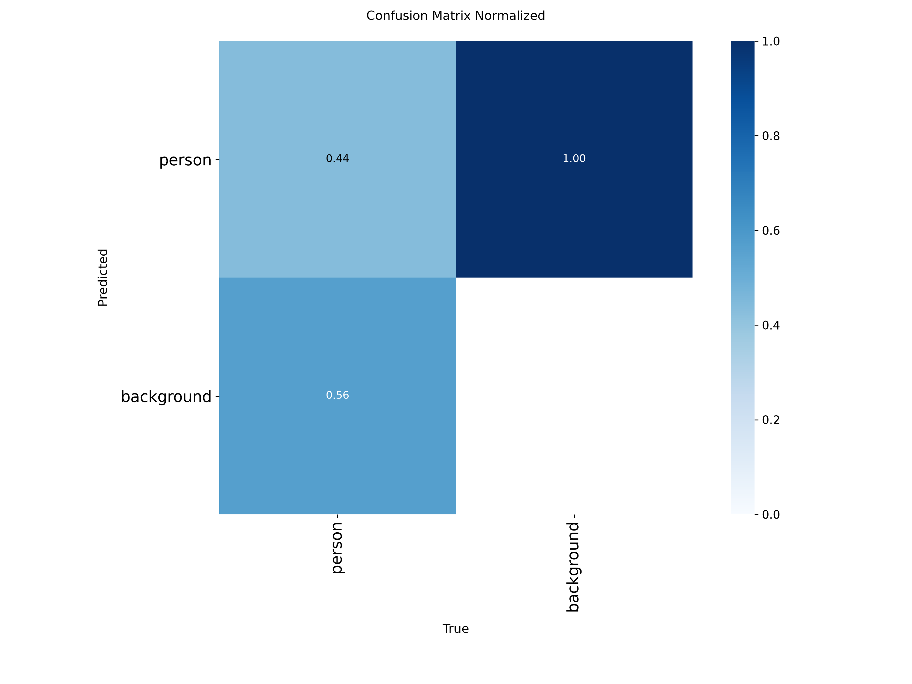
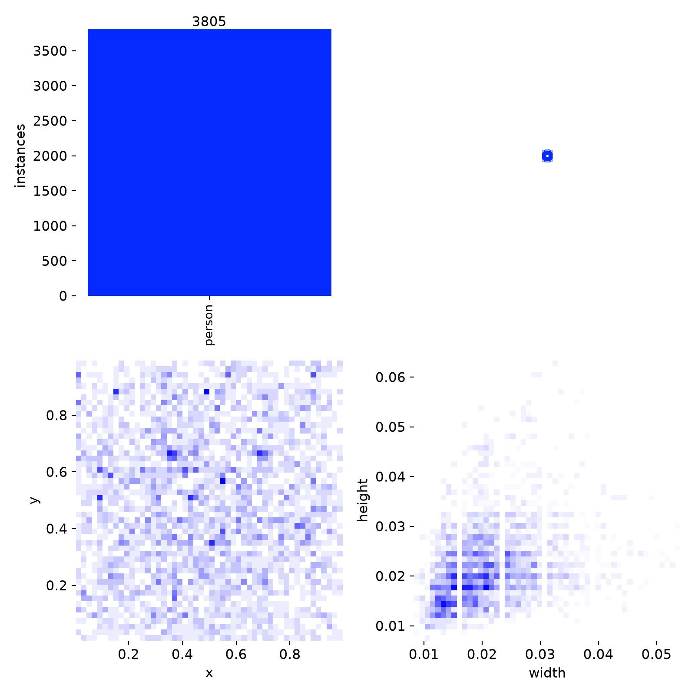
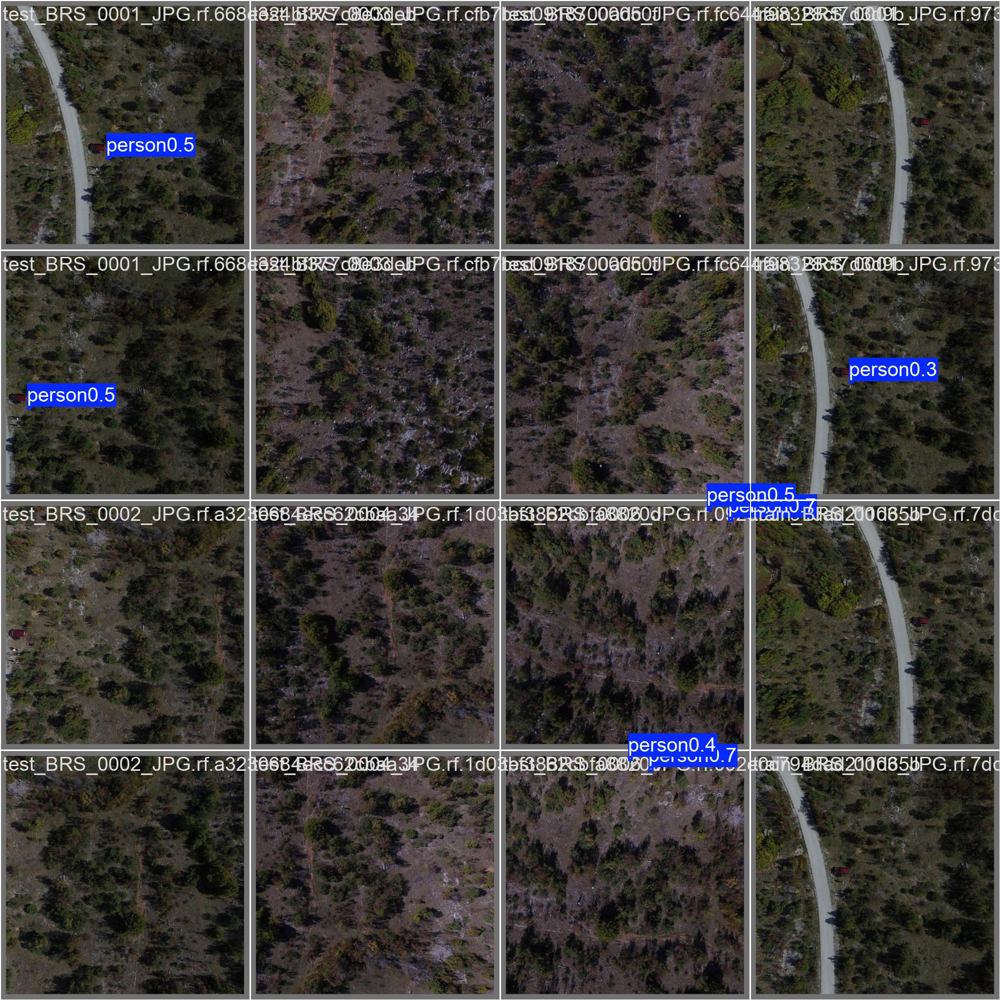

# rgb / yolo26n_e100_heridal_only

Generated by `src/detection/report.py` from the files in this folder. Metric definitions: [research/datasets/README.md](../../../research/datasets/README.md#reading-the-metrics).

## Setup

- Model: `yolo26n.pt`, imgsz 640, batch 32, 100 epochs, seed 0, random rescale ±0.5
- Train: heridal
- Val (picks best.pt): heridal

## Training

- Epochs run: 100
- best.pt from epoch: 76 (val AP50 0.246, AP50-95 0.082)
- Highest val AP50: 0.246 at epoch 25
- Last epoch: AP50 0.205, AP50-95 0.065
- Training time: 8 min

Val metrics (combined val set) every few epochs:

|   epoch |   AP50 |   AP50-95 |     P |     R |
|--------:|-------:|----------:|------:|------:|
|      10 |  0.204 |     0.055 | 0.396 | 0.241 |
|      20 |  0.163 |     0.051 | 0.303 | 0.19  |
|      30 |  0.124 |     0.046 | 0.269 | 0.195 |
|      40 |  0.169 |     0.058 | 0.278 | 0.224 |
|      50 |  0.128 |     0.047 | 0.359 | 0.201 |
|      60 |  0.176 |     0.053 | 0.373 | 0.264 |
|      70 |  0.208 |     0.055 | 0.492 | 0.27  |
|      76 |  0.246 |     0.082 | 0.59  | 0.264 |
|      80 |  0.221 |     0.071 | 0.431 | 0.27  |
|      90 |  0.194 |     0.061 | 0.367 | 0.241 |
|     100 |  0.205 |     0.065 | 0.39  | 0.253 |

## Scores (ultralytics, best.pt)

P and R at the confidence with the best F1. `all` is every val set together.

| dataset         | split   |   AP50 |   AP50-95 |     P |     R |
|:----------------|:--------|-------:|----------:|------:|------:|
| all             | val     |  0.246 |     0.081 | 0.6   | 0.264 |
| sard            | val     |  0.001 |     0     | 0.014 | 0.008 |
| sard            | test    |  0.001 |     0.001 | 0.005 | 0.007 |
| nii-cu-mapd-rgb | val     |  0.141 |     0.044 | 0.293 | 0.174 |
| heridal         | val     |  0.246 |     0.081 | 0.6   | 0.264 |
| heridal         | test    |  0.153 |     0.048 | 0.406 | 0.211 |

## eval_sizes.py

AP50 by `eval_sizes.py`; P and R at confidence 0.25; recall by person size (√area in px at the model input, or native px when tiled), with the number of persons in brackets.

#### heridal-test-last

As heridal-test, with last.pt (the final epoch) instead of best.pt.

|   imgsz | tiled   |   IoU |   images |   persons |   AP50 |   P@0.25 |   R@0.25 | R 0-8 px   | R 8-12 px   | R 12-16 px   | R 16-24 px   | R 24-32 px   |
|--------:|:--------|------:|---------:|----------:|-------:|---------:|---------:|:-----------|:------------|:-------------|:-------------|:-------------|
|     640 | no      |   0.5 |      303 |       582 |  0.143 |    0.564 |    0.136 | 0.06 (49)  | 0.07 (210)  | 0.16 (195)   | 0.23 (119)   | 0.22 (9)     |
|     640 | 640     |   0.5 |      303 |       582 |  0.184 |    0.491 |    0.189 | 0.20 (49)  | 0.14 (210)  | 0.21 (195)   | 0.21 (119)   | 0.33 (9)     |

#### heridal-test

HERIDAL's held-out locations (MED, BRA, CAP, SB, BLI, CAB), whole 853×640 frames.

|   imgsz | tiled   |   IoU |   images |   persons |   AP50 |   P@0.25 |   R@0.25 | R 0-8 px   | R 8-12 px   | R 12-16 px   | R 16-24 px   | R 24-32 px   |
|--------:|:--------|------:|---------:|----------:|-------:|---------:|---------:|:-----------|:------------|:-------------|:-------------|:-------------|
|     640 | no      |   0.5 |      303 |       582 |  0.151 |    0.503 |    0.143 | 0.02 (49)  | 0.07 (210)  | 0.18 (195)   | 0.24 (119)   | 0.33 (9)     |
|     640 | 640     |   0.5 |      303 |       582 |  0.195 |    0.545 |    0.198 | 0.10 (49)  | 0.15 (210)  | 0.24 (195)   | 0.23 (119)   | 0.33 (9)     |

## Plots

Losses and val metrics per epoch:

Precision against recall on the combined val set:

F1 against confidence threshold:

Precision against confidence threshold:

Recall against confidence threshold:

Confusion matrix (person against background), normalised:

Training labels: box positions and sizes:

Val batch 0, labels:

Val batch 0, predictions:

