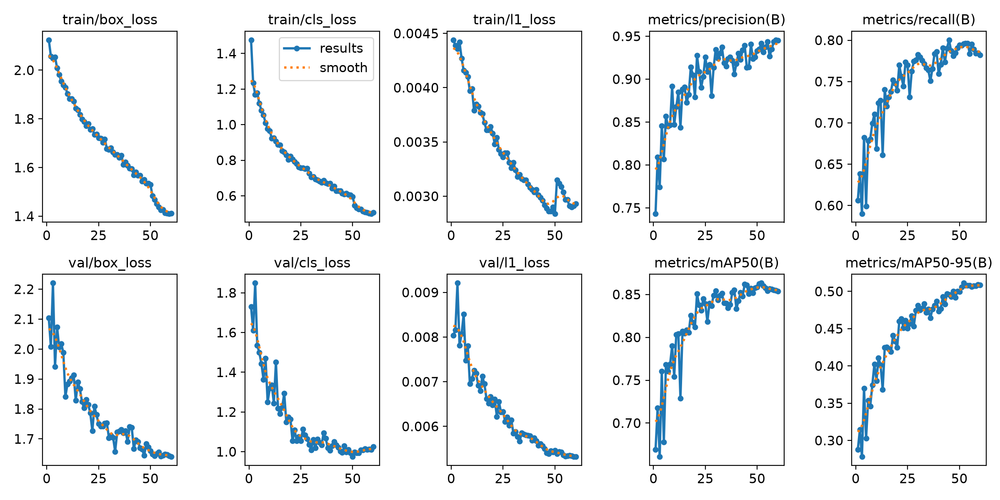
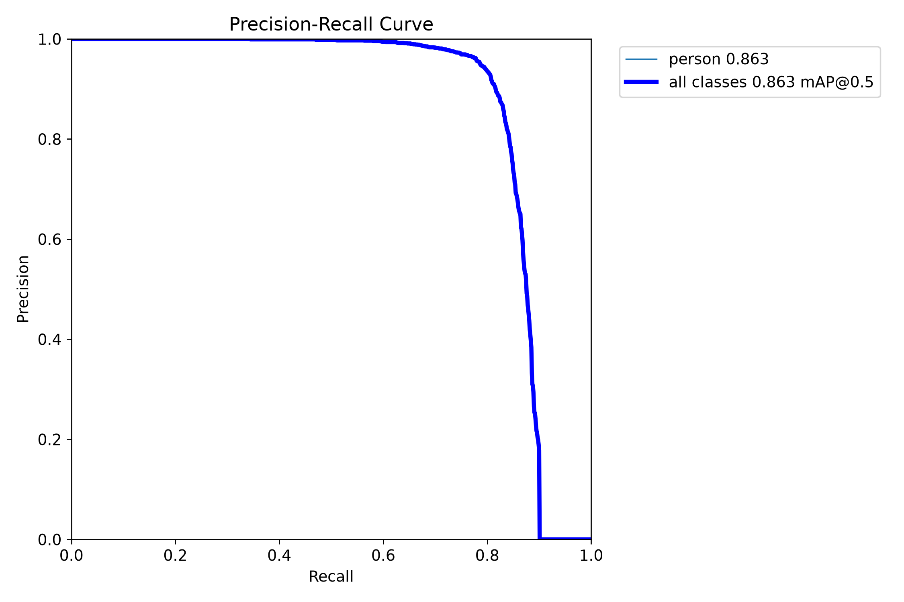
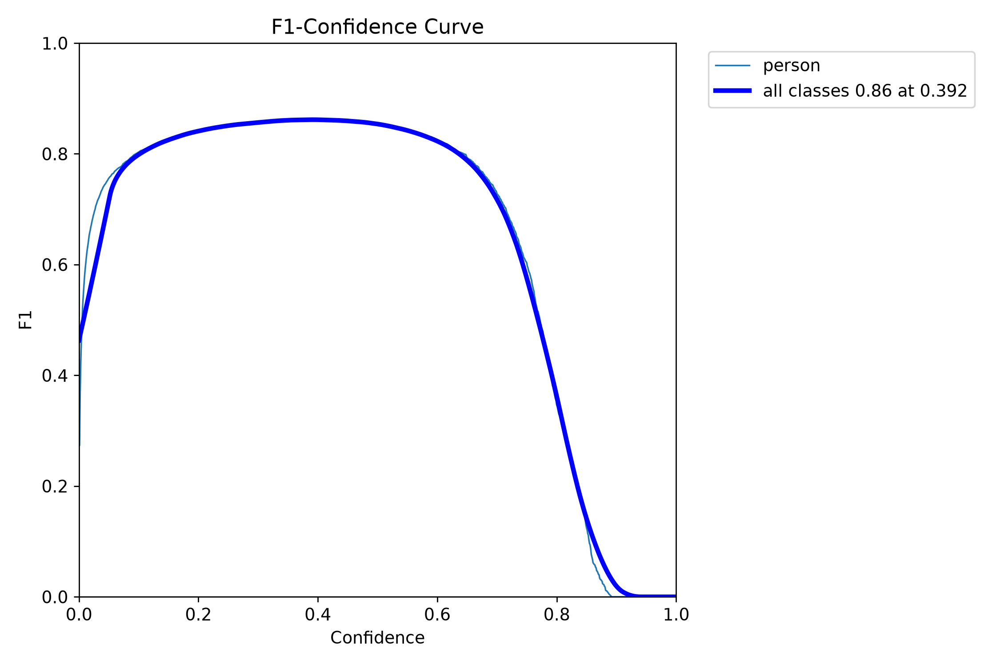
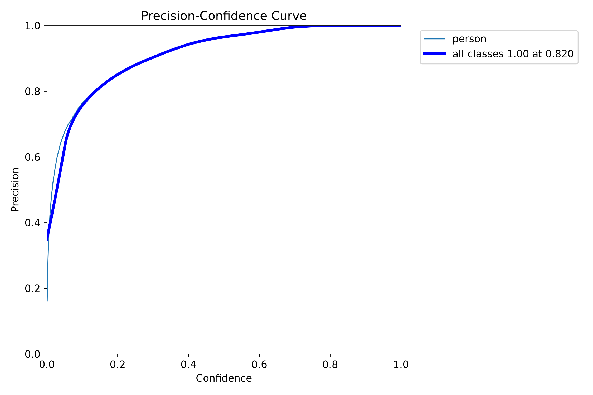
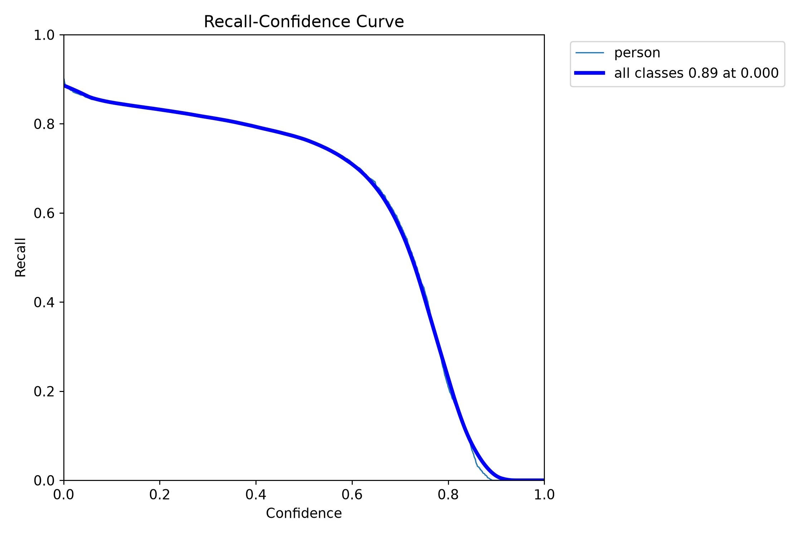
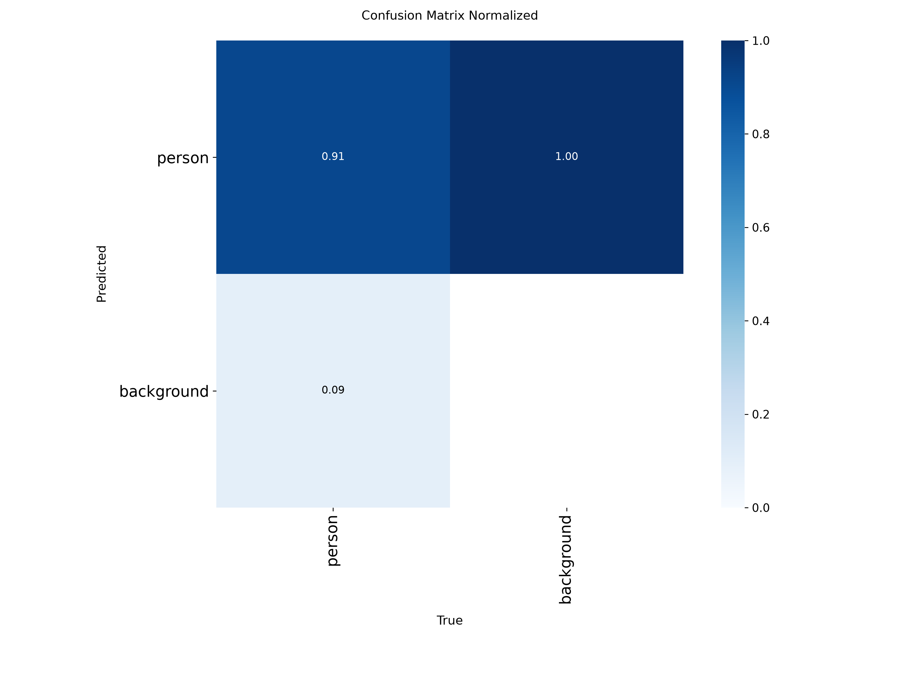
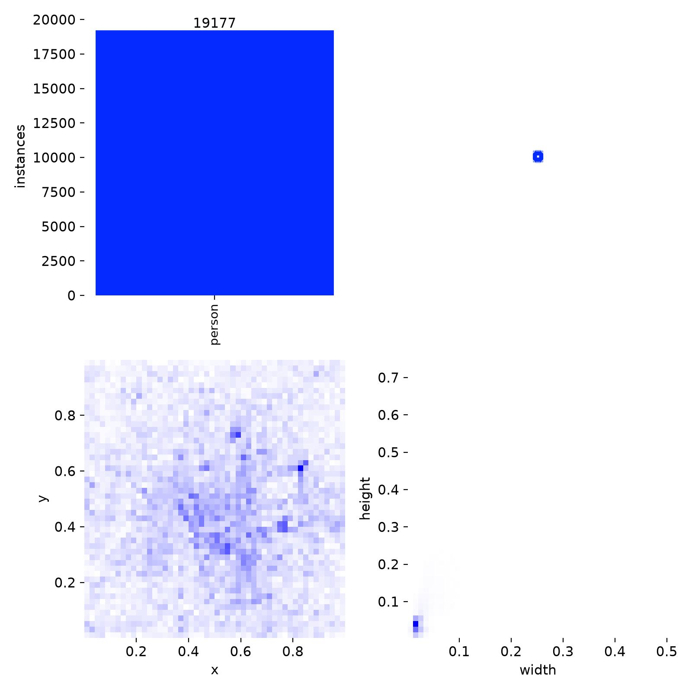
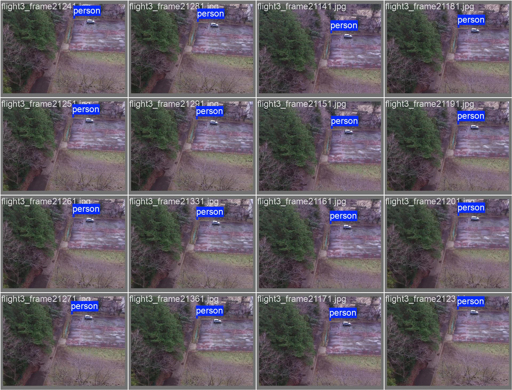
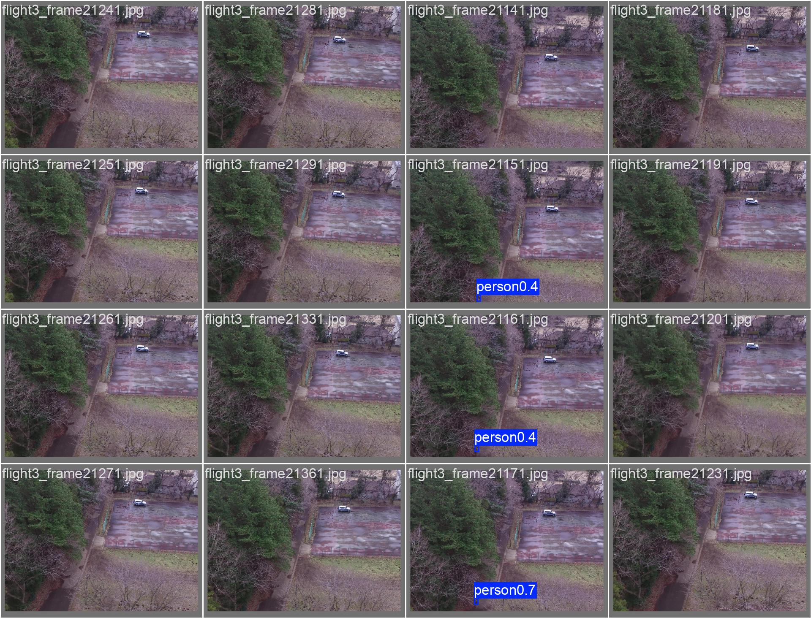

# rgb / yolo26n_e60_heridal

Generated by `src/detection/report.py` from the files in this folder. Metric definitions: [research/datasets/README.md](../../../research/datasets/README.md#reading-the-metrics).

## Setup

- Model: `yolo26n.pt`, imgsz 640, batch 32, 60 epochs, seed 0
- Data: sard, nii-cu-mapd-rgb, heridal

## Training

- Epochs run: 60
- best.pt from epoch: 52 (val AP50 0.863, AP50-95 0.511)
- Highest val AP50: 0.863 at epoch 52
- Last epoch: AP50 0.854, AP50-95 0.509
- Training time: 25 min

Val metrics (combined val set) every few epochs:

|   epoch |   AP50 |   AP50-95 |     P |     R |
|--------:|-------:|----------:|------:|------:|
|       6 |  0.768 |     0.354 | 0.857 | 0.678 |
|      12 |  0.804 |     0.401 | 0.885 | 0.727 |
|      18 |  0.826 |     0.441 | 0.914 | 0.752 |
|      24 |  0.845 |     0.461 | 0.903 | 0.773 |
|      30 |  0.854 |     0.481 | 0.935 | 0.783 |
|      36 |  0.834 |     0.465 | 0.924 | 0.751 |
|      42 |  0.852 |     0.493 | 0.923 | 0.791 |
|      48 |  0.852 |     0.492 | 0.924 | 0.784 |
|      52 |  0.863 |     0.511 | 0.942 | 0.795 |
|      54 |  0.858 |     0.508 | 0.938 | 0.796 |
|      60 |  0.854 |     0.509 | 0.945 | 0.782 |

## Scores (ultralytics, best.pt)

P and R at the confidence with the best F1. `all` is every val set together.

| dataset         | split   |   AP50 |   AP50-95 |     P |     R |
|:----------------|:--------|-------:|----------:|------:|------:|
| all             | val     |  0.862 |     0.512 | 0.942 | 0.797 |
| sard            | val     |  0.945 |     0.62  | 0.964 | 0.891 |
| sard            | test    |  0.941 |     0.626 | 0.96  | 0.906 |
| nii-cu-mapd-rgb | val     |  0.848 |     0.407 | 0.916 | 0.78  |
| heridal         | val     |  0.22  |     0.066 | 0.511 | 0.213 |
| heridal         | test    |  0.163 |     0.046 | 0.433 | 0.201 |

## eval_sizes.py

AP50 by `eval_sizes.py`; P and R at confidence 0.25; recall by person size (√area in px at the model input, or native px when tiled), with the number of persons in brackets.

#### heridal-test

HERIDAL's held-out locations (MED, BRA, CAP, SB, BLI, CAB), whole 853×640 frames.

|   imgsz | tiled   |   IoU |   images |   persons |   AP50 |   P@0.25 |   R@0.25 | R 0-8 px   | R 8-12 px   | R 12-16 px   | R 16-24 px   | R 24-32 px   |
|--------:|:--------|------:|---------:|----------:|-------:|---------:|---------:|:-----------|:------------|:-------------|:-------------|:-------------|
|     640 | no      |   0.5 |      303 |       582 |  0.152 |    0.527 |    0.136 | 0.14 (49)  | 0.09 (210)  | 0.13 (195)   | 0.20 (119)   | 0.33 (9)     |
|     640 | 640     |   0.5 |      303 |       582 |  0.215 |    0.551 |    0.222 | 0.22 (49)  | 0.18 (210)  | 0.26 (195)   | 0.23 (119)   | 0.33 (9)     |

## Plots

Losses and val metrics per epoch:

Precision against recall on the combined val set:

F1 against confidence threshold:

Precision against confidence threshold:

Recall against confidence threshold:

Confusion matrix (person against background), normalised:

Training labels: box positions and sizes:

Val batch 0, labels:

Val batch 0, predictions:

