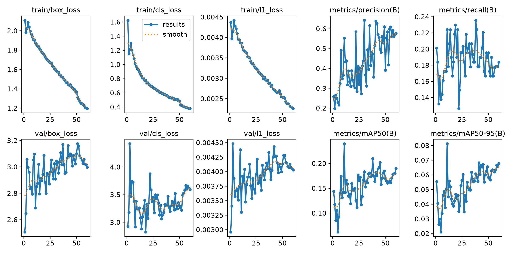
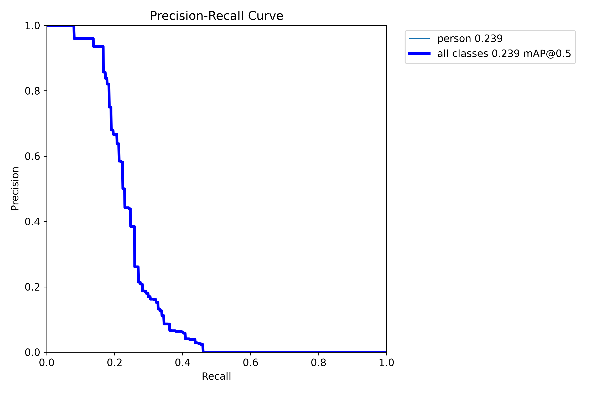
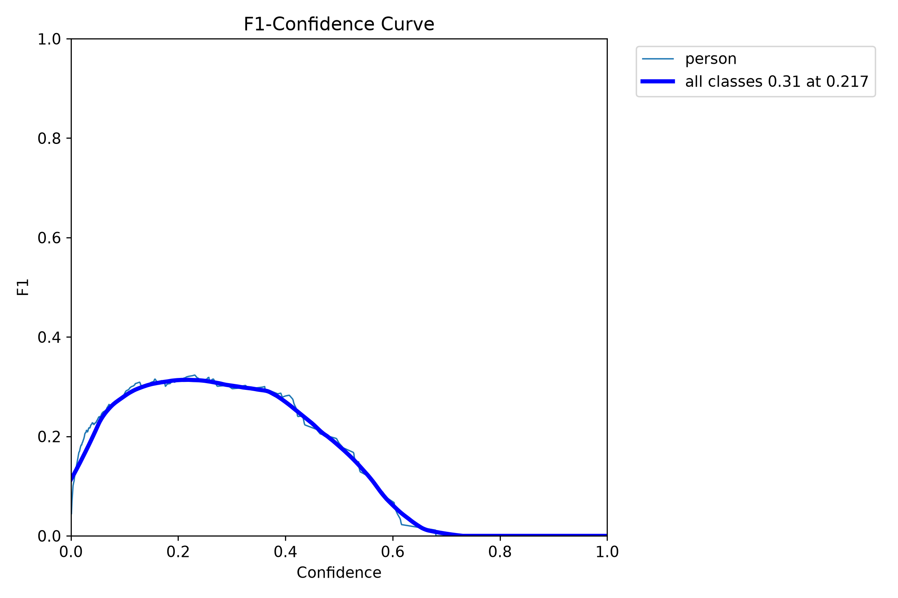
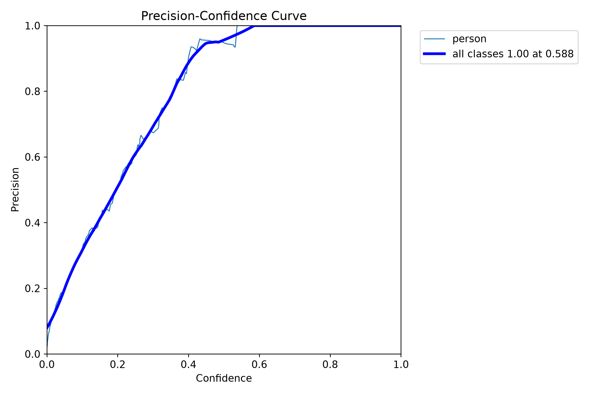
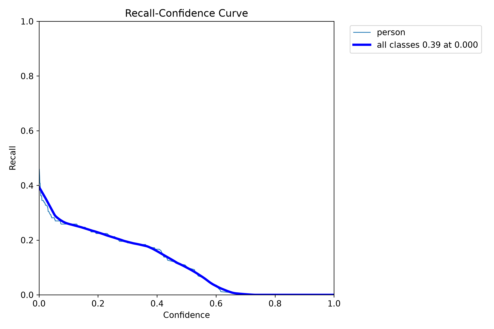
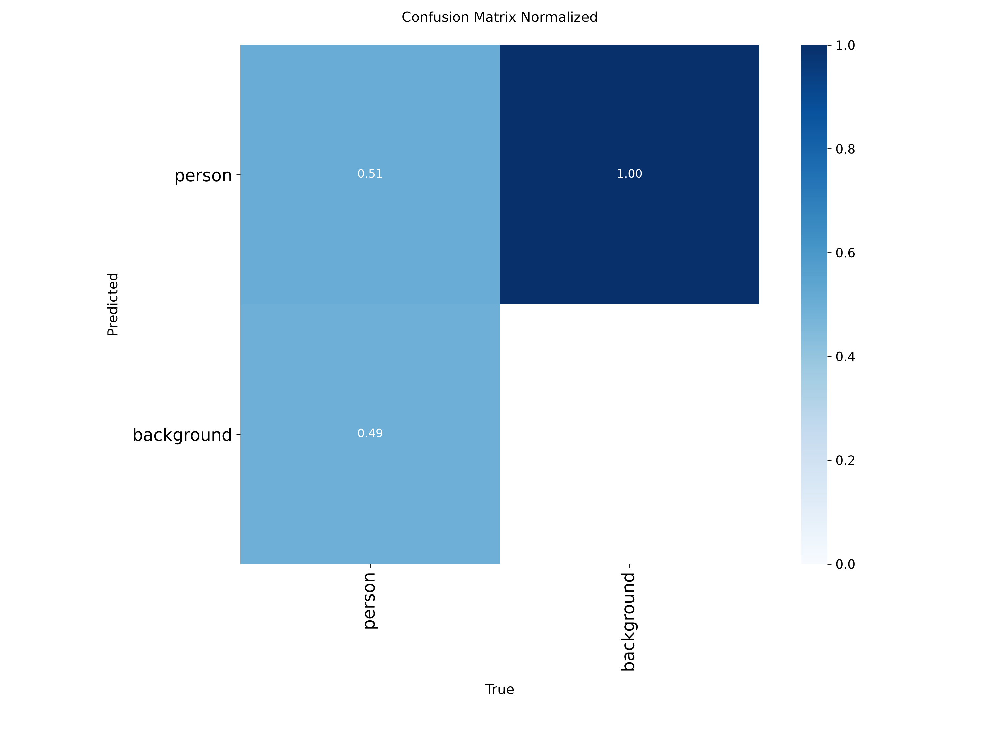
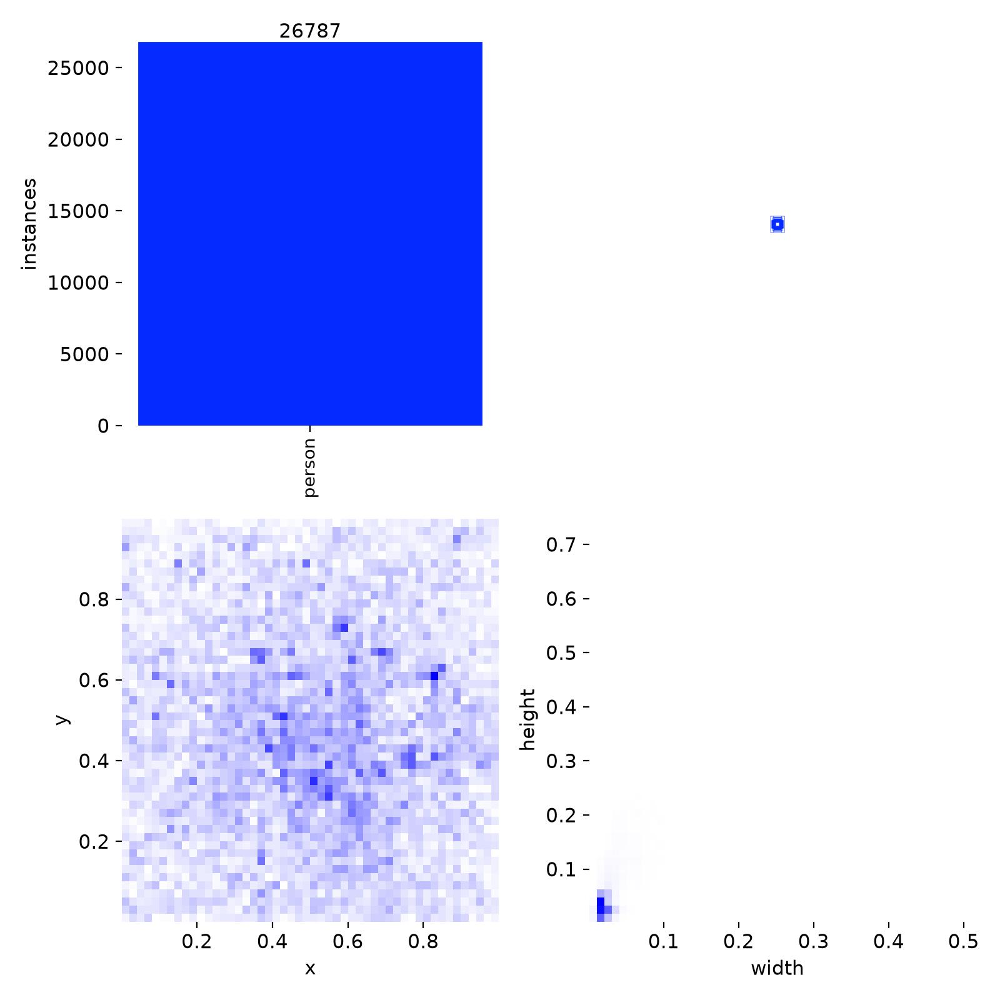
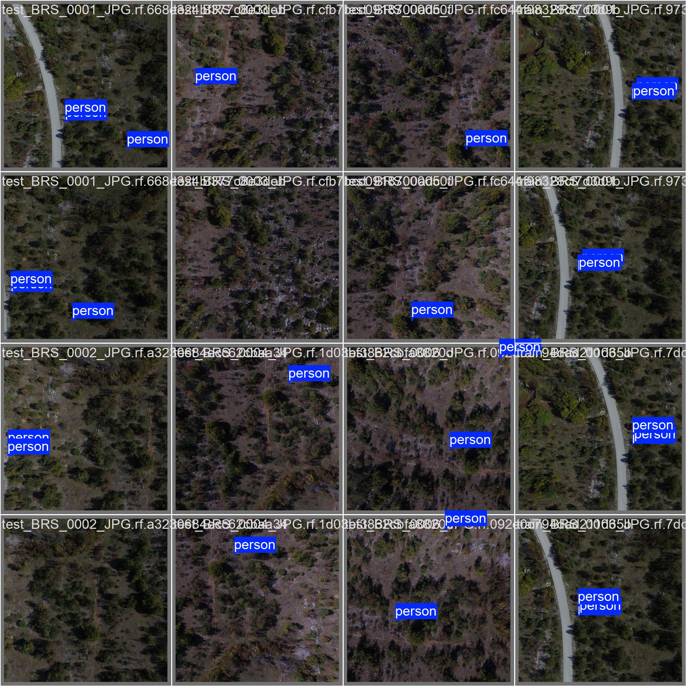
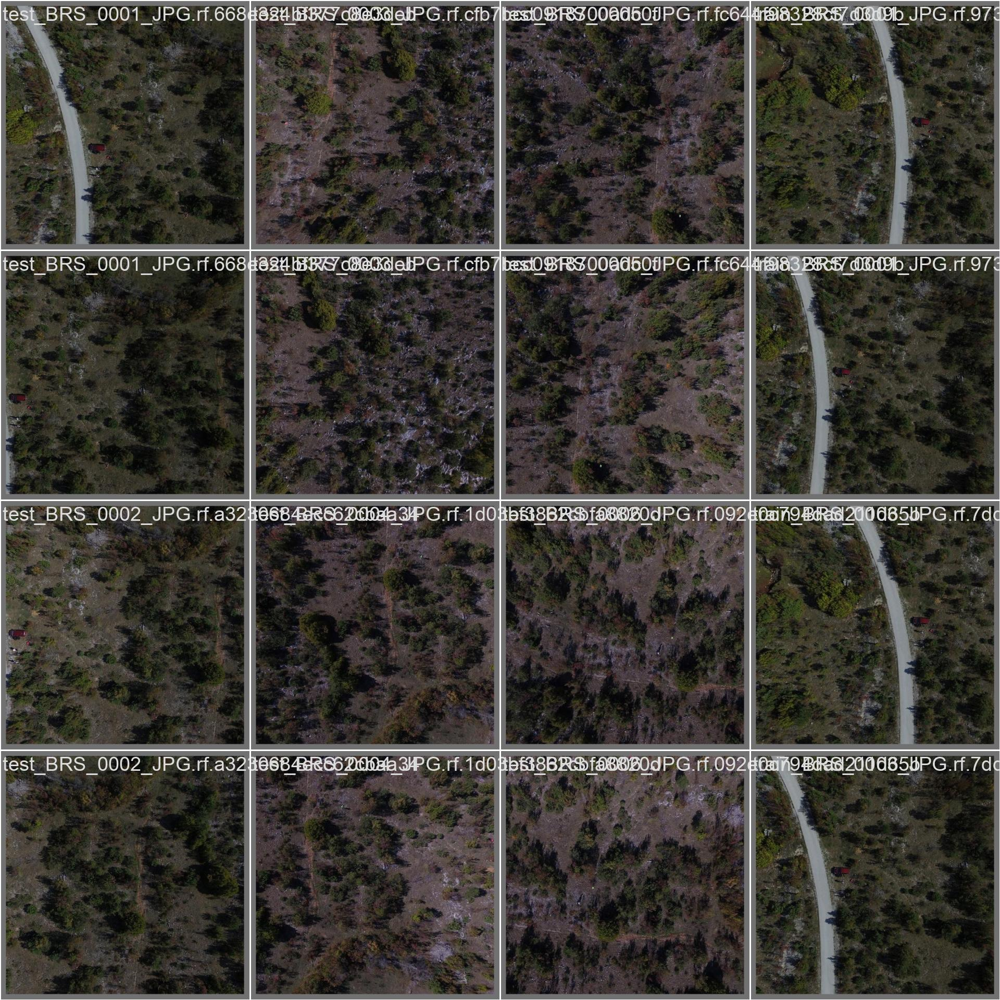

# rgb / yolo26n_e60_heridalx3_valh_s025

Generated by `src/detection/report.py` from the files in this folder. Metric definitions: [research/datasets/README.md](../../../research/datasets/README.md#reading-the-metrics).

## Setup

- Model: `yolo26n.pt`, imgsz 640, batch 32, 60 epochs, seed 0, random rescale ±0.25
- Train: sard, nii-cu-mapd-rgb, heridal ×3
- Val (picks best.pt): heridal

## Training

- Epochs run: 60
- best.pt from epoch: 11 (val AP50 0.240, AP50-95 0.081)
- Highest val AP50: 0.240 at epoch 11
- Last epoch: AP50 0.190, AP50-95 0.068
- Training time: 30 min

Val metrics (combined val set) every few epochs:

|   epoch |   AP50 |   AP50-95 |     P |     R |
|--------:|-------:|----------:|------:|------:|
|       6 |  0.092 |     0.034 | 0.216 | 0.144 |
|      11 |  0.24  |     0.081 | 0.553 | 0.224 |
|      12 |  0.142 |     0.045 | 0.433 | 0.178 |
|      18 |  0.16  |     0.042 | 0.389 | 0.218 |
|      24 |  0.177 |     0.053 | 0.411 | 0.195 |
|      30 |  0.183 |     0.055 | 0.643 | 0.195 |
|      36 |  0.174 |     0.055 | 0.415 | 0.184 |
|      42 |  0.175 |     0.06  | 0.627 | 0.19  |
|      48 |  0.182 |     0.062 | 0.528 | 0.195 |
|      54 |  0.164 |     0.064 | 0.599 | 0.167 |
|      60 |  0.19  |     0.068 | 0.578 | 0.184 |

## Scores (ultralytics, best.pt)

P and R at the confidence with the best F1. `all` is every val set together.

| dataset         | split   |   AP50 |   AP50-95 |     P |     R |
|:----------------|:--------|-------:|----------:|------:|------:|
| all             | val     |  0.242 |     0.081 | 0.577 | 0.224 |
| sard            | val     |  0.832 |     0.44  | 0.875 | 0.745 |
| sard            | test    |  0.833 |     0.429 | 0.867 | 0.751 |
| nii-cu-mapd-rgb | val     |  0.778 |     0.335 | 0.858 | 0.692 |
| heridal         | val     |  0.242 |     0.081 | 0.577 | 0.224 |
| heridal         | test    |  0.136 |     0.042 | 0.335 | 0.179 |

## eval_sizes.py

AP50 by `eval_sizes.py`; P and R at confidence 0.25; recall by person size (√area in px at the model input, or native px when tiled), with the number of persons in brackets.

#### heridal-test-last

As heridal-test, with last.pt (the final epoch) instead of best.pt.

|   imgsz | tiled   |   IoU |   images |   persons |   AP50 |   P@0.25 |   R@0.25 | R 0-8 px   | R 8-12 px   | R 12-16 px   | R 16-24 px   | R 24-32 px   |
|--------:|:--------|------:|---------:|----------:|-------:|---------:|---------:|:-----------|:------------|:-------------|:-------------|:-------------|
|     640 | no      |   0.5 |      303 |       582 |  0.105 |    0.554 |    0.088 | 0.04 (49)  | 0.04 (210)  | 0.08 (195)   | 0.19 (119)   | 0.22 (9)     |
|     640 | 640     |   0.5 |      303 |       582 |  0.122 |    0.576 |    0.143 | 0.18 (49)  | 0.09 (210)  | 0.15 (195)   | 0.20 (119)   | 0.22 (9)     |

#### heridal-test

HERIDAL's held-out locations (MED, BRA, CAP, SB, BLI, CAB), whole 853×640 frames.

|   imgsz | tiled   |   IoU |   images |   persons |   AP50 |   P@0.25 |   R@0.25 | R 0-8 px   | R 8-12 px   | R 12-16 px   | R 16-24 px   | R 24-32 px   |
|--------:|:--------|------:|---------:|----------:|-------:|---------:|---------:|:-----------|:------------|:-------------|:-------------|:-------------|
|     640 | no      |   0.5 |      303 |       582 |  0.135 |    0.548 |    0.108 | 0.00 (49)  | 0.03 (210)  | 0.13 (195)   | 0.24 (119)   | 0.33 (9)     |
|     640 | 640     |   0.5 |      303 |       582 |  0.166 |    0.525 |    0.165 | 0.04 (49)  | 0.14 (210)  | 0.20 (195)   | 0.20 (119)   | 0.22 (9)     |

## Plots

Losses and val metrics per epoch:

Precision against recall on the combined val set:

F1 against confidence threshold:

Precision against confidence threshold:

Recall against confidence threshold:

Confusion matrix (person against background), normalised:

Training labels: box positions and sizes:

Val batch 0, labels:

Val batch 0, predictions:

