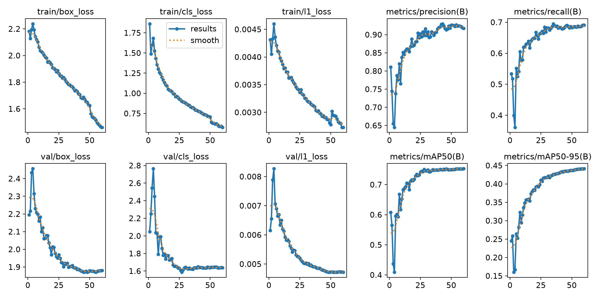
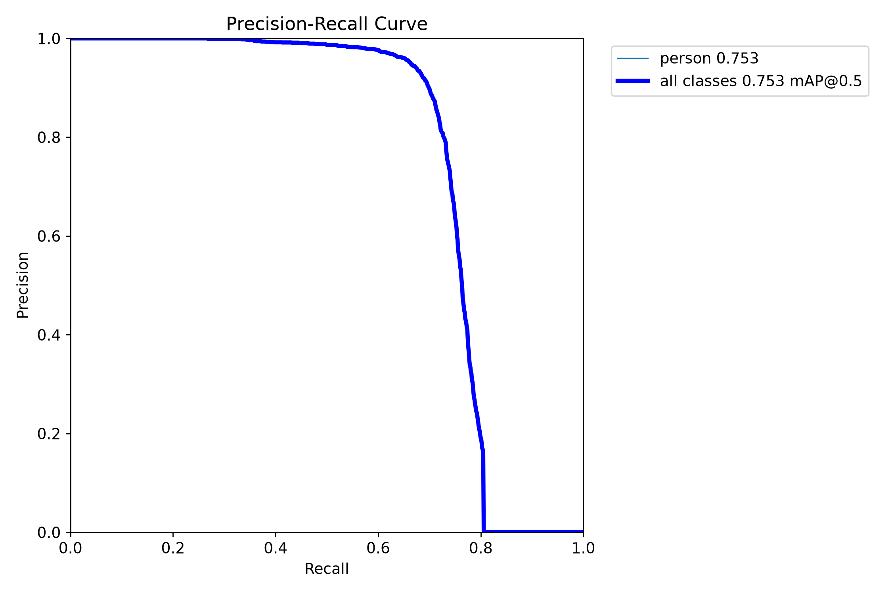
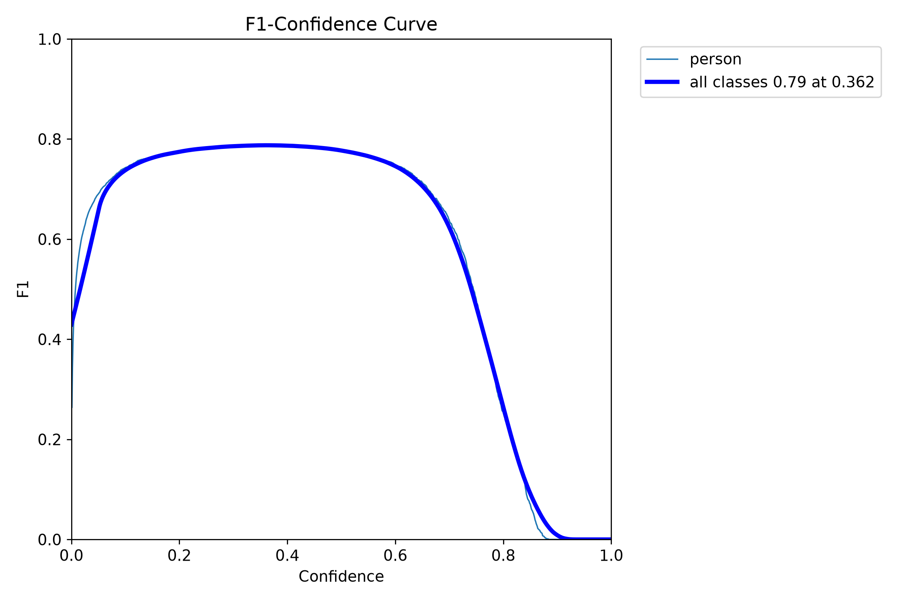
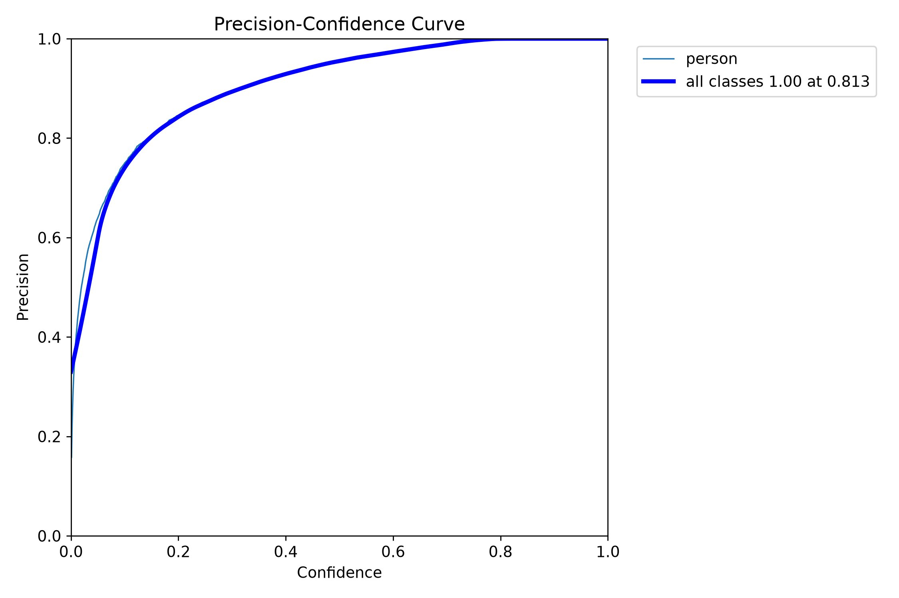
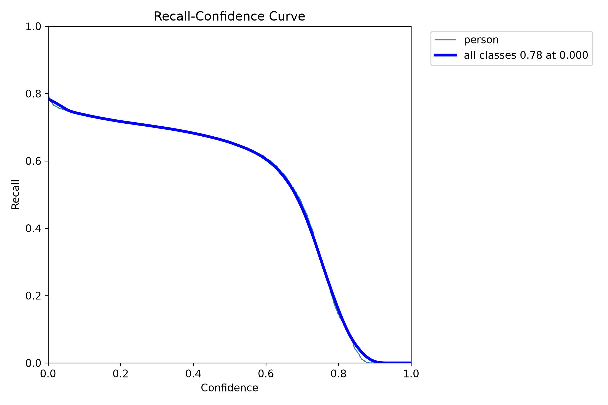
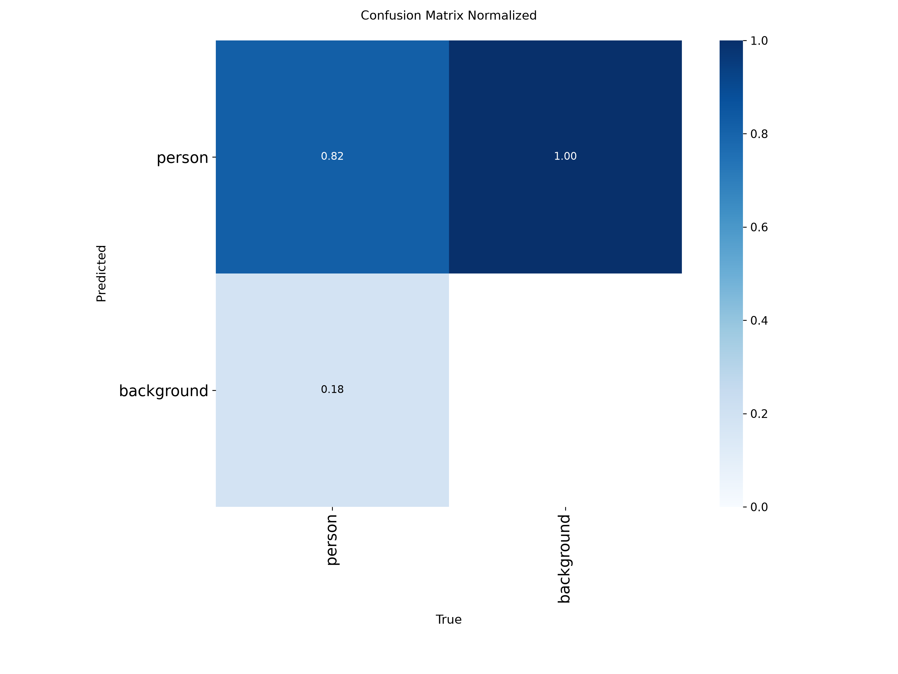
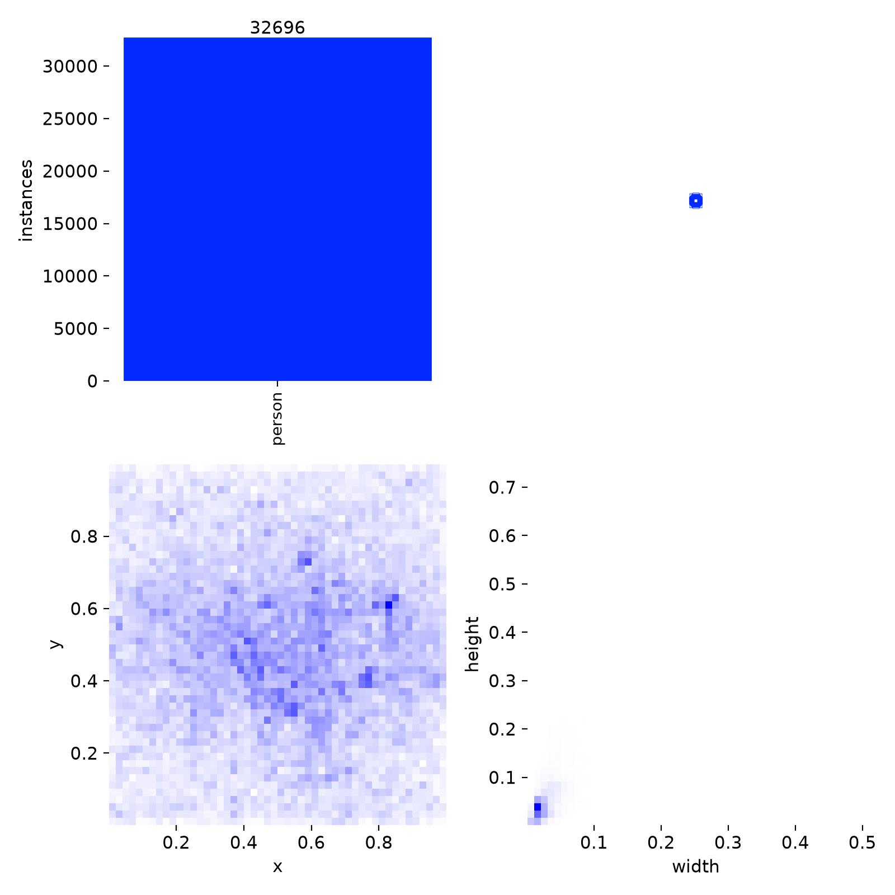
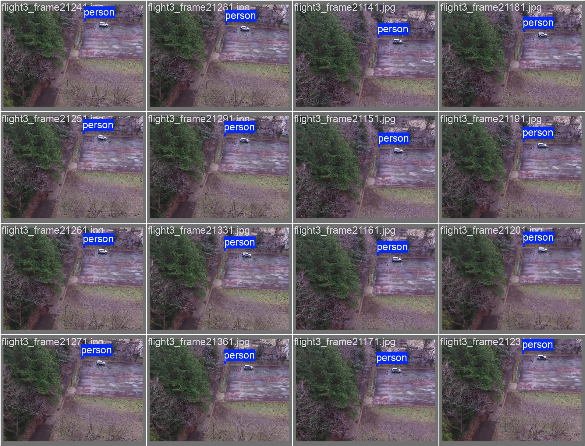
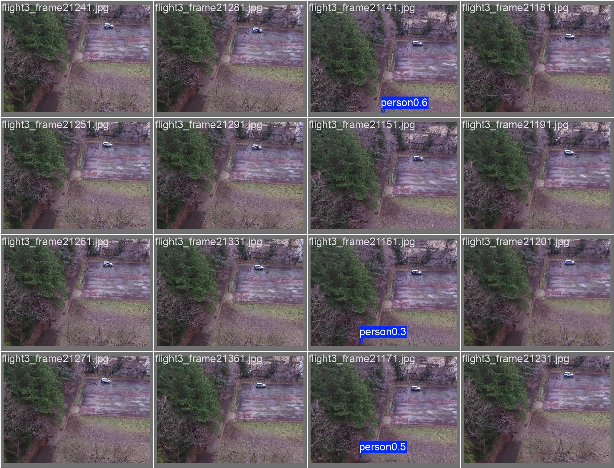

# rgb / yolo26n_e60_nomad

Generated by `src/detection/report.py` from the files in this folder. Metric definitions: [research/datasets/README.md](../../../research/datasets/README.md#reading-the-metrics).

## Setup

- Model: `yolo26n.pt`, imgsz 640, batch 32, 60 epochs, seed 0, random rescale ±0.5
- Train: sard, nii-cu-mapd-rgb, heridal, nomad
- Val (picks best.pt): sard, nii-cu-mapd-rgb, heridal, nomad

## Training

- Epochs run: 60
- best.pt from epoch: 60 (val AP50 0.753, AP50-95 0.441)
- Highest val AP50: 0.753 at epoch 60
- Last epoch: AP50 0.753, AP50-95 0.441
- Training time: 58 min

Val metrics (combined val set) every few epochs:

|   epoch |   AP50 |   AP50-95 |     P |     R |
|--------:|-------:|----------:|------:|------:|
|       6 |  0.601 |     0.252 | 0.787 | 0.525 |
|      12 |  0.687 |     0.349 | 0.845 | 0.621 |
|      18 |  0.716 |     0.38  | 0.888 | 0.646 |
|      24 |  0.733 |     0.398 | 0.891 | 0.663 |
|      30 |  0.746 |     0.418 | 0.898 | 0.682 |
|      36 |  0.748 |     0.426 | 0.898 | 0.689 |
|      42 |  0.75  |     0.433 | 0.928 | 0.679 |
|      48 |  0.749 |     0.436 | 0.924 | 0.682 |
|      54 |  0.752 |     0.44  | 0.927 | 0.685 |
|      60 |  0.753 |     0.441 | 0.917 | 0.691 |

## Scores (ultralytics, best.pt)

P and R at the confidence with the best F1. `all` is every val set together.

| dataset         | split   |   AP50 |   AP50-95 |     P |     R |
|:----------------|:--------|-------:|----------:|------:|------:|
| all             | val     |  0.754 |     0.441 | 0.916 | 0.692 |
| sard            | val     |  0.941 |     0.622 | 0.967 | 0.889 |
| sard            | test    |  0.943 |     0.629 | 0.955 | 0.903 |
| nii-cu-mapd-rgb | val     |  0.856 |     0.415 | 0.946 | 0.788 |
| heridal         | val     |  0.183 |     0.078 | 0.42  | 0.19  |
| heridal         | test    |  0.16  |     0.048 | 0.43  | 0.202 |
| nomad           | val     |  0.404 |     0.201 | 0.685 | 0.384 |
| nomad           | test    |  0.152 |     0.057 | 0.511 | 0.196 |

## eval_sizes.py

AP50 by `eval_sizes.py`; P and R at confidence 0.25; recall by person size (√area in px at the model input, or native px when tiled), with the number of persons in brackets.

#### heridal-test

HERIDAL's held-out locations (MED, BRA, CAP, SB, BLI, CAB), whole 853×640 frames.

|   imgsz | tiled   |   IoU |   images |   persons |   AP50 |   P@0.25 |   R@0.25 | R 0-8 px   | R 8-12 px   | R 12-16 px   | R 16-24 px   | R 24-32 px   |
|--------:|:--------|------:|---------:|----------:|-------:|---------:|---------:|:-----------|:------------|:-------------|:-------------|:-------------|
|     640 | no      |   0.5 |      303 |       582 |  0.168 |    0.547 |    0.131 | 0.02 (49)  | 0.05 (210)  | 0.17 (195)   | 0.24 (119)   | 0.22 (9)     |
|     640 | 640     |   0.5 |      303 |       582 |  0.192 |    0.532 |    0.186 | 0.10 (49)  | 0.12 (210)  | 0.25 (195)   | 0.23 (119)   | 0.33 (9)     |

#### nomad-test

|   imgsz | tiled   |   IoU |   images |   persons |   AP50 |   P@0.25 |   R@0.25 | R 0-8 px   | R 8-12 px   | R 12-16 px   | R 16-24 px   | R 24-32 px   |
|--------:|:--------|------:|---------:|----------:|-------:|---------:|---------:|:-----------|:------------|:-------------|:-------------|:-------------|
|     640 | no      |   0.5 |      860 |       846 |  0.145 |    0.562 |    0.167 | 0.00 (201) | 0.13 (194)  | 0.18 (219)   | 0.32 (228)   | 0.75 (4)     |
|     640 | 640     |   0.5 |      860 |       846 |  0.3   |    0.56  |    0.33  | 0.01 (201) | 0.23 (194)  | 0.43 (219)   | 0.60 (228)   | 0.50 (4)     |

## Plots

Losses and val metrics per epoch:

Precision against recall on the combined val set:

F1 against confidence threshold:

Precision against confidence threshold:

Recall against confidence threshold:

Confusion matrix (person against background), normalised:

Training labels: box positions and sizes:

Val batch 0, labels:

Val batch 0, predictions:

