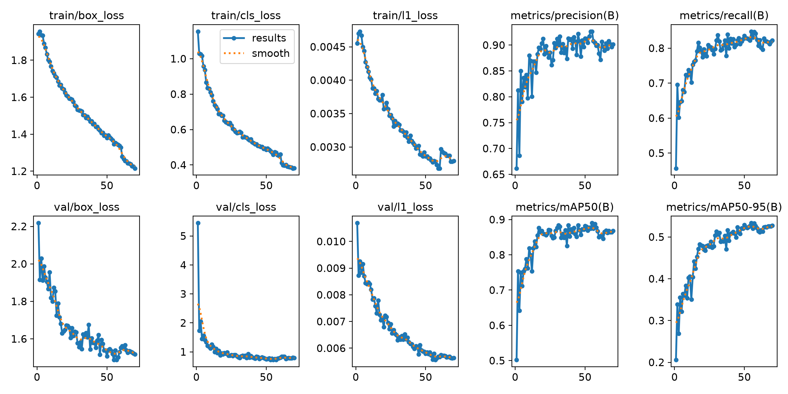
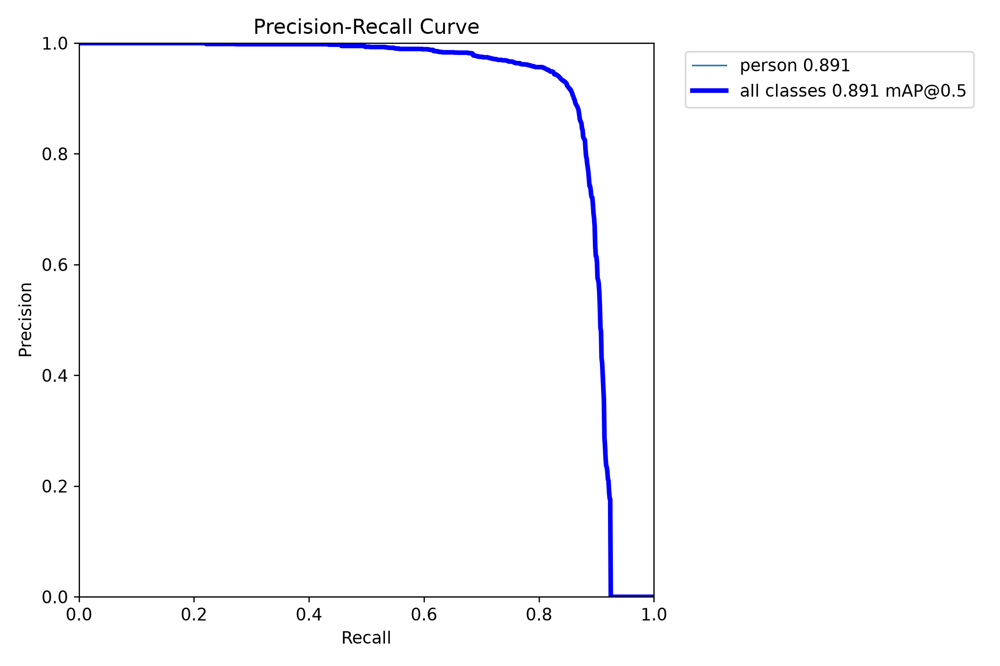
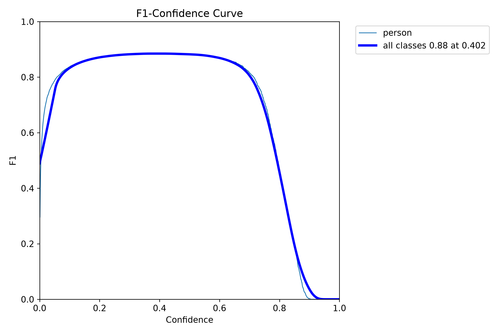
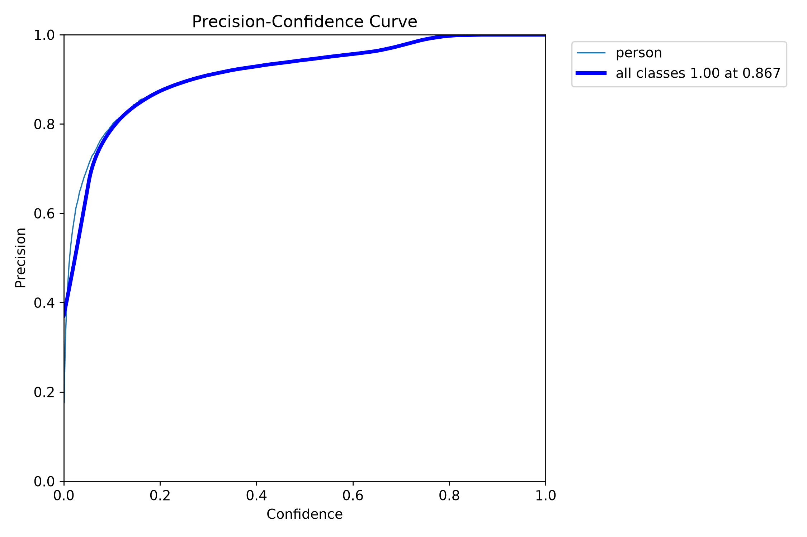
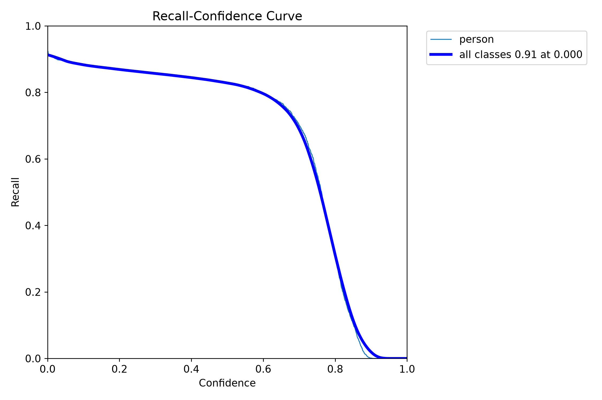
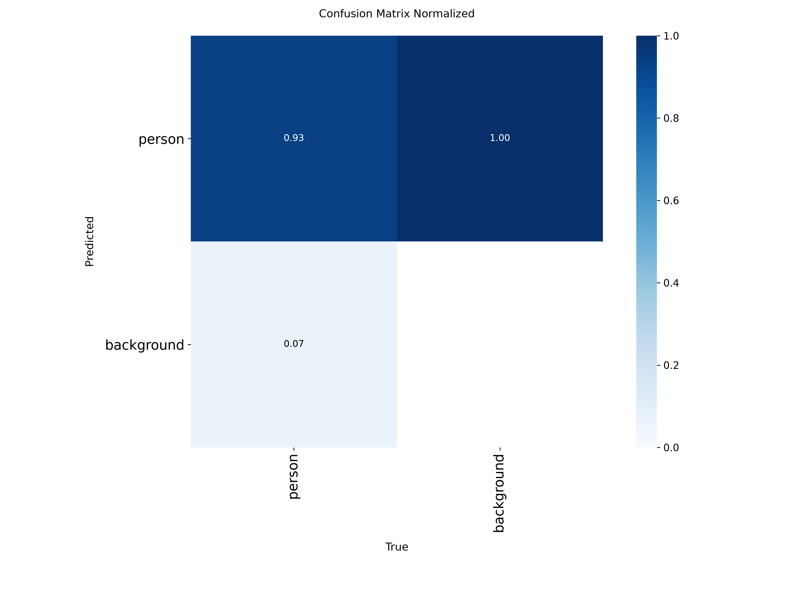
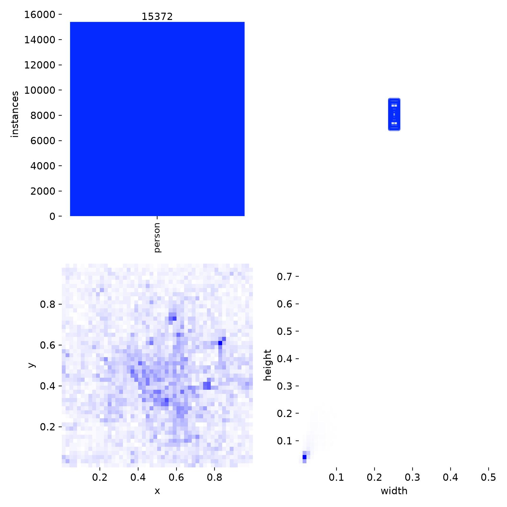
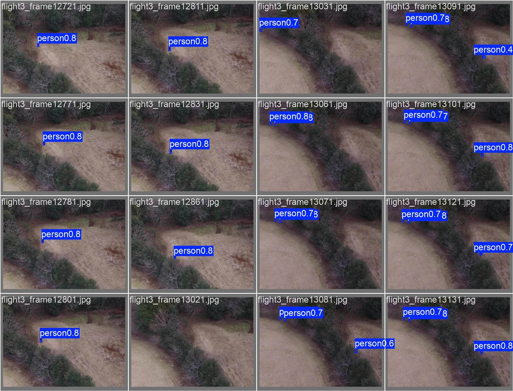

# rgb / yolo26s_e70

Generated by `src/detection/report.py` from the files in this folder. Metric definitions: [research/datasets/README.md](../../../research/datasets/README.md#reading-the-metrics).

## Setup

- Model: `yolo26s.pt`, imgsz 640, batch 32, 70 epochs, seed 0
- Data: sard, nii-cu-mapd-rgb

## Training

- Epochs run: 70
- best.pt from epoch: 55 (val AP50 0.890, AP50-95 0.533)
- Highest val AP50: 0.890 at epoch 55
- Last epoch: AP50 0.868, AP50-95 0.527
- Training time: 29 min

Val metrics (combined val set) every few epochs:

|   epoch |   AP50 |   AP50-95 |     P |     R |
|--------:|-------:|----------:|------:|------:|
|       7 |  0.76  |     0.36  | 0.819 | 0.675 |
|      14 |  0.839 |     0.441 | 0.868 | 0.762 |
|      21 |  0.859 |     0.47  | 0.882 | 0.797 |
|      28 |  0.85  |     0.478 | 0.904 | 0.783 |
|      35 |  0.849 |     0.49  | 0.885 | 0.808 |
|      42 |  0.877 |     0.513 | 0.916 | 0.826 |
|      49 |  0.872 |     0.52  | 0.897 | 0.826 |
|      55 |  0.89  |     0.533 | 0.926 | 0.848 |
|      56 |  0.875 |     0.52  | 0.908 | 0.831 |
|      63 |  0.846 |     0.513 | 0.897 | 0.796 |
|      70 |  0.868 |     0.527 | 0.902 | 0.822 |

## Scores (ultralytics, best.pt)

P and R at the confidence with the best F1. `all` is every val set together.

| dataset         | split   |   AP50 |   AP50-95 |     P |     R |
|:----------------|:--------|-------:|----------:|------:|------:|
| all             | val     |  0.889 |     0.535 | 0.927 | 0.846 |
| sard            | val     |  0.948 |     0.637 | 0.967 | 0.908 |
| sard            | test    |  0.946 |     0.644 | 0.965 | 0.897 |
| nii-cu-mapd-rgb | val     |  0.788 |     0.357 | 0.885 | 0.73  |

## eval_sizes.py

AP50 by `eval_sizes.py`; P and R at confidence 0.25; recall by person size (√area in px at the model input, or native px when tiled), with the number of persons in brackets.

#### heridal-test

HERIDAL's held-out locations (MED, BRA, CAP, SB, BLI, CAB), whole 853×640 frames.

|   imgsz | tiled   |   IoU |   images |   persons |   AP50 |   P@0.25 |   R@0.25 | R 0-8 px   | R 8-12 px   | R 12-16 px   | R 16-24 px   | R 24-32 px   |
|--------:|:--------|------:|---------:|----------:|-------:|---------:|---------:|:-----------|:------------|:-------------|:-------------|:-------------|
|     640 | no      |   0.5 |      303 |       582 |  0.006 |    0.141 |    0.019 | 0.00 (49)  | 0.00 (210)  | 0.01 (195)   | 0.05 (119)   | 0.33 (9)     |
|     640 | 640     |   0.5 |      303 |       582 |  0.009 |    0.097 |    0.026 | 0.00 (49)  | 0.00 (210)  | 0.02 (195)   | 0.07 (119)   | 0.33 (9)     |

#### heridal-v1-roboflow-test

First HERIDAL conversion, before the location split: Roboflow's 101-image test split.

|   imgsz | tiled   |   IoU |   images |   persons |   AP50 |   P@0.25 |   R@0.25 | R 0-8 px   | R 8-12 px   | R 12-16 px   | R 16-24 px   | R 24-32 px   |
|--------:|:--------|------:|---------:|----------:|-------:|---------:|---------:|:-----------|:------------|:-------------|:-------------|:-------------|
|     640 | no      |   0.5 |      101 |       337 |  0.003 |    0.106 |    0.015 | 0.00 (18)  | 0.00 (155)  | 0.02 (116)   | 0.07 (46)    | 0.00 (2)     |
|    1280 | no      |   0.5 |      101 |       337 |  0.003 |    0.092 |    0.018 | 0.00 (18)  | 0.00 (155)  | 0.01 (116)   | 0.11 (46)    | 0.00 (2)     |
|     640 | 640     |   0.5 |      101 |       337 |  0.008 |    0.092 |    0.03  | 0.00 (18)  | 0.00 (155)  | 0.03 (116)   | 0.15 (46)    | 0.00 (2)     |

#### heridal-v1-unique

First HERIDAL conversion, before the location split: one frame per distinct view over all 1,579 frames.

|   imgsz | tiled   |   IoU |   images |   persons |   AP50 |   P@0.25 |   R@0.25 | R 0-8 px   | R 8-12 px   | R 12-16 px   | R 16-24 px   | R 24-32 px   |
|--------:|:--------|------:|---------:|----------:|-------:|---------:|---------:|:-----------|:------------|:-------------|:-------------|:-------------|
|     640 | no      |   0.5 |     1275 |      2462 |  0.008 |    0.164 |    0.019 | 0.00 (118) | 0.00 (796)  | 0.01 (959)   | 0.05 (561)   | 0.32 (28)    |
|    1280 | no      |   0.5 |     1275 |      2462 |  0.006 |    0.132 |    0.019 | 0.00 (118) | 0.00 (796)  | 0.01 (959)   | 0.06 (561)   | 0.18 (28)    |
|     640 | 640     |   0.5 |     1275 |      2462 |  0.012 |    0.13  |    0.029 | 0.00 (118) | 0.00 (796)  | 0.02 (959)   | 0.08 (561)   | 0.39 (28)    |

#### nii-cu-mapd-rgb-val

|   imgsz | tiled   |   IoU |   images |   persons |   AP50 |   P@0.25 |   R@0.25 | R 32-64 px   | R 64-1e+09 px   |
|--------:|:--------|------:|---------:|----------:|-------:|---------:|---------:|:-------------|:----------------|
|     640 | no      |   0.5 |      485 |       891 |  0.802 |    0.831 |    0.771 | 0.84 (424)   | 0.71 (467)      |

#### sard-test

|   imgsz | tiled   |   IoU |   images |   persons |   AP50 |   P@0.25 |   R@0.25 | R 0-8 px   | R 8-12 px   | R 12-16 px   | R 16-24 px   | R 24-32 px   | R 32-64 px   | R 64-1e+09 px   |
|--------:|:--------|------:|---------:|----------:|-------:|---------:|---------:|:-----------|:------------|:-------------|:-------------|:-------------|:-------------|:----------------|
|     640 | no      |   0.5 |      570 |       732 |  0.953 |    0.923 |    0.922 | 0.00 (3)   | 0.00 (1)    | 0.25 (4)     | 0.71 (28)    | 0.79 (80)    | 0.93 (336)   | 0.99 (280)      |

#### sard-val

|   imgsz | tiled   |   IoU |   images |   persons |   AP50 |   P@0.25 |   R@0.25 | R 0-8 px   | R 8-12 px   | R 12-16 px   | R 16-24 px   | R 24-32 px   | R 32-64 px   | R 64-1e+09 px   |
|--------:|:--------|------:|---------:|----------:|-------:|---------:|---------:|:-----------|:------------|:-------------|:-------------|:-------------|:-------------|:----------------|
|     640 | no      |   0.5 |     1144 |      1463 |  0.951 |    0.931 |    0.925 | 0.00 (2)   | 0.00 (5)    | 0.00 (9)     | 0.54 (46)    | 0.85 (146)   | 0.95 (730)   | 0.97 (525)      |

## Plots

Losses and val metrics per epoch:

Precision against recall on the combined val set:

F1 against confidence threshold:

Precision against confidence threshold:

Recall against confidence threshold:

Confusion matrix (person against background), normalised:

Training labels: box positions and sizes:

Val batch 0, labels:

Val batch 0, predictions:

