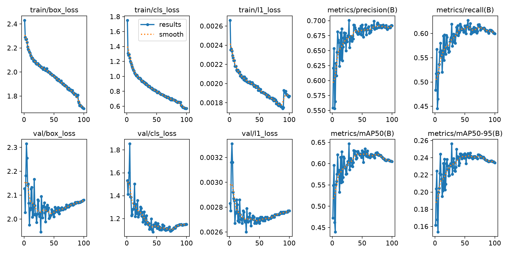
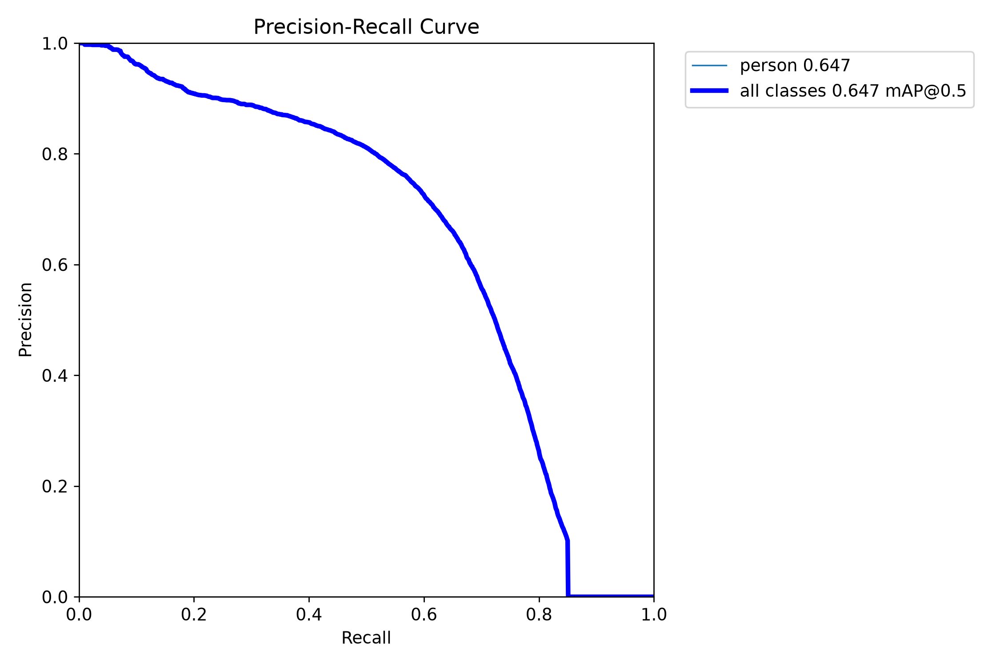
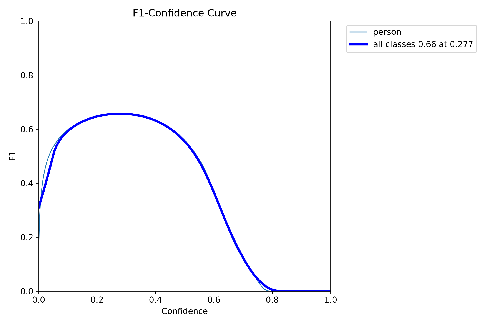
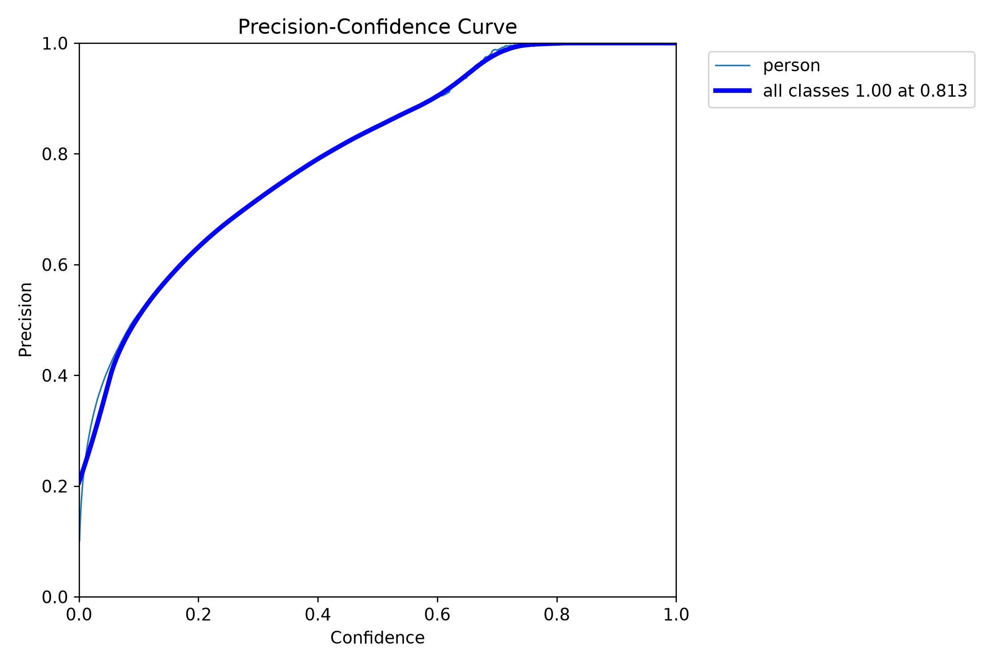
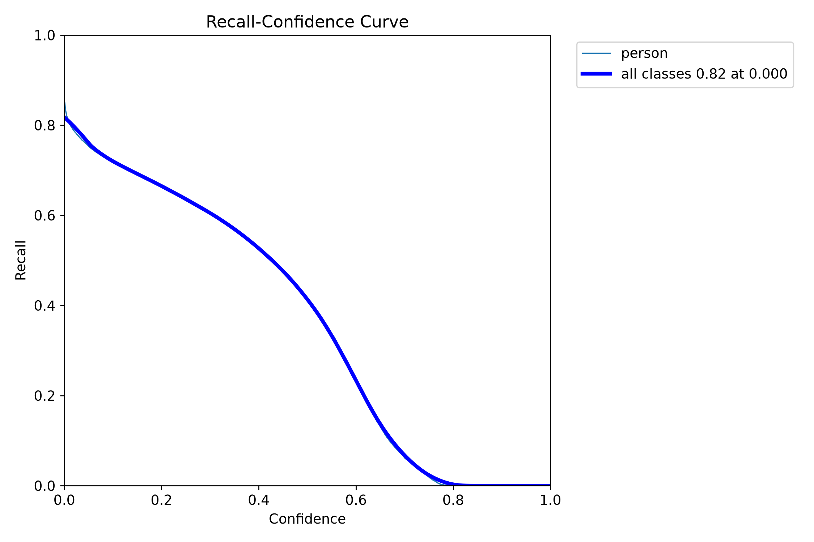
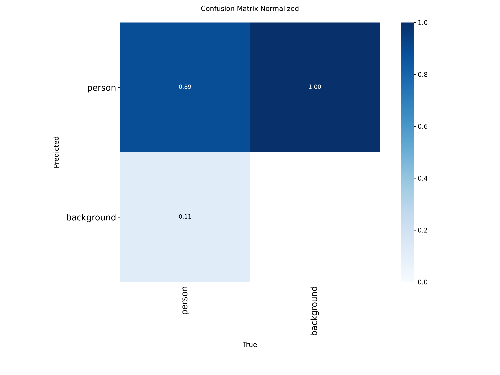
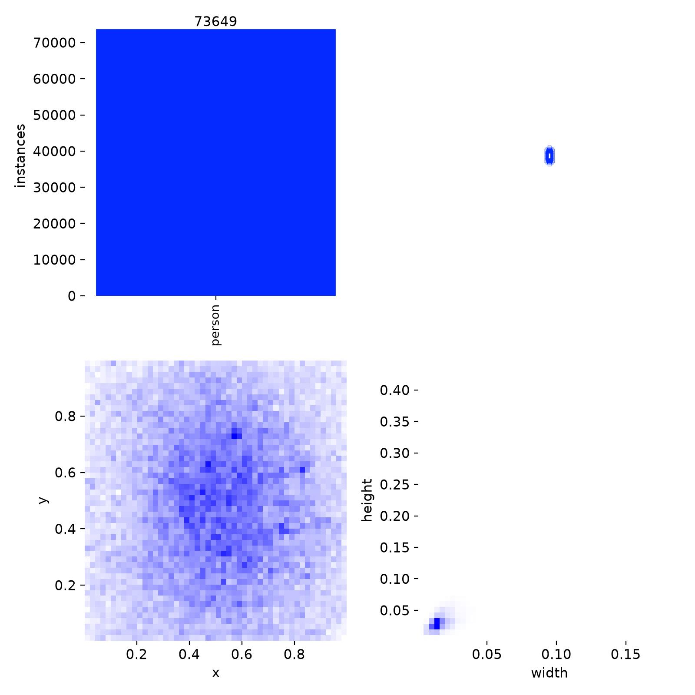
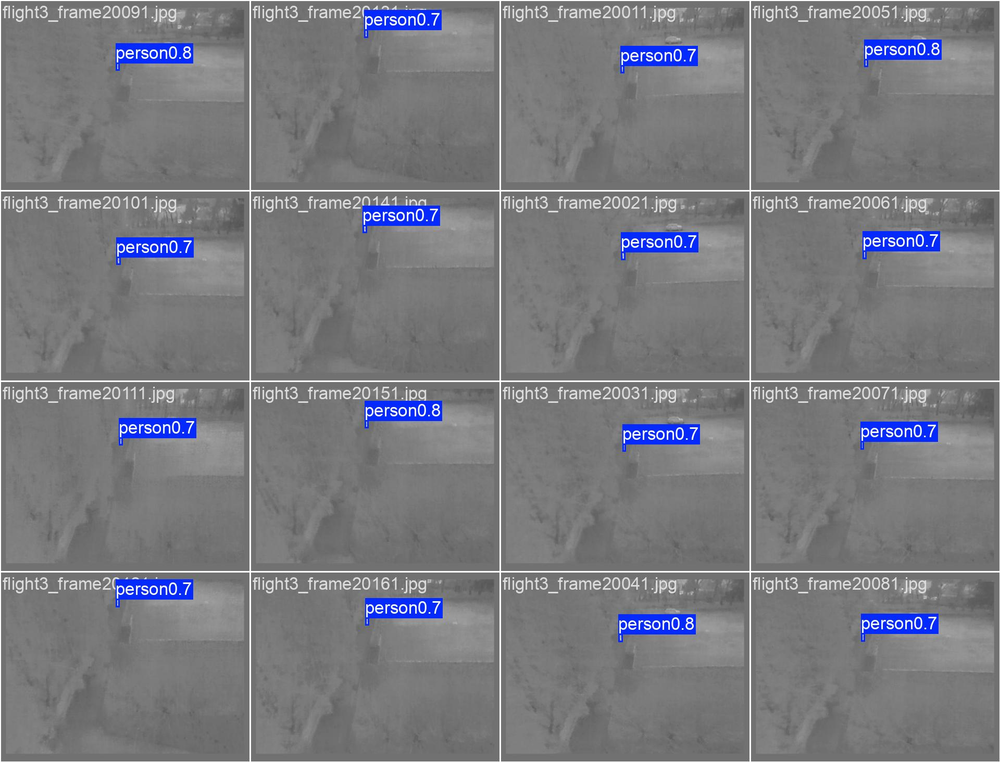

# thermal / yolo26n_e100

Generated by `src/detection/report.py` from the files in this folder. Metric definitions: [research/datasets/README.md](../../../research/datasets/README.md#reading-the-metrics).

## Setup

- Model: `yolo26n.pt`, imgsz 640, batch 32, 100 epochs, seed 0
- Data: rgbtdroneperson-thermal, nii-cu-mapd-thermal, hit-uav

## Training

- Epochs run: 100
- best.pt from epoch: 28 (val AP50 0.647, AP50-95 0.256)
- Highest val AP50: 0.647 at epoch 28
- Last epoch: AP50 0.605, AP50-95 0.234
- Training time: 37 min

Val metrics (combined val set) every few epochs:

|   epoch |   AP50 |   AP50-95 |     P |     R |
|--------:|-------:|----------:|------:|------:|
|      10 |  0.581 |     0.22  | 0.668 | 0.554 |
|      20 |  0.613 |     0.238 | 0.68  | 0.592 |
|      28 |  0.647 |     0.256 | 0.701 | 0.619 |
|      30 |  0.594 |     0.229 | 0.667 | 0.584 |
|      40 |  0.611 |     0.231 | 0.681 | 0.6   |
|      50 |  0.63  |     0.245 | 0.693 | 0.616 |
|      60 |  0.616 |     0.241 | 0.688 | 0.599 |
|      70 |  0.618 |     0.24  | 0.699 | 0.601 |
|      80 |  0.62  |     0.24  | 0.69  | 0.611 |
|      90 |  0.607 |     0.235 | 0.692 | 0.601 |
|     100 |  0.605 |     0.234 | 0.692 | 0.6   |

## Scores (ultralytics, best.pt)

P and R at the confidence with the best F1. `all` is every val set together.

| dataset                 | split   |   AP50 |   AP50-95 |     P |     R |
|:------------------------|:--------|-------:|----------:|------:|------:|
| all                     | val     |  0.65  |     0.257 | 0.703 | 0.623 |
| rgbtdroneperson-thermal | val     |  0.584 |     0.197 | 0.655 | 0.594 |
| nii-cu-mapd-thermal     | val     |  0.986 |     0.631 | 0.98  | 0.957 |
| hit-uav                 | val     |  0.911 |     0.492 | 0.901 | 0.857 |
| hit-uav                 | test    |  0.921 |     0.493 | 0.893 | 0.864 |

## eval_sizes.py

AP50 by `eval_sizes.py`; P and R at confidence 0.25; recall by person size (√area in px at the model input, or native px when tiled), with the number of persons in brackets.

#### hit-uav-test

|   imgsz | tiled   |   IoU |   images |   persons |   AP50 |   P@0.25 |   R@0.25 | R 0-8 px   | R 8-12 px   | R 12-16 px   | R 16-24 px   | R 24-32 px   | R 32-64 px   | R 64-1e+09 px   |
|--------:|:--------|------:|---------:|----------:|-------:|---------:|---------:|:-----------|:------------|:-------------|:-------------|:-------------|:-------------|:----------------|
|     640 | no      |   0.5 |      571 |      2611 |  0.921 |    0.834 |    0.905 | 0.75 (16)  | 0.88 (548)  | 0.91 (1045)  | 0.92 (858)   | 0.90 (136)   | 0.71 (7)     | 0.00 (1)        |

#### hit-uav-val

|   imgsz | tiled   |   IoU |   images |   persons |   AP50 |   P@0.25 |   R@0.25 | R 0-8 px   | R 8-12 px   | R 12-16 px   | R 16-24 px   | R 24-32 px   | R 32-64 px   |
|--------:|:--------|------:|---------:|----------:|-------:|---------:|---------:|:-----------|:------------|:-------------|:-------------|:-------------|:-------------|
|     640 | no      |   0.5 |      287 |      1168 |  0.914 |    0.843 |    0.898 | 0.60 (5)   | 0.84 (230)  | 0.91 (476)   | 0.94 (398)   | 0.84 (57)    | 0.50 (2)     |

#### nii-cu-mapd-thermal-val

|   imgsz | tiled   |   IoU |   images |   persons |   AP50 |   P@0.25 |   R@0.25 | R 8-12 px   | R 12-16 px   | R 16-24 px   | R 24-32 px   |
|--------:|:--------|------:|---------:|----------:|-------:|---------:|---------:|:------------|:-------------|:-------------|:-------------|
|     640 | no      |   0.5 |      485 |       891 |  0.984 |    0.916 |    0.971 | 0.67 (36)   | 0.97 (335)   | 0.99 (413)   | 1.00 (107)   |

#### rgbtdroneperson-thermal-val

|   imgsz | tiled   |   IoU |   images |   persons |   AP50 |   P@0.25 |   R@0.25 | R 0-8 px   | R 8-12 px   | R 12-16 px   | R 16-24 px   | R 24-32 px   | R 32-64 px   |
|--------:|:--------|------:|---------:|----------:|-------:|---------:|---------:|:-----------|:------------|:-------------|:-------------|:-------------|:-------------|
|     640 | no      |   0.5 |     1225 |     14460 |  0.588 |    0.664 |    0.583 | 0.32 (501) | 0.60 (7850) | 0.64 (4581)  | 0.45 (1406)  | 0.39 (88)    | 0.38 (34)    |

## Plots

Losses and val metrics per epoch:

Precision against recall on the combined val set:

F1 against confidence threshold:

Precision against confidence threshold:

Recall against confidence threshold:

Confusion matrix (person against background), normalised:

Training labels: box positions and sizes:

Val batch 0, labels:

Val batch 0, predictions:

