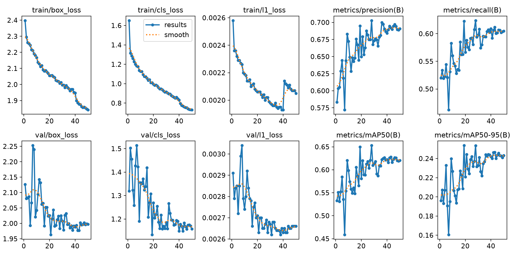
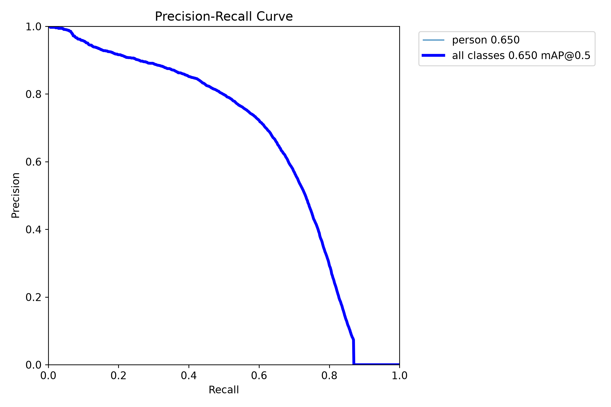
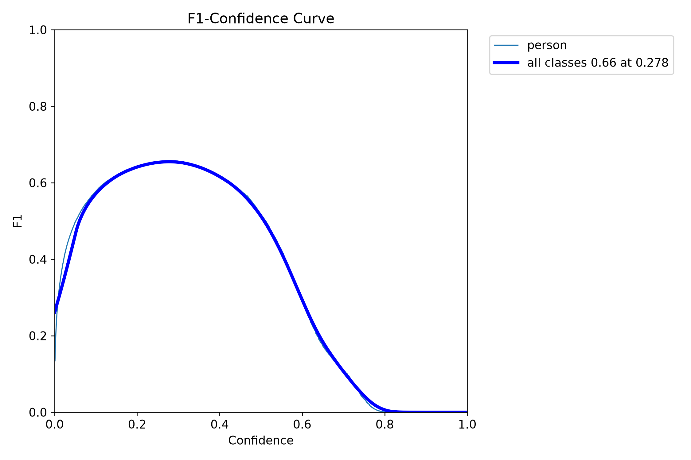
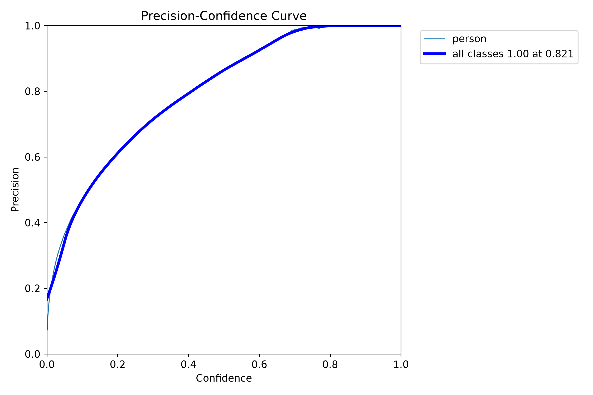
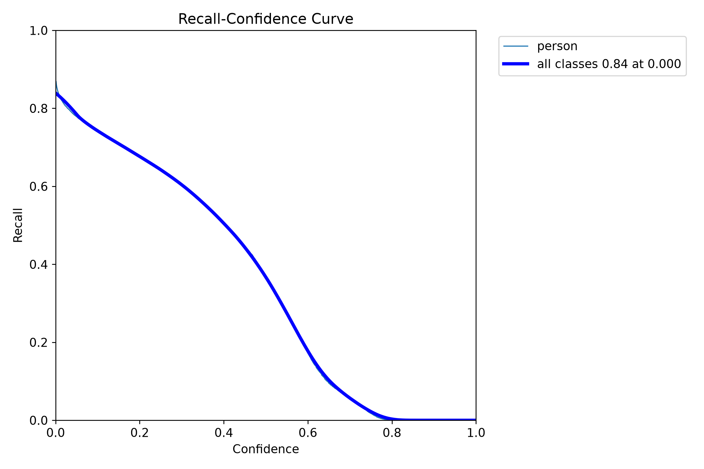
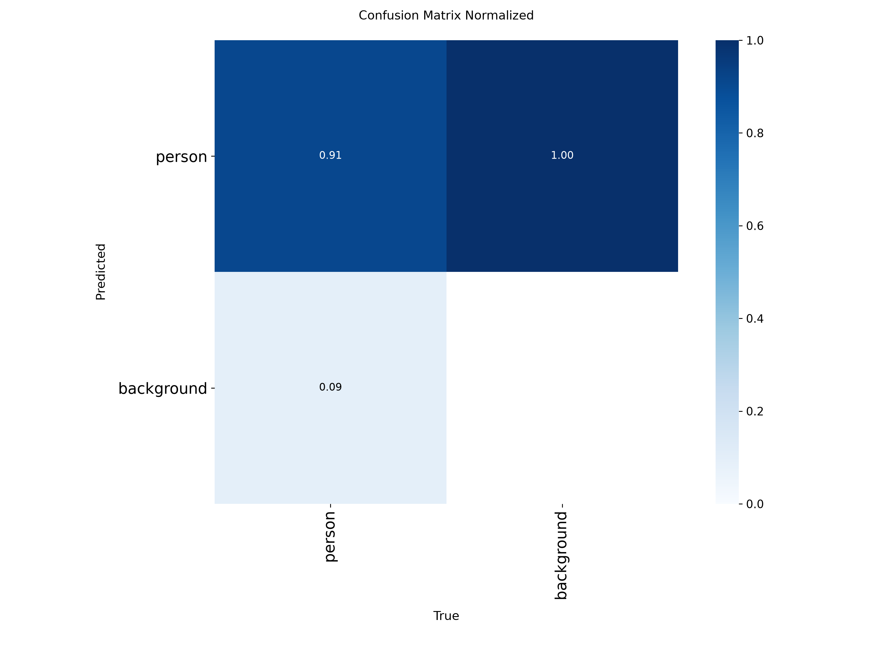
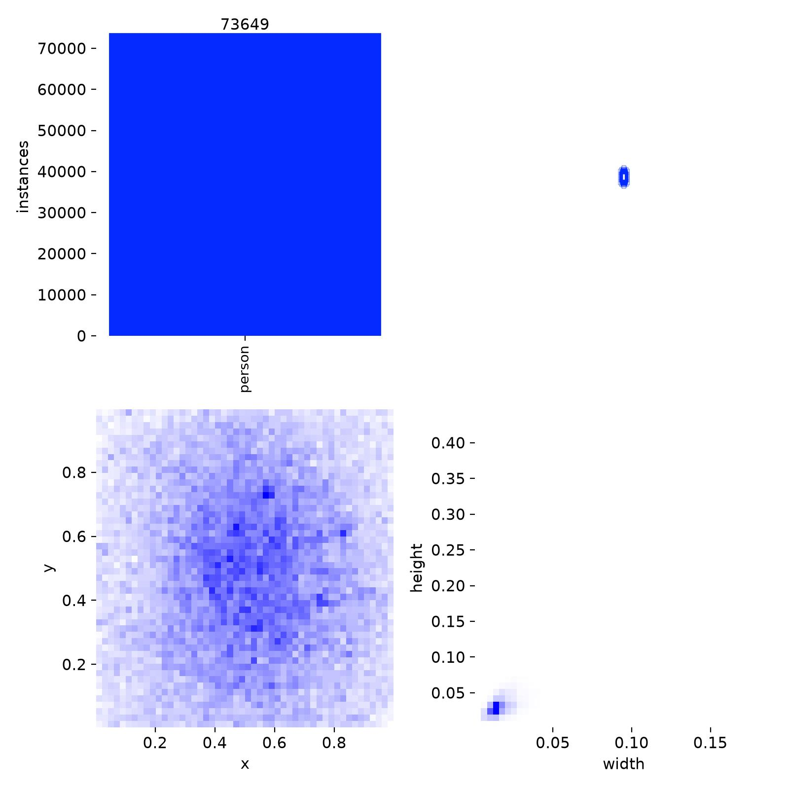
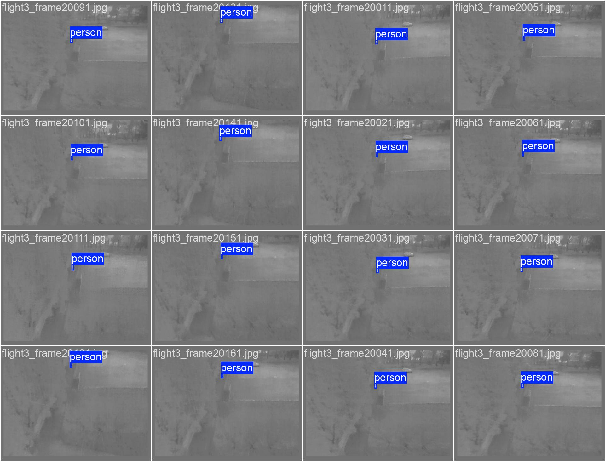
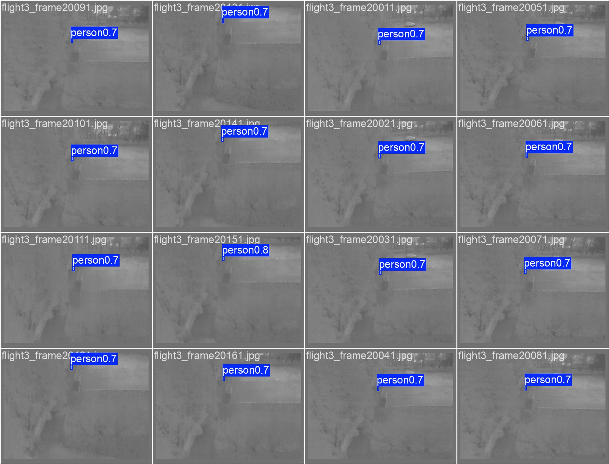

# thermal / yolo26n_e50

Generated by `src/detection/report.py` from the files in this folder. Metric definitions: [research/datasets/README.md](../../../research/datasets/README.md#reading-the-metrics).

## Setup

- Model: `yolo26n.pt`, imgsz 640, batch 32, 50 epochs, seed 0, random rescale ±0.5
- Train: rgbtdroneperson-thermal, nii-cu-mapd-thermal, hit-uav
- Val (picks best.pt): rgbtdroneperson-thermal, nii-cu-mapd-thermal, hit-uav

## Training

- Epochs run: 50
- best.pt from epoch: 28 (val AP50 0.653, AP50-95 0.253)
- Highest val AP50: 0.653 at epoch 28
- Last epoch: AP50 0.620, AP50-95 0.243
- Training time: 17 min

Val metrics (combined val set) every few epochs:

|   epoch |   AP50 |   AP50-95 |     P |     R |
|--------:|-------:|----------:|------:|------:|
|       5 |  0.584 |     0.233 | 0.644 | 0.544 |
|      10 |  0.598 |     0.227 | 0.672 | 0.56  |
|      15 |  0.548 |     0.208 | 0.648 | 0.534 |
|      20 |  0.581 |     0.221 | 0.65  | 0.566 |
|      25 |  0.618 |     0.242 | 0.682 | 0.592 |
|      28 |  0.653 |     0.253 | 0.703 | 0.624 |
|      30 |  0.613 |     0.233 | 0.673 | 0.597 |
|      35 |  0.608 |     0.237 | 0.681 | 0.595 |
|      40 |  0.622 |     0.242 | 0.684 | 0.609 |
|      45 |  0.623 |     0.244 | 0.694 | 0.602 |
|      50 |  0.62  |     0.243 | 0.691 | 0.605 |

## Scores (ultralytics, best.pt)

P and R at the confidence with the best F1. `all` is every val set together.

| dataset                 | split   |   AP50 |   AP50-95 |     P |     R |
|:------------------------|:--------|-------:|----------:|------:|------:|
| all                     | val     |  0.652 |     0.255 | 0.696 | 0.627 |
| rgbtdroneperson-thermal | val     |  0.588 |     0.194 | 0.654 | 0.596 |
| nii-cu-mapd-thermal     | val     |  0.983 |     0.616 | 0.982 | 0.964 |
| hit-uav                 | val     |  0.886 |     0.471 | 0.896 | 0.816 |
| hit-uav                 | test    |  0.896 |     0.475 | 0.861 | 0.849 |

## Plots

Losses and val metrics per epoch:

Precision against recall on the combined val set:

F1 against confidence threshold:

Precision against confidence threshold:

Recall against confidence threshold:

Confusion matrix (person against background), normalised:

Training labels: box positions and sizes:

Val batch 0, labels:

Val batch 0, predictions:

