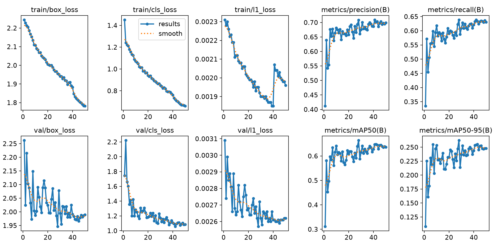
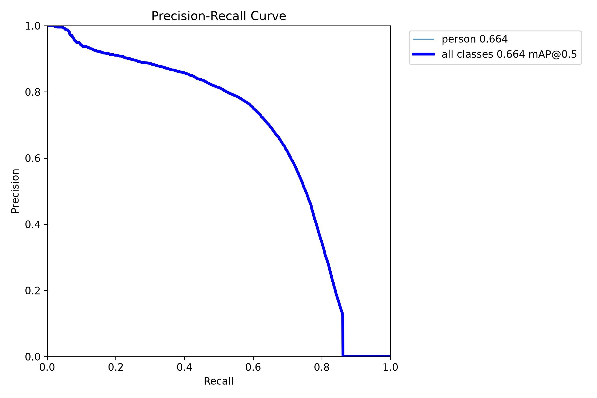
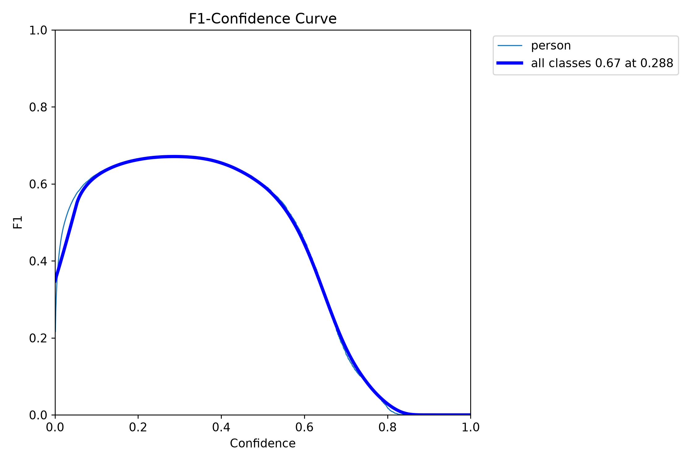
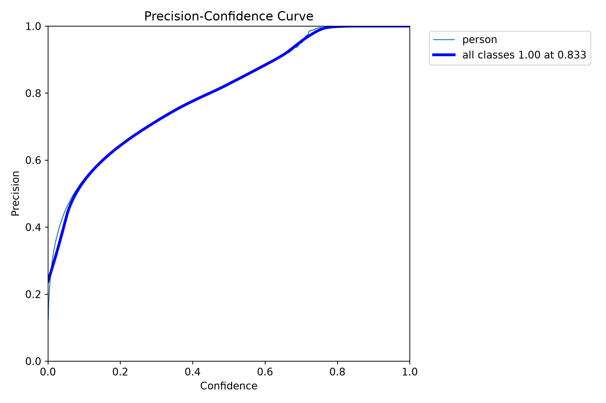
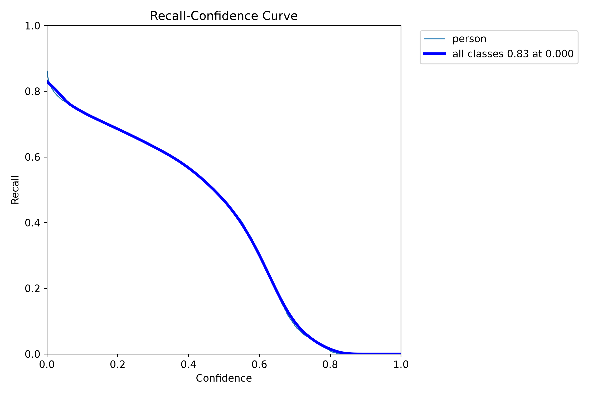
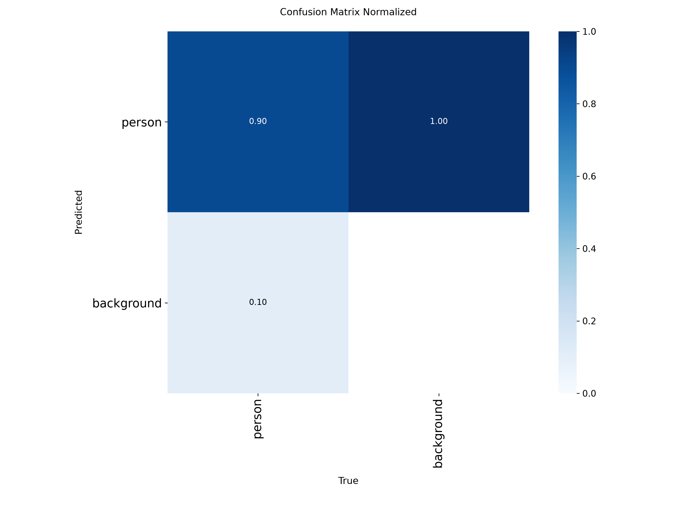
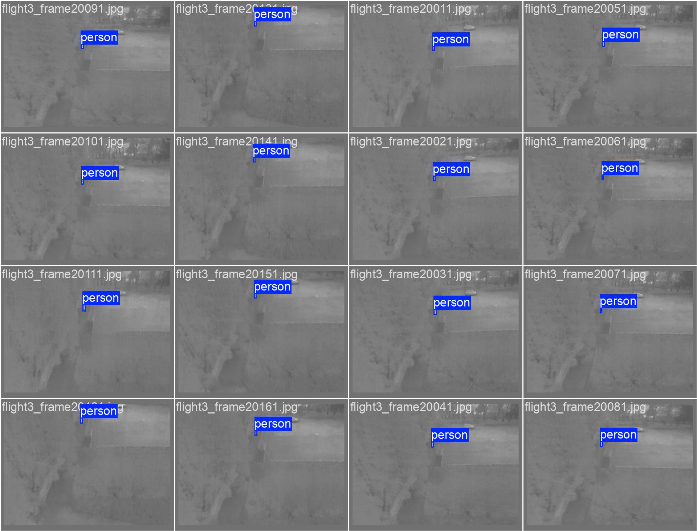
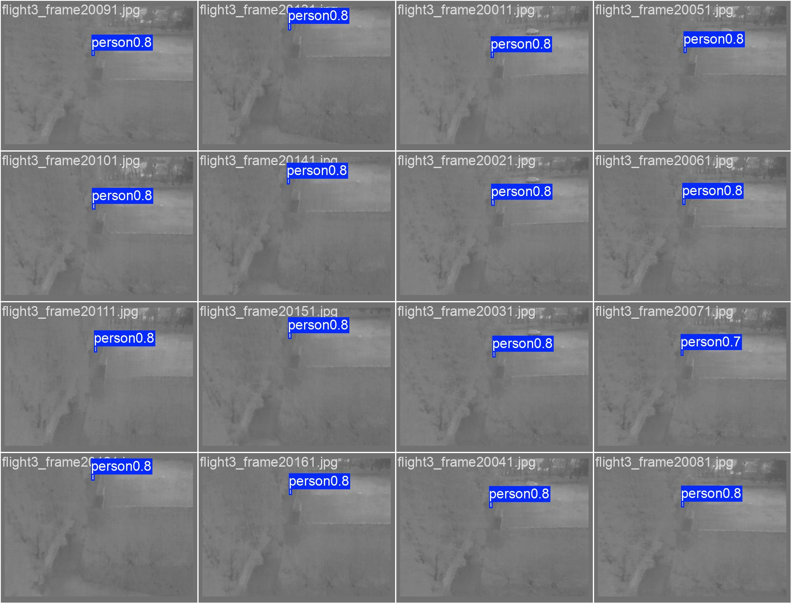

# thermal / yolo26s_e50

Generated by `src/detection/report.py` from the files in this folder. Metric definitions: [research/datasets/README.md](../../../research/datasets/README.md#reading-the-metrics).

## Setup

- Model: `yolo26s.pt`, imgsz 640, batch 32, 50 epochs, seed 0
- Data: rgbtdroneperson-thermal, nii-cu-mapd-thermal, hit-uav

## Training

- Epochs run: 50
- best.pt from epoch: 28 (val AP50 0.664, AP50-95 0.262)
- Highest val AP50: 0.664 at epoch 28
- Last epoch: AP50 0.636, AP50-95 0.248
- Training time: 27 min

Val metrics (combined val set) every few epochs:

|   epoch |   AP50 |   AP50-95 |     P |     R |
|--------:|-------:|----------:|------:|------:|
|       5 |  0.598 |     0.231 | 0.676 | 0.555 |
|      10 |  0.641 |     0.253 | 0.681 | 0.618 |
|      15 |  0.618 |     0.239 | 0.669 | 0.592 |
|      20 |  0.609 |     0.232 | 0.658 | 0.59  |
|      25 |  0.613 |     0.238 | 0.687 | 0.595 |
|      28 |  0.664 |     0.262 | 0.708 | 0.639 |
|      30 |  0.615 |     0.237 | 0.676 | 0.61  |
|      35 |  0.611 |     0.236 | 0.674 | 0.605 |
|      40 |  0.628 |     0.244 | 0.686 | 0.621 |
|      45 |  0.644 |     0.252 | 0.697 | 0.632 |
|      50 |  0.636 |     0.248 | 0.699 | 0.63  |

## Scores (ultralytics, best.pt)

P and R at the confidence with the best F1. `all` is every val set together.

| dataset                 | split   |   AP50 |   AP50-95 |     P |     R |
|:------------------------|:--------|-------:|----------:|------:|------:|
| all                     | val     |  0.666 |     0.262 | 0.704 | 0.644 |
| rgbtdroneperson-thermal | val     |  0.602 |     0.205 | 0.66  | 0.616 |
| nii-cu-mapd-thermal     | val     |  0.977 |     0.594 | 0.97  | 0.939 |
| hit-uav                 | val     |  0.914 |     0.501 | 0.902 | 0.863 |
| hit-uav                 | test    |  0.934 |     0.509 | 0.884 | 0.884 |

## eval_sizes.py

AP50 by `eval_sizes.py`; P and R at confidence 0.25; recall by person size (√area in px at the model input, or native px when tiled), with the number of persons in brackets.

#### hit-uav-test

|   imgsz | tiled   |   IoU |   images |   persons |   AP50 |   P@0.25 |   R@0.25 | R 0-8 px   | R 8-12 px   | R 12-16 px   | R 16-24 px   | R 24-32 px   | R 32-64 px   | R 64-1e+09 px   |
|--------:|:--------|------:|---------:|----------:|-------:|---------:|---------:|:-----------|:------------|:-------------|:-------------|:-------------|:-------------|:----------------|
|     640 | no      |   0.5 |      571 |      2611 |  0.919 |     0.84 |    0.905 | 0.75 (16)  | 0.86 (548)  | 0.90 (1045)  | 0.94 (858)   | 0.94 (136)   | 0.71 (7)     | 0.00 (1)        |

#### hit-uav-val

|   imgsz | tiled   |   IoU |   images |   persons |   AP50 |   P@0.25 |   R@0.25 | R 0-8 px   | R 8-12 px   | R 12-16 px   | R 16-24 px   | R 24-32 px   | R 32-64 px   |
|--------:|:--------|------:|---------:|----------:|-------:|---------:|---------:|:-----------|:------------|:-------------|:-------------|:-------------|:-------------|
|     640 | no      |   0.5 |      287 |      1168 |  0.897 |    0.852 |    0.879 | 0.40 (5)   | 0.81 (230)  | 0.89 (476)   | 0.93 (398)   | 0.82 (57)    | 0.50 (2)     |

#### nii-cu-mapd-thermal-val

|   imgsz | tiled   |   IoU |   images |   persons |   AP50 |   P@0.25 |   R@0.25 | R 8-12 px   | R 12-16 px   | R 16-24 px   | R 24-32 px   |
|--------:|:--------|------:|---------:|----------:|-------:|---------:|---------:|:------------|:-------------|:-------------|:-------------|
|     640 | no      |   0.5 |      485 |       891 |  0.974 |    0.928 |    0.962 | 0.58 (36)   | 0.97 (335)   | 0.98 (413)   | 1.00 (107)   |

#### rgbtdroneperson-thermal-val

|   imgsz | tiled   |   IoU |   images |   persons |   AP50 |   P@0.25 |   R@0.25 | R 0-8 px   | R 8-12 px   | R 12-16 px   | R 16-24 px   | R 24-32 px   | R 32-64 px   |
|--------:|:--------|------:|---------:|----------:|-------:|---------:|---------:|:-----------|:------------|:-------------|:-------------|:-------------|:-------------|
|     640 | no      |   0.5 |     1225 |     14460 |  0.603 |    0.656 |    0.616 | 0.37 (501) | 0.65 (7850) | 0.65 (4581)  | 0.44 (1406)  | 0.39 (88)    | 0.56 (34)    |

## Plots

Losses and val metrics per epoch:

Precision against recall on the combined val set:

F1 against confidence threshold:

Precision against confidence threshold:

Recall against confidence threshold:

Confusion matrix (person against background), normalised:

Training labels: box positions and sizes:

Val batch 0, labels:

Val batch 0, predictions:

