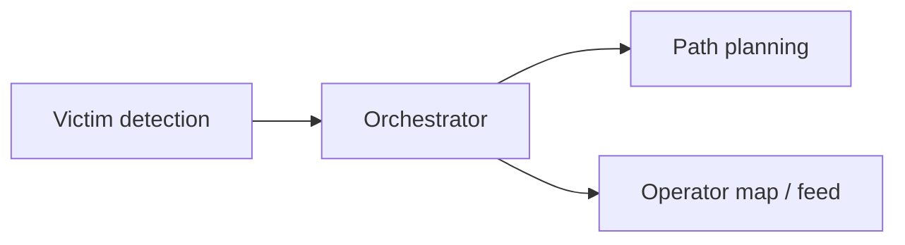

# Station

> **Status:** Draft · **Updated:** 2026-10-18

## Purpose

The laptop on the vehicle. It is the **orchestrator** and the **only compute node**.

## Responsibilities

- [ ] Receive drone video and images
- [ ] Detect and tag victims
- [ ] Plan the robot's path
- [ ] Orchestrate the mission
- [ ] Present the operator map and feed

## Interfaces

Rates, message formats and the link budget: [research/communication/](../research/communication/).

## Constraints

Laptop compute budget, latency, and WiFi bandwidth: TBD.

## Contents

Code lives in [src/detection/](../src/detection/); the dataset evidence behind it is in
[research/datasets/](../research/datasets/).

| File | Description |
| --- | --- |
| [detection-data-analysis.md](../research/datasets/detection-data-analysis.md) | Person sizes vs model input size per dataset |
| [dataset-profiles.md](../research/datasets/dataset-profiles.md) | Per-dataset profile: size, backgrounds, persons per image, pixels per person, contrast, sharpness, crowding |
| [dataset-suitability.md](../research/datasets/dataset-suitability.md) | Full dataset audit: quality, density, coverage, leakage, downscaling, RGB + IR fusion, model options, data plan |