# Анализ данных для детекции

> **Статус:** черновик · **Обновлено:** 2026-10-18

В этом документе собраны все свидетельства о детекторе пострадавших для станции: как выглядят люди в каждом скачанном датасете, сколько их на изображении, качество изображений, полнота метаданных, утечки между выборками, до какого размера можно уменьшать изображения и как соотносятся RGB и инфракрасный (ИК) каналы.

Вывод и рекомендации, построенные на этих данных, приведены в [dataset-suitability.md](dataset-suitability.md).

Для этого анализа ни одна модель не обучалась. Результаты детекции получены только инференсом на уже имеющихся весах:
- `best.pt`: YOLO11n, ранее обученная на HIT-UAV, 14 из 50 запланированных эпох.
- `yolo11n.pt`: предобученная на COCO, только класс «человек».

**Содержание**

1. [Данные и метод](#1-данные-и-метод)
2. [Обзор по датасетам](#2-обзор-по-датасетам)
3. [HIT-UAV (тепловизор)](#3-hit-uav-тепловизор)
4. [C2A (RGB, синтетические катастрофы)](#4-c2a-rgb-синтетические-катастрофы)
5. [Образец WiSARD (реальный поиск и спасение, RGB + ИК)](#5-образец-wisard-реальный-поиск-и-спасение-rgb--ик)
6. [Сравнение датасетов](#6-сравнение-датасетов)
7. [Детекция в зависимости от размера человека и размера входа](#7-детекция-в-зависимости-от-размера-человека-и-размера-входа)
8. [Что это значит для нашего дрона](#8-что-это-значит-для-нашего-дрона)
9. [Воспроизведение](#9-воспроизведение)

## 1. Данные и метод

| Датасет | Модальность | Источник | Роль здесь | Лицензия |
| --- | --- | --- | --- | --- |
| HIT-UAV v1.2.1 | Тепловизор, 640×512 | Реальные данные; кампус и дороги; 60–130 м | Кандидат для обучения на тепловизоре | CC0 |
| C2A | RGB, разные размеры | Синтетика: люди вставлены в реальные фото катастроф AIDER | Кандидат для обучения на RGB | неясна |
| Образец WiSARD | RGB 3840×2160 + тепловизор 640×512 | Реальный поиск и спасение; один полёт, Mt Erie, 2021-04-17 | Только оценка | разрешающее уведомление |

**Подготовка** (`src/detection/prepare.py`):
- Каждый датасет приводится к единственному классу `person`.
- Изображения без людей сохраняются как негативные примеры.
- Категории HIT-UAV Car, Bicycle, OtherVehicle и DontCare отбрасываются.
- Разметка поз C2A читается отдельно из `All labels with Pose information/`.

**Скрипты**

| Скрипт | Что измеряет |
| --- | --- |
| `src/detection/analyze.py` | Размер человека относительно размера входа модели (`imgsz`) по каждому датасету |
| `src/detection/audit.py` | Плотность, размер, форму, скученность, положение, контраст, качество изображений, метаданные, почти-дубликаты, сопоставление RGB↔ИК и все графики ниже |
| `src/detection/eval_sizes.py` | AP50 и recall только по инференсу для каждого размера человека, при разных `imgsz` и с тайлингом |

**Определения**

| Термин | Значение |
| --- | --- |
| Размер человека | √(ширина бокса × высота бокса) в исходных пикселях |
| Малый / крошечный | Менее 8 px: ниже этого детекторы в основном промахиваются |
| Контраст | (средняя яркость внутри бокса − средняя яркость кольца шириной в размер бокса вокруг него) ÷ стандартное отклонение яркости изображения. \|значение\| < 0,5 = низкий контраст. Сильный признак для тепловизора; для RGB лишь приближение, так как людей отличает и цвет |
| Резкость | Дисперсия лапласиана после приведения длинной стороны к 640 px, чтобы датасеты были сопоставимы |
| Скученность | Расстояние от центра человека до центра ближайшего другого человека в единицах размера этого человека |
| Почти-дубликат | 64-битный разностный хэш (dHash), отличающийся не более чем на 4 бита от какого-либо train-изображения |
| AP50 / recall | Жадное сопоставление при IoU ≥ 0,5; recall при уверенности 0,25 |

**Графики:** каждый датасет везде имеет свой цвет: HIT-UAV синий, C2A оранжевый, WiSARD ИК бирюзовый, WiSARD RGB жёлтый. Рамки разметки на изображениях нарисованы жёлтым.

**Вычисления:** Apple M4 (MPS), nice 10, 3 потока CPU.

## 2. Обзор по датасетам

| | HIT-UAV | C2A | WiSARD ИК | WiSARD RGB |
| --- | --- | --- | --- | --- |
| Изображений (train / val / test) | 2 029 / 290 / 579 | 6 129 / 2 043 / 2 043 | 264 | 264 |
| Людей | 12 312 | 360 467 | 1 006 | 1 022 |
| Разрешение | 640×512 | 152–4000+ px, медиана длинной стороны 428 | 640×512 | 3840×2160 |
| Изображений без людей | 41,6% | 0% | 1,1% | 1,1% |
| Людей на изображение: среднее / медиана / макс. | 4,25 / 2 / 33 | 35,3 / 34 / 240 | 3,8 / 4 / 4 | 3,9 / 4 / 4 |
| Размер человека в px, p5 / p25 / p50 / p75 / p95 | 9,9 / 12,4 / 14,9 / 18,6 / 24,4 | 3,5 / 5,7 / 12,0 / 21,0 / 23,2 | 13,3 / 14,7 / 17,2 / 19,9 / 24,9 | 49,3 / 56,9 / 66,7 / 79,6 / 105,0 |
| Медианная площадь человека, % изображения | 0,067% | 0,082% | 0,091% | 0,054% |
| Людей < 8 px (исходные) | 0,5% | 34,6% | 0% | 0% |
| Ширина:высота, медиана | 0,60 | 0,82 | 0,57 | 0,63 |
| Вытянутые (> 1,5:1 в любую сторону) | 61,6% | 57,4% | 59,0% | 54,8% |
| Обрезаны краем изображения | 4,3% | 3,1% | 0,4% | 0,1% |
| Перекрываются с другим человеком | 19,4% | 5,1% | 23,0% | 23,1% |
| Ближайший человек ближе 2 размеров тела | 53,3% | 38,1% | 48,6% | 49,9% |
| Контраст, медиана (доля низкого контраста) | 0,90 (25,7%) | −0,19 (68,2%) | 1,12 (2,9%) | 0,21 (88,6%) |
| Почти-дубликаты train среди val/test | 31% | 72–73% | н/д | н/д |

### Размер человека

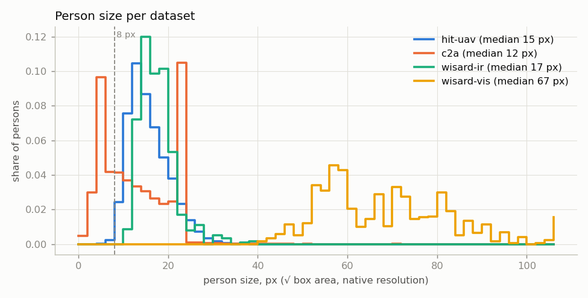

Доля людей по интервалам размера (исходные px):

| Интервал | HIT-UAV | C2A | WiSARD ИК | WiSARD RGB |
| --- | --- | --- | --- | --- |
| < 8 | 0,5% | **34,6%** | 0% | 0% |
| 8–12 | 19,9% | 15,6% | 1,7% | 0% |
| 12–16 | 38,2% | 12,8% | 38,4% | 0% |
| 16–24 | 35,8% | 35,8% | 54,0% | 0% |
| 24–32 | 5,2% | 0,6% | 4,8% | 0% |
| 32–64 | 0,2% | 0,4% | 1,2% | 43,7% |
| ≥ 64 | 0% | 0,1% | 0% | 56,3% |

- Оба тепловизионных набора — это **задача про крошечные объекты**: 94% (HIT-UAV) и 92% (WiSARD ИК) людей имеют размер 8–24 px.
- C2A распадается на две группы: треть меньше 8 px и треть в диапазоне 16–24 px, а выше 24 px почти ничего нет. Это следствие того, как генератор вставлял людей (§4.3), а не свойство реальных сцен.
- Люди в WiSARD RGB примерно в 4 раза крупнее в пикселях, чем те же люди в WiSARD ИК (медианное отношение 3,9×), потому что у RGB-сенсора в 6 раз больше пикселей при схожем поле зрения.

### Как выглядят люди

Случайные фрагменты в исходном разрешении; число — размер человека в px:


- **HIT-UAV:** тёплые пятна без видимых конечностей; часто мягкие и размытые.
- **C2A:** ниже примерно 8 px человек — это несколько цветных пикселей без человеческой формы. У более крупных вставок видны края и освещение, не совпадающее со сценой.
- **WiSARD ИК:** белые силуэты людей с конечностями на фоне текстурированных скал.
- **WiSARD RGB:** чёткие люди в яркой одежде; на некоторых кадрах есть смаз от движения.

## 3. HIT-UAV (тепловизор)

### 3.1 Состав

| Выборка | Изображений | С людьми | Людей |
| --- | --- | --- | --- |
| train | 2 029 | 1 165 | 8 533 |
| val | 290 | 171 | 1 168 |
| test | 579 | 355 | 2 611 |
| **всего** | **2 898** | **1 691 (58,4%)** | **12 312** |

- Исходные категории: Person 12 312, Car 7 311, Bicycle 4 980, OtherVehicle 148, DontCare 148 (в 103 изображениях).
- 2 898 изображений отобраны из 43 470 кадров видео.

### 3.2 Метаданные из имён файлов

Имена файлов имеют вид `время_высота_угол_погода_id`, например `1_130_90_0_04077`. README датасета эти поля не описывает; порядок взят из `tools/info/scenario.txt` (`day`, `night`) и `weather.txt` (`sunny`, `rainy`).

**Флаг 1 = ночь подтверждается данными:** медианный контраст человека равен 1,06 для флага 1 и 0,23 для флага 0. В тепловизоре люди заметно сильнее выделяются ночью, когда земля холодная.

| Условие | Изображений | Людей | Медианный размер, px | Медианный контраст | Медианная яркость |
| --- | --- | --- | --- | --- | --- |
| День | 917 | 2 739 | 15,9 | **0,23** | 124,8 |
| Ночь | 1 981 | 9 573 | 14,5 | **1,06** | 126,2 |
| Солнечно | 2 898 | 12 312 | 14,9 | 0,90 | 126,1 |
| Дождь | 0 | 0 | – | – | – |

Покрытие сочетаний высота × угол камеры (изображений на ячейку):


- В каждом из 56 сочетаний высоты и угла не менее 18 изображений.
- Больше всего изображений на высоте 60 м (30%), затем 130 м (17%). Строка 90 м самая скудная (145 изображений).
- Угол камеры от 30° (наклонный) до 90° (строго вниз).

### 3.3 Размер человека


| Высота | Изображений | Доля ночных | Людей | Медиана, px | Медианный контраст |
| --- | --- | --- | --- | --- | --- |
| 60 м | 863 | 82% | 6 268 | 16,0 | 1,13 |
| 70 м | 267 | 62% | 994 | 18,0 | 0,33 |
| 80 м | 256 | 63% | 1 316 | 16,2 | 0,44 |
| 90 м | 145 | 100% | 429 | 14,7 | 0,61 |
| 100 м | 291 | 45% | 811 | 13,7 | 0,60 |
| 110 м | 247 | 58% | 833 | 13,5 | 0,74 |
| 120 м | 336 | 53% | 663 | 11,0 | 1,03 |
| 130 м | 493 | 72% | 998 | 11,7 | 1,08 |

| Угол камеры | Изображений | Людей | Медиана, px | Медианный контраст |
| --- | --- | --- | --- | --- |
| 30° | 477 | 3 300 | 12,6 | 0,97 |
| 40° | 339 | 988 | 13,4 | 0,56 |
| 50° | 486 | 1 738 | 16,7 | 0,76 |
| 60° | 471 | 1 648 | 17,2 | 0,72 |
| 70° | 421 | 1 210 | 17,1 | 0,71 |
| 80° | 390 | 2 647 | 17,3 | 1,61 |
| 90° | 314 | 781 | 16,0 | 0,58 |


- Размер падает с высотой: около 16–18 px на 60–80 м, 11–12 px на 120–130 м.
- Наклонные виды (30–40°) дают более мелких людей (12,6–13,4 px). Обзор длиннее, а люди, находящиеся дальше от камеры, уменьшаются.
- Контраст сильнее всего зависит от **времени суток** (0,23 днём против 1,06 ночью). По высотам явного тренда нет, и он не просто следует доле ночных кадров: на 90 м кадры все ночные, но контраст 0,61. Каждая высота — это отдельный набор полётов и сцен, так что высота и сцена смешаны.

### 3.4 Плотность и положение

- 41,6% изображений без людей, 8,1% с одним, 19,7% с 2–5, 27,0% с 6–20 и 3,6% с более чем 20. Медиана 2, среднее 4,25, максимум 33.
- Люди появляются группами: 53% стоят ближе 2 размеров тела к кому-то ещё, и 19% боксов перекрываются с другим боксом.
- Есть небольшое смещение к центру кадра (§6).

### 3.5 Качество изображений

- Медиана яркости 126; RMS-контраст 34; динамический диапазон (p99 − p1) 143 из 255 уровней.
- Медианная резкость 50 — самая низкая из всех четырёх наборов и в 9 раз ниже, чем у WiSARD ИК в том же формате 640×512. Изображения выглядят сглаженными автоматической регулировкой усиления камеры и JPEG.
- 8-битный 3-канальный JPEG с одинаковыми каналами, палитра «белое — горячее». **Данных о температуре нет** (не радиометрический).

### 3.6 Примеры (день сверху, ночь снизу)

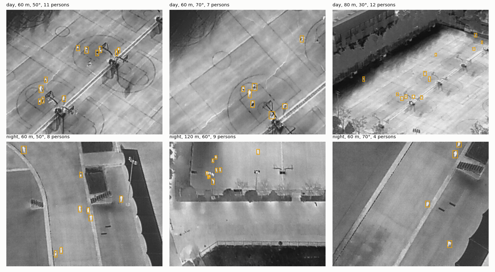

Днём: нагретый солнцем асфальт так же тёпл, как люди, а люди выглядят тёмными или серыми силуэтами, которые почти не выделяются. Ночью они — яркие пятна на холодном фоне.

### 3.7 Размер входа

| imgsz | Медианный размер человека на входе модели, px | Людей < 8 px |
| --- | --- | --- |
| 320 | 7,4 | 59% |
| 640 (исходный) | 14,9 | 1% |
| 960 / 1280 | 14,9 + увеличение | 1% |


Измеренное влияние размера входа на детекцию — в §7.

### 3.8 Целостность данных

- **31% изображений val и test — почти-дубликаты** изображений train. Кадры видео из одного полёта, по-видимому, разделены по кадрам, поэтому оценки на тесте внутри домена оптимистичны.
- 148 боксов DontCare после подготовки становятся фоном (1,2% от числа людей).
- Погода всегда солнечная, сцен катастроф нет (кампус, дороги, игровые площадки, парковки).

## 4. C2A (RGB, синтетические катастрофы)

### 4.1 Состав

| Выборка | Изображений | Людей | Различных фоновых сцен |
| --- | --- | --- | --- |
| train | 6 129 | 215 821 | 2 018 |
| val | 2 043 | 72 123 | 1 353 |
| test | 2 043 | 72 523 | 1 399 |

| Тип катастрофы | Изображений | Людей |
| --- | --- | --- |
| collapsed_building (обрушение здания) | 2 555 | 92 417 |
| fire (пожар) | 2 605 | 89 000 |
| flood (наводнение) | 2 630 | 89 900 |
| traffic_incident (ДТП) | 2 425 | 89 150 |


Некоторые люди, уже присутствовавшие на фоновых фото AIDER (например, пожарные), тоже размечены — наряду со вставленными.

### 4.2 Поза

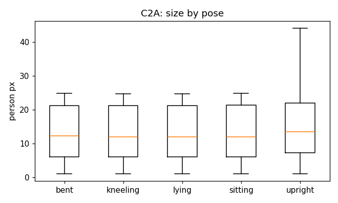

| Поза | Доля | Медиана, px |
| --- | --- | --- |
| bent (наклонившись) | 18,9% | 11,7 |
| kneeling (на коленях) | 19,0% | 11,5 |
| lying (лёжа) | 19,0% | 11,6 |
| sitting (сидя) | 18,9% | 11,6 |
| upright (стоя) | 24,2% | 13,0 |

- У каждого из 360 467 людей есть метка позы.
- Позы сбалансированы по замыслу. **Лежащие (19%) — единственные данные о лежащих пострадавших, что у нас есть**, но они вставлены искусственно, а не реальны.
- Размер одинаков для всех поз (медиана 11,5–13 px, квартили идентичны). Лежащее тело сверху примерно вдвое длиннее скорчившегося, значит, генератор масштабировал людей независимо от позы.

### 4.3 Артефакт масштаба


| Длинная сторона изображения (train) | Медианный размер человека, px | Медианный размер человека, % длинной стороны |
| --- | --- | --- |
| < 320 | 11,7 | 4,44% |
| 320–640 | 11,7 | 2,64% |
| 640–1000 | 12,6 | 1,64% |
| ≥ 1000 | 13,4 | 0,79% |

- Людей вставляли примерно с фиксированным размером в пикселях (около 2–24 px) **независимо от разрешения изображения и высоты камеры**. Человек занимает 4,4% кадра 240 px, но 0,8% кадра 4K.
- Одно и то же тело поэтому появляется в масштабах, различающихся в 5 раз относительно сцены, чего реальная камера дать не может.
- Люди крупнее 24 px встречаются лишь на нескольких больших изображениях.
- Разрешение небольшое и разбросанное: 80% изображений короче 640 px по длинной стороне (медиана 428). Самые частые размеры: 240×240 (165 изображений), 300×300 (140) и 230×230 (125).

### 4.4 Размер входа и увеличение

| imgsz | Медианный размер человека, px (без увеличения) | Людей < 8 px |
| --- | --- | --- |
| 320 | 7,7 | 52% |
| 640 | 11,0 | 38% |
| 960 | 11,6 | 36% |
| 1280 | 11,8 | 35% |
| полный | 12,0 | 35% |


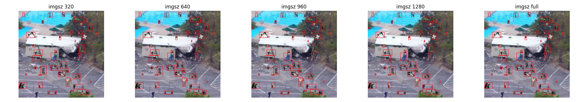

- Таблица предполагает, что изображения никогда не увеличиваются. Масштабирование YOLO с letterbox **увеличивает** малые изображения до `imgsz`, поэтому при 640 большинство изображений C2A растягивается. Людям достаётся больше пикселей, но не больше деталей.
- **35% людей меньше 8 px даже в полном разрешении**, поэтому recall на C2A ограничен сверху независимо от `imgsz`.

### 4.5 Плотность, контраст, качество

- На каждом изображении есть люди: у 98,8% их больше 20 (медиана 34, максимум 240). В реальных сценах землетрясений — несколько разбросанных пострадавших, а не толпы.
- Перекрываются лишь 5% боксов, но 38% людей находятся ближе 2 размеров тела от другого.
- Контраст по яркости слегка отрицательный (медиана −0,19): вставленные люди часто темнее окружения и отличаются в основном цветом.
- Качество сильно разнится: яркость 68–152 (p5–p95); резкость 41–1620, разброс в 40 раз — от размытых увеличенных исходников до чётких крупных.
- Положение равномерно по кадру с пустой рамкой 3–5%: случайные места вставки без учёта контекста сцены (§6).

### 4.6 Утечка между выборками


- Каждый фон AIDER используется до 5 раз (`<сцена>_0` … `_4`) с разными вставленными людьми.
- **98,2% сцен val и 98,3% сцен test также встречаются в train.** 72–73% изображений val/test — почти-дубликаты изображений train.
- Оценки val/test на C2A в том виде, как он распространяется, измеряют запомненные фоны. Перед использованием для выбора модели разделите данные по сценам.

## 5. Образец WiSARD (реальный поиск и спасение, RGB + ИК)

### 5.1 Состав

| Модальность | Кадров | Людей | Разрешение | Медианный размер человека, px | Людей < 8 px |
| --- | --- | --- | --- | --- | --- |
| RGB (`VIS_0003`) | 264 | 1 022 | 3840×2160 | 66,7 | 0% |
| ИК (`IR_0004`) | 264 | 1 006 | 640×512 | 17,2 | 0% |

- Один полёт, Mt Erie, 2021-04-17, день, скалы и хвойный лес.
- Одни и те же 4 актёра присутствуют в 92–96% кадров, идут или стоят вместе.
- Разметка поставляется в формате YOLO, один класс (human).

### 5.2 Размер входа

| imgsz | RGB: медианный размер на входе, px | RGB: < 8 px | ИК: медианный размер на входе, px | ИК: < 8 px |
| --- | --- | --- | --- | --- |
| 320 | 5,6 | 94% | 8,6 | 40% |
| 640 | 11,1 | 4% | 17,2 (исходный) | 0% |
| 960 | 16,7 | 0% | 17,2 | 0% |
| 1280 | 22,2 | 0% | 17,2 | 0% |
| полный | 66,7 | 0% | 17,2 | 0% |


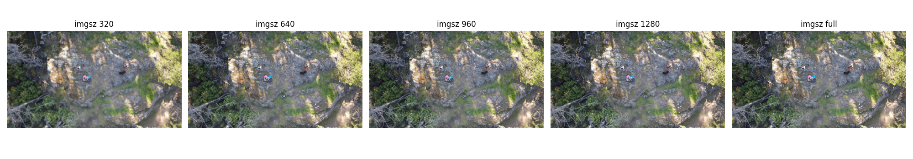
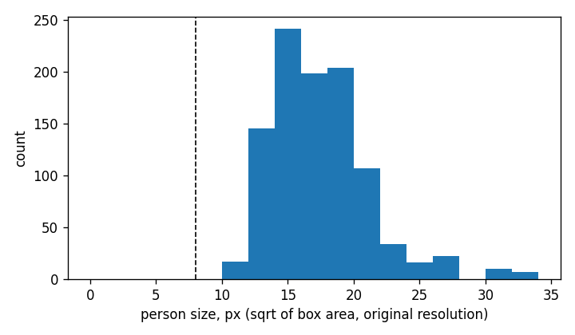


Уменьшение 4K до 640 сжимает людей в 6 раз, с 67 px до примерно 11 px. Тайлинг полного кадра сохраняет все детали (измерено в §7).

### 5.3 Сопоставление RGB ↔ ИК

Кадры имеют общий индекс: 263 индекса есть в обеих модальностях, и в 247 из них число людей совпадает. Если сопоставить людей по порядку x и подогнать линейное отображение, получим:

| Величина | Значение |
| --- | --- |
| ИК x (нормированный) | 1,511 · RGB x − 0,273 |
| ИК y (нормированный) | 1,040 · RGB y − 0,038 |
| Область ИК в кадре RGB | x 0,18–0,84, y 0,04–1,00 → **63,6% площади RGB** |
| Медианная ошибка после подгонки | 0,012 нормированных = **7,7 px ИК** (около 0,45 человека) |
| Отношение размеров человека, RGB px ÷ ИК px | 3,9× (примерно в 15× больше пикселей на человека в RGB) |


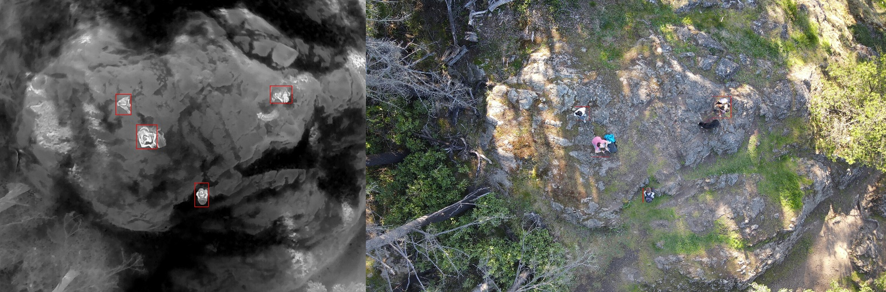

- ИК-камера видит центральные две трети ширины кадра RGB и почти всю его высоту.
- Линейное отображение для одного полёта выравнивает их с точностью около половины человека. Этого достаточно, чтобы **сопоставлять боксы детекции** между камерами, но не чтобы накладывать пиксели в одно изображение.
- Параллакс между двумя камерами меняется с высотой над землёй, поэтому отображение нужно калибровать для каждой установки и проверять на каждой высоте.

### 5.4 Качество и контраст

| | Яркость p50 | RMS-контраст p50 | Динамический диапазон p50 | Резкость p50 | Контраст человека p50 |
| --- | --- | --- | --- | --- | --- |
| WiSARD ИК | 86 | 45 | 201 | 459 | 1,12 (2,9% низкий) |
| WiSARD RGB | 111 | 53 | 204 | 3 730 | 0,21 (88,6% низкий) |

- Люди в ИК хорошо выделяются по яркости. Однако освещённые солнцем скалы нагреваются до такой же температуры (см. изображение первого кадра), так что горячие камни — риск ложных срабатываний.
- Люди в RGB почти не отличаются от окружения по яркости (88,6% низкий контраст). Их находят по цвету и форме; яркая одежда актёров сильно помогает. Пострадавших, покрытых пылью, в RGB было бы найти труднее, и именно здесь тепловизор даёт больше всего.

## 6. Сравнение датасетов

### 6.1 Людей на изображение

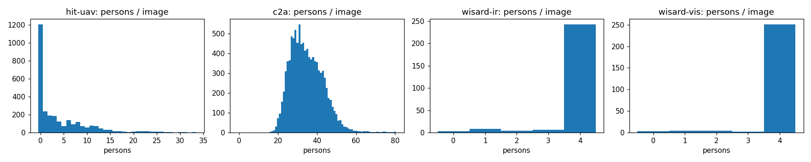

| Людей на изображении | HIT-UAV | C2A | WiSARD ИК | WiSARD RGB |
| --- | --- | --- | --- | --- |
| 0 | 41,6% | 0% | 1,1% | 1,1% |
| 1 | 8,1% | 0% | 3,0% | 1,5% |
| 2–5 | 19,7% | 0% | 95,8% | 97,3% |
| 6–20 | 27,0% | 1,2% | 0% | 0% |
| > 20 | 3,6% | 98,8% | 0% | 0% |

### 6.2 Где люди находятся в кадре

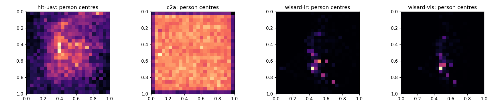

- HIT-UAV: небольшое смещение к центру (пилот кадрировал объекты).
- C2A: равномерно, с пустой рамкой (случайная вставка).
- WiSARD: один плотный кластер (одна группа актёров).

### 6.3 Форма боксов и скученность

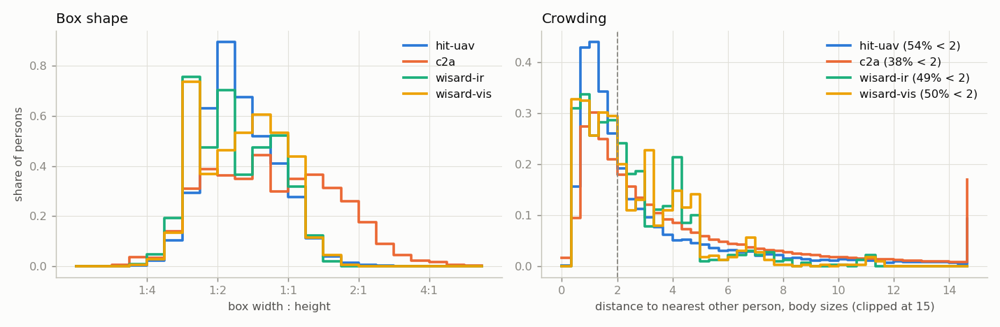

- Во всех реальных датасетах боксы в основном выше, чем шире (медиана ширина:высота 0,57–0,63): стоящие или идущие люди, снятые под углом.
- C2A квадратнее (0,82) и имеет длинный хвост широких боксов, что согласуется со вставками согнувшихся и лежащих людей.
- Скученность: около половины реальных людей имеют соседа ближе 2 размеров тела. Детекция должна разделять людей, стоящих близко друг к другу (важны настройки подавления немаксимумов, NMS).

### 6.4 Контраст

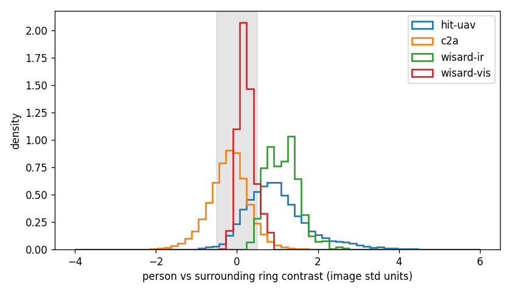

| | p5 | p25 | p50 | p75 | p95 | Низкий (\|c\| < 0,5) |
| --- | --- | --- | --- | --- | --- | --- |
| HIT-UAV | −0,05 | 0,46 | 0,90 | 1,37 | 2,53 | 25,7% |
| C2A | −1,05 | −0,50 | −0,19 | 0,10 | 0,59 | 68,2% |
| WiSARD ИК | 0,57 | 0,82 | 1,12 | 1,39 | 1,77 | 2,9% |
| WiSARD RGB | −0,06 | 0,08 | 0,21 | 0,34 | 0,73 | 88,6% |

### 6.5 Качество изображений


| p5 / p50 / p95 | Яркость | RMS-контраст | Динамический диапазон | Резкость |
| --- | --- | --- | --- | --- |
| HIT-UAV | 102 / 126 / 153 | 17 / 34 / 60 | 77 / 143 / 212 | 20 / 50 / 123 |
| C2A | 68 / 113 / 152 | 25 / 45 / 64 | 111 / 192 / 240 | 41 / 211 / 1 620 |
| WiSARD ИК | 74 / 86 / 97 | 41 / 45 / 51 | 189 / 201 / 216 | 244 / 459 / 801 |
| WiSARD RGB | 103 / 111 / 115 | 49 / 53 / 59 | 193 / 204 / 221 | 1 045 / 3 730 / 4 400 |

Два тепловизионных набора выглядят совершенно по-разному: HIT-UAV мягкий с низким динамическим диапазоном, WiSARD ИК резкий с высоким динамическим диапазоном. Модель, обученная на одном, воспринимает другой как новый сенсор (§7.3).

## 7. Детекция в зависимости от размера человека и размера входа

Только инференс. AP50 и recall измерены при IoU ≥ 0,5; recall — при уверенности 0,25.

### 7.1 Тепловизор: насколько можно уменьшать?

Тест HIT-UAV (579 изображений, 2 611 людей), YOLO11n, обученная на 640:

| imgsz | AP50 | Precision | Recall | Recall < 8 px | 8–12 | 12–16 | 16–24 | 24–32 | мс/изобр. |
| --- | --- | --- | --- | --- | --- | --- | --- | --- | --- |
| 320 | 0,664 | 0,646 | 0,678 | 0,06 | 0,37 | 0,69 | 0,85 | 0,90 | 9,3 |
| 480 | 0,840 | 0,709 | 0,849 | 0,31 | 0,76 | 0,87 | 0,89 | 0,88 | 10,7 |
| **640** | **0,872** | 0,696 | **0,888** | 0,50 | 0,87 | 0,90 | 0,90 | 0,87 | 12,4 |
| 960 | 0,851 | 0,711 | 0,833 | 0,63 | 0,83 | 0,86 | 0,83 | 0,73 | 18,9 |
| 1280 | 0,754 | 0,777 | 0,644 | 0,38 | 0,69 | 0,72 | 0,57 | 0,44 | 26,7 |

(В интервале < 8 px всего 16 людей, поэтому значения recall там шумные.)

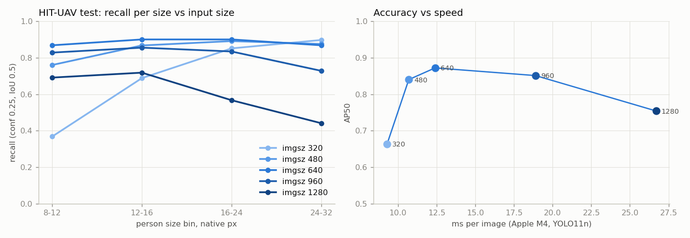

- **Уменьшение:** 480 стоит 3 пункта AP, а 320 — 21. Recall падает, когда человек на входе модели около 6 px (люди 8–12 px при половинном масштабе: 0,37). **Порог: около 8 px на входе; цельтесь в 10 px и больше.**
- **Увеличение для модели, обученной на 640, сильнее всего вредит крупным людям** (recall для 24–32 px падает с 0,87 до 0,44 при 1280): модель никогда не видела таких крупных людей. Увеличение помогает, только если модель обучена на таком размере.
- 640 — лучший компромисс: 12 мс на кадр на M4.

### 7.2 4K RGB: масштабирование против тайлинга

WiSARD RGB (264 кадра, 1 022 человека), COCO YOLO11n zero-shot, только класс «человек»:

| Режим | AP50 | Precision | Recall | Recall 32–64 px | Recall ≥ 64 px | мс/изобр. |
| --- | --- | --- | --- | --- | --- | --- |
| Масштаб до 640 | 0,030 | 0,64 | 0,007 | 0,00 | 0,01 | 48 |
| Масштаб до 1280 | 0,127 | 0,55 | 0,036 | 0,03 | 0,05 | 57 |
| Масштаб до 1920 | 0,132 | 0,54 | 0,066 | 0,11 | 0,03 | 73 |
| **Тайлы 640, перекрытие 20%** | **0,324** | 0,65 | **0,356** | **0,59** | 0,17 | 494 |

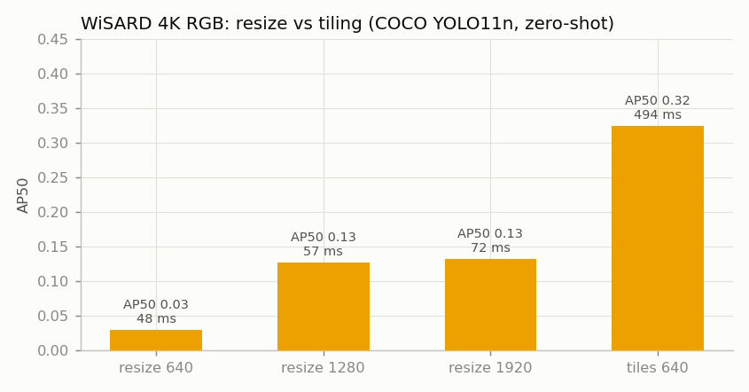

- Тайлинг **в 10 раз лучше**, чем масштабирование до 640, и в 2,5 раза лучше, чем масштабирование до 1920. Тайлы обрабатывались по одному с низким приоритетом; пакетная обработка всех 40 тайлов кадра резко сократила бы 494 мс.
- Абсолютные значения низкие, потому что веса COCO редко видели людей строго сверху. Полезно именно сравнение режимов.

### 7.3 Разрыв между доменами

| Модель → данные | imgsz | AP50 | Precision | Recall |
| --- | --- | --- | --- | --- |
| Модель HIT-UAV → тест HIT-UAV | 640 | 0,872 | 0,70 | 0,888 |
| Модель HIT-UAV → WiSARD ИК | 640 | **0,010** | 0,04 | 0,012 |
| Модель HIT-UAV → WiSARD ИК | 960 / 1280 | 0,010 / 0,003 | – | 0,006 / 0,002 |
| Модель HIT-UAV → WiSARD ИК, IoU ≥ 0,25 | 640 | 0,063 | 0,14 | 0,040 |
| Модель COCO → тест HIT-UAV | 640 / 960 | 0,099 / 0,120 | 0,45 / 0,41 | 0,035 / 0,044 |
| Модель COCO → WiSARD ИК | 640 / 960 | 0,059 / 0,096 | 0,88 / 0,63 | 0,007 / 0,005 |
| Модель COCO → тест C2A | 640 / 1280 | 0,151 / 0,205 | 0,46 / 0,40 | 0,122 / 0,254 |

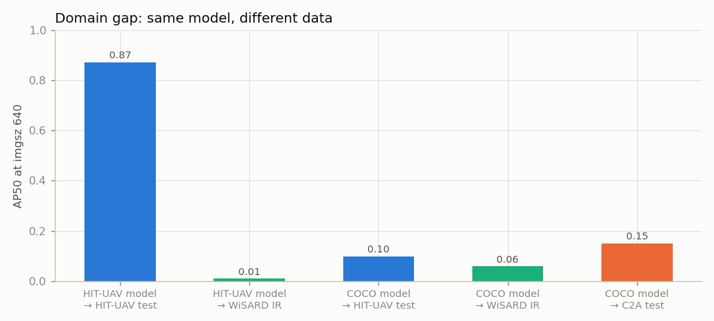

- Модель HIT-UAV **не переносится** на реальные тепловизионные съёмки в дикой природе, хотя люди в WiSARD ИК крупнее (17 против 15 px) и сильнее выделяются (контраст 1,12 против 0,90).
- Она на них срабатывает, но только крошечными боксами с низкой уверенностью на горячих точках внутри человека (например, 5×11 px внутри бокса 27×35 px).
- Вероятные причины:
  1. Фон: текстурированные горячие скалы против ровного асфальта.
  2. Вид сенсора: резкий с высоким динамическим диапазоном против мягкого (§6.5).
  3. Стиль боксов: боксы всего тела против плотно прилегающих.
  4. Модель — частичный 14-эпоховый прогон.
- Веса COCO вообще не обнаруживают людей в тепловизоре. Для тепловизионного детектора нужны тепловизионные обучающие данные.
- На C2A recall zero-shot модели удваивается при переходе от 640 к 1280 (0,12 → 0,25), а recall для людей меньше 8 px растёт с 0,02 до 0,12. Мелким людям в RGB нужно больше пикселей на входе.

## 8. Что это значит для нашего дрона

Ожидаемый размер человека в зависимости от высоты зависания, по √площади для человека, снятого строго сверху: стоящий ≈ 0,45 м, лежащий ≈ 0,9 м.

Приведённые ниже характеристики камер — **допущения**, пока у нас нет данных реального дрона. HIT-UAV измерил 16 px на 60 м, что больше, чем предсказывает эта таблица (более узкий объектив, наклонный вид и тепловой ореол вокруг тела), поэтому считайте эти цифры консервативными.

| Высота | Тепловой GSD | Тепловизор 640×512, HFOV 40° | RGB GSD | RGB 4000×3000, HFOV 72°, исходный / тайлинг | RGB, масштаб до 640 | RGB, масштаб до 1280 |
| --- | --- | --- | --- | --- | --- | --- |
| 20 м | 2,3 см/px | 20 / 40 px | 0,7 см/px | 62 / 124 px | 10 / 20 px | 20 / 40 px |
| 30 м | 3,4 | 13 / 26 | 1,1 | 41 / 83 | 7 / 13 | 13 / 26 |
| 40 м | 4,5 | 10 / 20 | 1,5 | 31 / 62 | 5 / 10 | 10 / 20 |
| 50 м | 5,7 | 8 / 16 | 1,8 | 25 / 50 | 4 / 8 | 8 / 16 |
| 60 м | 6,8 | 7 / 13 | 2,2 | 21 / 41 | 3 / 7 | 7 / 13 |
| 80 м | 9,1 | 5 / 10 | 2,9 | 15 / 31 | 2 / 5 | 5 / 10 |
| 100 м | 11,4 | 4 / 8 | 3,6 | 12 / 25 | 2 / 4 | 4 / 8 |
| 120 м | 13,6 | 3 / 7 | 4,4 | 10 / 21 | 2 / 3 | 3 / 7 |

GSD (ground sampling distance, расстояние между центрами пикселей на земле) = 2 · высота · tan(HFOV / 2) ÷ ширина изображения. Размер человека в px = размер человека в метрах ÷ GSD × (вход модели ÷ ширина изображения).

С учётом порога 8–10 px из §7.1:
- **Тепловизор работает до примерно 40 м** для стоящих людей и до примерно 80 м для лежащих.
- **RGB с тайлингом в исходном разрешении** работает до примерно 100 м.
- **RGB, уменьшенный до 640, не работает выше примерно 30 м.**

## 9. Воспроизведение

```bash
# Size vs imgsz per dataset
.venv/bin/python src/detection/analyze.py data/yolo/hit-uav/images data/yolo/hit-uav/labels --out station/assets/hit-uav-analysis
# Full audit + all charts in station/assets/audit/ (charts in §7 need the eval JSONs below)
.venv/bin/python src/detection/audit.py --out station/assets/audit
# Inference-only sweeps (low priority, 3 threads)
r() { nice -n 10 .venv/bin/python src/detection/eval_sizes.py --threads 3 "$@"; }
r runs/runs/hituav-n-640/weights/best.pt hit-uav test --imgsz 320 480 640 960 1280 --out station/assets/audit/eval/hituav-model_hituav-test.json
r runs/runs/hituav-n-640/weights/best.pt wisard-ir val --imgsz 640 960 1280 --out station/assets/audit/eval/hituav-model_wisard-ir.json
r runs/runs/hituav-n-640/weights/best.pt wisard-ir val --imgsz 640 1280 --iou 0.25 --out station/assets/audit/eval/hituav-model_wisard-ir_iou25.json
r models/yolo11n.pt hit-uav test --imgsz 640 960 --out station/assets/audit/eval/coco-model_hituav-test.json
r models/yolo11n.pt wisard-ir val --imgsz 640 960 --out station/assets/audit/eval/coco-model_wisard-ir.json
r models/yolo11n.pt wisard-vis val --imgsz 640 1280 1920 --tile 640 --out station/assets/audit/eval/coco-model_wisard-vis.json
r models/yolo11n.pt c2a test --imgsz 640 1280 --out station/assets/audit/eval/coco-model_c2a-test.json
```