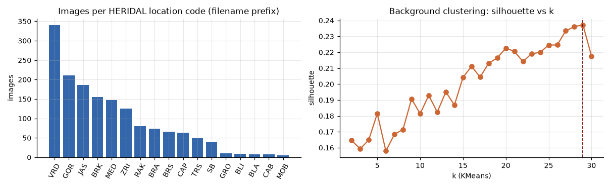
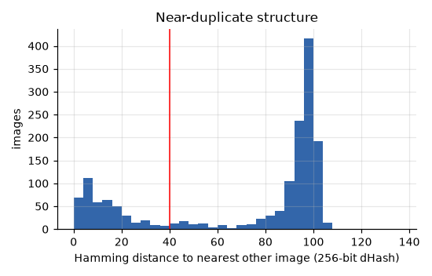
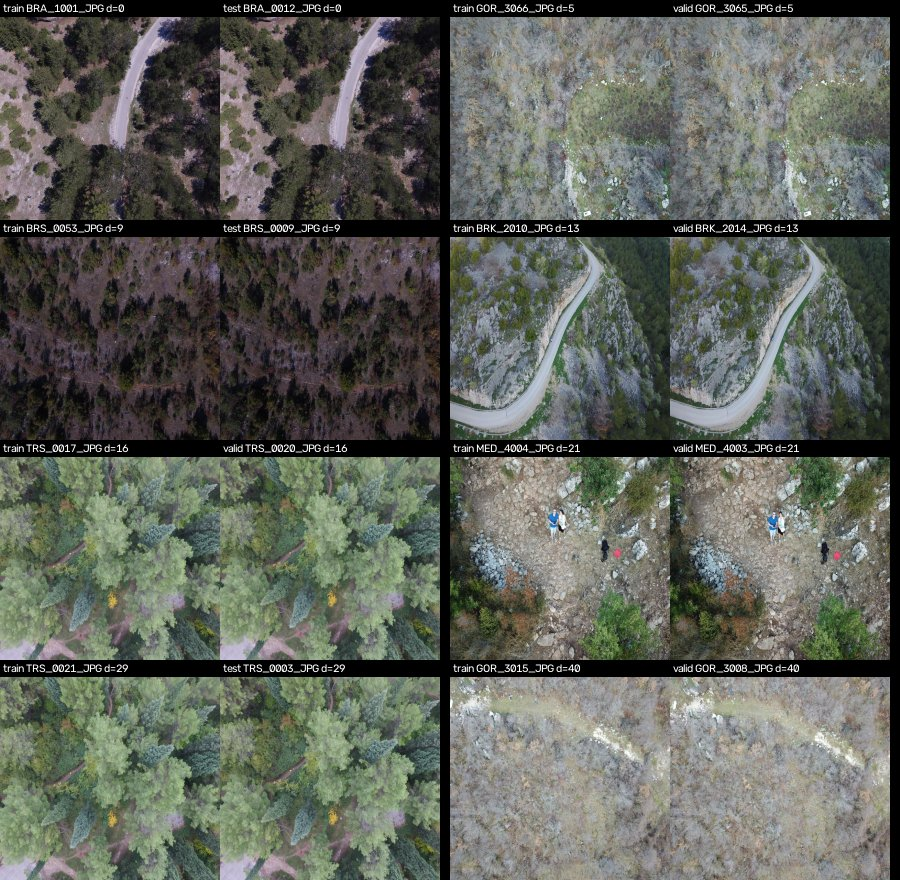
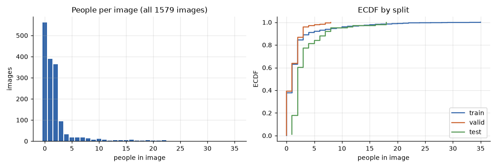
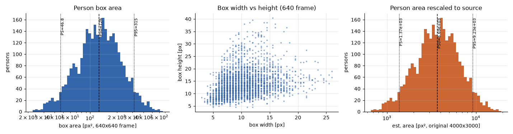
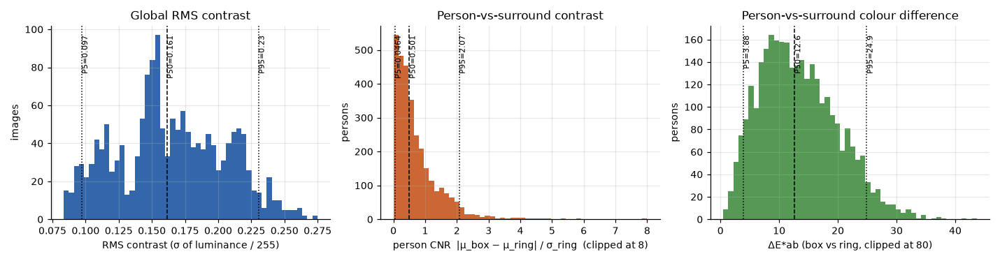
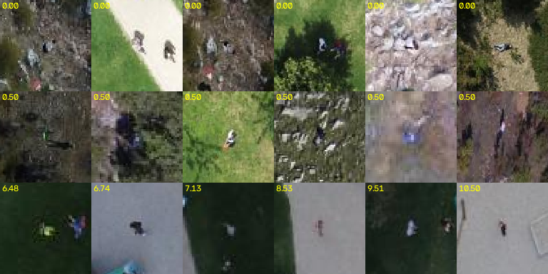
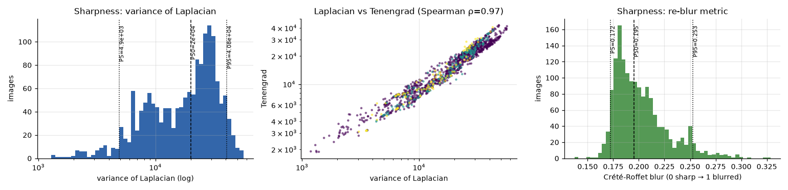
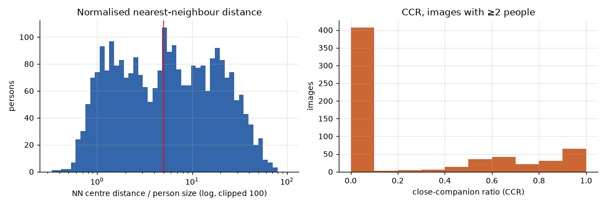
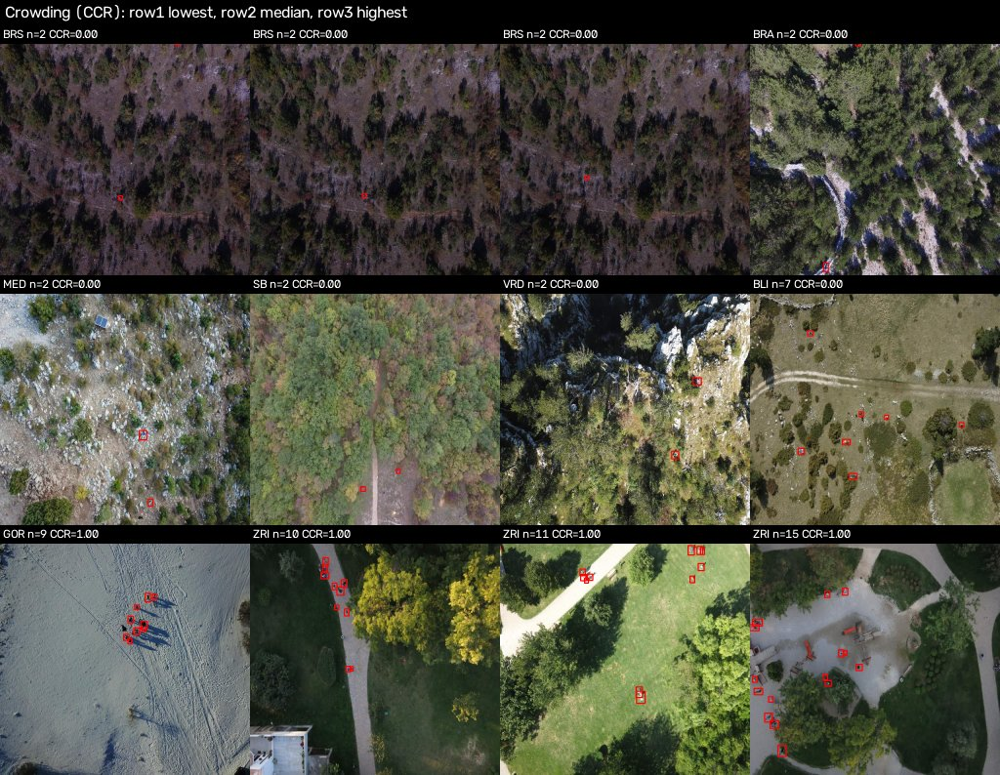

# HERIDAL Profile

> **Status:** Draft · **Updated:** 2026-10-18

Profile of HERIDAL, the real-world RGB test set chosen in [literature/datasets.md](../literature/datasets.md).
It covers the same eight points as [dataset-profiles.md](dataset-profiles.md): summary, size, distinct backgrounds,
people per image, pixels per person, contrast, sharpness and crowding. Every image (1,579) and every person box
(3,073) is included, with no sampling. Numbers come from `station/assets/heridal/summary.json` and
`scene_types.json`; see [Reproduce](#reproduce).

> **Which copy of HERIDAL.** This profile describes the **Roboflow export**
> ["Heridal Human Detection" v4](https://universe.roboflow.com/drone-internship/heridal-human-detection)
> (COCO JSON, CC BY 4.0, 167 MB). It is **not** the 8.3 GB Zenodo original listed in `datasets.md`.
> Roboflow resized every frame to **640×640 by stretching**. Sizes, sharpness and aspect ratios below describe
> that export. The original ~4000×3000 frames would have about 29× more pixels per person.

## At a glance (comparable with the other datasets)

The HERIDAL column uses the exact metric definitions of `src/detection/audit.py`. The other columns are copied
from [dataset-profiles.md](dataset-profiles.md).

| | HERIDAL (Roboflow) | HIT-UAV | C2A | WiSARD IR | WiSARD RGB |
|---|---|---|---|---|---|
| Modality | RGB, real SAR | thermal | RGB, synthetic | thermal | RGB |
| Images | 1,579 | 2,898 | 10,215 | 264 | 264 |
| Persons | 3,073 | 12,312 | 360,467 | 1,006 | 1,022 |
| Resolution | 640×640 (stretched from 4:3) | 640×512 | 123×152 – 5184×3456 | 640×512 | 3840×2160 |
| Distinct backgrounds | ≈15 sites, 11 scene types | ≈20 scenes (264 clips) | 2,043 photos (≈400 scenes) | 1 site | 1 site |
| Persons / image, mean (p50) | 1.95 (1) | 4.25 (2) | 35.3 (34) | 3.81 (4) | 3.87 (4) |
| Pixels / person, mean (p50) | 146 (126) | 271 (221) | 230 (144) | 328 (297) | 5,147 (4,446) |
| Person contrast, mean (p50) | −0.13 (−0.09) | +1.00 (+0.90) | −0.21 (−0.19) | +1.13 (+1.12) | +0.23 (+0.21) |
| Low-contrast persons (\|c\| < 0.5) | 70.0% | 25.7% | 68.2% | 2.9% | 88.6% |
| Person sharpness at 640, p50 | 3,818 | 437 | 662 | 3,046 | 4,058 |
| Nearest neighbour, p50 (body sizes) | 5.42 | 1.82 | 2.72 | 2.06 | 2.00 |
| Persons with a neighbour < 2 sizes | 23.4% | 53.3% | 38.1% | 48.6% | 49.9% |

**What stands out**
- HERIDAL has the **smallest people** of all five sets (median 126 px², about 11 px side).
- It is the **only real wilderness RGB set with many backgrounds**.
- It is the **least crowded**: people are scattered, not in groups.
- It has the **most empty frames**: 561 images (35.5%) contain no person. These are useful hard negatives.

## Key findings

1. **⚠ Split leakage.** 44 of the 101 test images (44%) have a near-identical frame in train or valid, and
   there are 360 cross-split near-duplicate pairs in total. The test-only location codes MOB and GRO show the same
   scenes as BLA and GOR, which are in train. Test metrics on this export are optimistic. Use the 57 clean test
   images, or re-split by location (§3.4).
2. **People are tiny.** 100% are COCO "small", 90% are below 16×16 px and 14% are below 8×8 px at 640. At
   stride 8 a median person is about one feature cell. Tiling or a stride-4 head is required, as found for
   WiSARD RGB in [dataset-suitability.md](dataset-suitability.md).
3. **Weak grey-level contrast, but colour helps.** 70% of people have |c| < 0.5. Their median colour
   difference to the surroundings is still ΔE ≈ 12.6, so colour carries information that grey-level metrics miss.
4. **Frames are sharp.** Blur is not the limiting factor. Size and clutter are.
5. **Test split is unrepresentative.** It has no empty images and 3.3 people per image (train: 1.96), and no
   images of shrubland or snow.

---

## 1. Summary

- **Purpose:** detect lost or injured people in UAV imagery for wilderness search and rescue (Božić-Štulić,
  Marušić & Gotovac, *IJCV* 2019). The terrain is Croatian karst plateau, maquis, pine forest, ravines, snow and
  one city park. Volunteers stand, walk, sit and lie in SAR-like poses.
- **Task:** single-class person detection with axis-aligned boxes, essentially **tiny-object detection in
  clutter**. In frames with people, persons cover 0.11% of the image on average (median 0.05%).
- **Annotations:** COCO JSON per split: `bbox` [x, y, w, h], `area`, `iscrowd = 0`, no masks or keypoints.
  Categories are `0: Human` and `1: human`. **All 3,073 boxes use id 1**, and id 0 is a Roboflow
  super-category placeholder, so map everything to `person`. No box is degenerate or outside the image.
- **Pre-processing by Roboflow:** auto-orient, then stretch-resize to 640×640, with no augmentation. Objects
  appear 25% narrower than they really are (horizontal scale 0.160, vertical 0.213).

## 2. Size

| | Value |
|---|---|
| On disk | 166.3 MiB (images 99.7%, JSON 0.6 MB) |
| Images | 1,579, all 640×640 JPEG (mean 107 KB) |
| Persons | 3,073 |

| Split | Images | Persons | Empty images | Persons / image |
|---|---:|---:|---:|---:|
| train | 1,258 | 2,468 | 475 (37.8%) | 1.96 |
| valid | 220 | 268 | 86 (39.1%) | 1.22 |
| test | 101 | 337 | 0 | 3.34 |

- Test (101 images) corresponds to the original HERIDAL test set.
- All valid images carry `train_…` original names, so Roboflow carved valid out of the original train set.
- Spot checks of empty images at full resolution found no missed people, so they look like true negatives
  ([examples_empty.jpg](assets/heridal/examples_empty.jpg)).

## 3. Distinct backgrounds

Counted at four levels, because "background" is ambiguous:

| Level | Method | Count |
|---|---|---:|
| Location code | 3-letter token in the original file name (`train_VRD_3032…`) | 17 |
| Physical site | codes merged after visual check (MOB = BLA, GRO = GOR) | ≈15 |
| **Scene type** | colour + texture features → KMeans (k = 29) → clusters labelled by hand | **11** (9–12) |
| Unique view | perceptual-hash (dHash) near-duplicate groups | 1,275 |

### 3.1 Location codes



- The distribution is very skewed. VRD 340, GOR 211, JAS 186, BRK 155, MED 148, ZRI 126, RAK 80, BRA 74, BRS 66,
  CAP 64, TRS 49, SB 40, GRO 10, BLI 9, BLA 8, CAB 8, MOB 5.
- **ZRI (an urban park) holds 42% of all persons** (10.3 per image).
- Five codes have no test images (VRD, GOR, JAS, RAK, BLA). Four appear only in test (BLI, CAB, GRO, MOB).
- Sample frames: [locations_overview_a.jpg](assets/heridal/locations_overview_a.jpg),
  [locations_overview_b.jpg](assets/heridal/locations_overview_b.jpg).

### 3.2 Scene types

**Method**
- Features: 77-d per image, from HSV histograms, an LBP texture histogram and a gradient histogram.
- PCA to 95% of the variance, then KMeans for k = 2…30.
- The silhouette score is low (0.16–0.24) and keeps rising up to k = 29, so scenes form a continuum, not
  crisp clusters.
- We took the k = 29 partition and labelled every cluster by eye
  ([cluster_sheet_0](assets/heridal/cluster_sheet_0.jpg), [1](assets/heridal/cluster_sheet_1.jpg),
  [2](assets/heridal/cluster_sheet_2.jpg)). The mapping is in `src/detection/heridal_scenes.py`.

| Scene type | Images | train / valid / test | Persons / img | Empty |
|---|---:|---|---:|---:|
| Karst mosaic (grass + conifer / shrub clumps) | 333 | 289 / 29 / 15 | 0.78 | 54% |
| Closed forest canopy | 269 | 197 / 42 / 30 | 1.70 | 20% |
| Mediterranean shrubland / maquis | 268 | 221 / 47 / **0** | 1.35 | 33% |
| Dry karst grassland | 219 | 173 / 40 / 6 | 0.82 | 49% |
| Urban park | 129 | 122 / 4 / 3 | 9.76 | 12% |
| Leafless grey winter scrub, hazy meadow | 111 | 74 / 20 / 17 | 1.87 | 14% |
| Dark sparse woodland, low light | 69 | 43 / 14 / 12 | 1.58 | 26% |
| Snow | 68 | 55 / 13 / **0** | 1.44 | 47% |
| Riverside meadow / woodland edge | 58 | 43 / 8 / 7 | 1.00 | 59% |
| Cliffs / ravines with hard shadow | 36 | 30 / 0 / 6 | 1.25 | 39% |
| Autumn deciduous forest | 19 | 11 / 3 / 5 | 2.00 | 0% |

### 3.3 Unique views
- The Hamming distance from each image to its nearest neighbour is **bimodal**: near-duplicates at 0–35,
  unrelated frames at 85–105. We used 40 as the threshold.
- 1,275 view groups result, so about 19% of the frames repeat a scene that is already in the set.



### 3.4 Leakage
- **Cross-split near-duplicate pairs:** 360 in total (train–valid 168, train–test 153, valid–test 39).
  Some pairs are hash-identical, e.g. `train_BRA_1001` vs `test_BRA_0012`.
- **Test images with a twin:** 44 of 101 have a near-identical frame in train or valid.
- **Robustness:** the count is stable across thresholds. At dHash ≤ 30 / 40 / 50 there are 317 / 360 / 405
  cross-split pairs and 42 / 44 / 46 test images with a twin.
- **Fix:** split by location code, or by `view_group` in `images.csv`. This is the same issue as the C2A val/test
  leak in [dataset-suitability.md](dataset-suitability.md).



## 4. People per image

| | mean | p5 | p25 | p50 | p75 | p95 | max |
|---|---|---|---|---|---|---|---|
| all images | 1.95 | 0 | 0 | 1 | 2 | 8 | 35 |
| images with people | 3.02 | 1 | 1 | 2 | 3 | 11 | 35 |
| test only | 3.34 | 1 | 2 | 2 | 3 | 8 | 18 |

- Counts: 0 → 561, 1 → 389, 2 → 364, 3 → 94, 4–9 → 104, 10+ → 67.
- The distribution is zero-inflated with a long tail that comes from ZRI.
- The test split has no empty frames, so **measure image-level false positives on valid, not test**.



## 5. Pixels per person

Box w × h in the 640 frame. The source estimate assumes 4000×3000 originals (×29.3).

| | mean | p5 | p25 | p50 | p75 | p95 |
|---|---|---|---|---|---|---|
| area, px² | 146 | 47 | 86 | 126 | 185 | 315 |
| side √(w·h), px | 11.6 | 6.8 | 9.2 | 11.2 | 13.6 | 17.7 |
| width × height, px (p50) | | | | 9.5 × 13 | | |
| est. source area, px² | 4,290 | 1,370 | 2,505 | 3,691 | 5,420 | 9,229 |

- **Size classes:** < 8×8 px: 13.6%. < 16×16 px: 89.7%. < 32×32 px: 100%.
- **Aspect ratio:** median w/h is 0.76, about 1.0 once the stretch is undone. People seen from above are close to
  square, unlike the upright-pedestrian boxes most COCO models expect.
- **Narrow size range:** about 6.7× in area from p5 to p95, consistent with a fairly constant flight altitude.
  Priors of about 6–20 px cover 90% of people.
- **Pixels lost to the export:** the stretch discards about 97% of each person's pixels. With the original frames,
  tiled training at native resolution would be far better.



## 6. Contrast

**Definitions**
- **Team metric** (audit.py): `c = (mean grey in box − mean grey of a ring one box-size wide) / grey std of the image`.
  The value is signed, and |c| < 0.5 counts as low contrast.
- **CNR:** `|μ_box − μ_ring| / σ_ring`, the person's distance from its surroundings in units of local clutter
  (ring width max(w, h, 4) px).
- **ΔE\*ab:** CIELAB colour difference between the box and the ring. It catches a red jacket on green grass of
  equal brightness.
- **Image RMS contrast:** grey std / 255.

| | mean | p5 | p25 | p50 | p75 | p95 |
|---|---|---|---|---|---|---|
| person contrast c (team metric) | −0.13 | −1.05 | −0.44 | −0.09 | +0.20 | +0.65 |
| person CNR | 0.74 | 0.05 | 0.23 | 0.50 | 0.98 | 2.07 |
| person ΔE\*ab | 13.4 | 3.9 | 8.3 | 12.6 | 17.8 | 24.9 |
| image RMS contrast (0–1) | 0.164 | 0.097 | 0.138 | 0.161 | 0.195 | 0.230 |

**Interpretation**
- **People are camouflaged in grey level.**
  - 70% have |c| < 0.5 and 76% have CNR < 1.
  - On average they are slightly *darker* than their surroundings (clothing and shadows on bright limestone).
  - High-contrast people (CNR > 2) stand on uniform surfaces. Of those 177 people, 122 are in ZRI (paths, lawn)
    and 23 in GOR (snow).
- **Colour separates them better.** Median ΔE is 12.6 and only 35% have ΔE < 10. The lowest-CNR crops include
  clearly visible people in coloured clothing whose brightness happens to match the ground (top row below).
  Grey-level metrics are a lower bound on separability, which is the same caveat as in dataset-profiles.md.
- **Low image RMS (< 0.10)** means flat, dim scenes. Of the bottom 5%, 43 of 79 are dark BRS woodland; the rest
  are hazy meadow and grey scrub.
- **High image RMS (> 0.23)** means sunlit limestone cliffs (VRD) or snow with dark trees (GOR). That is high
  contrast, but also high clutter.




## 7. Sharpness

**Definitions**
- **Team metric:** Laplacian variance at 640 (ksize 1), computed on the person box grown 25% per side, and on
  the whole image.
- **VoL3:** the same with a 3×3 Laplacian.
- **Crété-Roffet blur:** re-blur the image and measure how much detail is lost; 0 = sharp, 1 = blurred. This is
  less content-dependent.

| | mean | p5 | p25 | p50 | p75 | p95 |
|---|---|---|---|---|---|---|
| person sharpness @640 (team) | 4,674 | 634 | 1,834 | 3,818 | 6,780 | 11,505 |
| image sharpness @640 (team) | 2,929 | 573 | 1,254 | 2,830 | 4,208 | 6,360 |
| image VoL3 | 20,451 | 4,900 | 9,683 | 20,046 | 29,051 | 40,768 |
| Crété-Roffet blur | 0.202 | 0.172 | 0.182 | 0.195 | 0.214 | 0.253 |

**Interpretation**
- **Crisp by the team's guide.** Over 1,000 counts as crisp, and HERIDAL is in the same range as WiSARD RGB
  (4,058). The 6× downscale concentrates detail.
- **Laplacian variance mostly measures texture.**
  - The lowest-scoring frames are sharp photos of smooth lawns (ZRI). The highest are sunlit conifer canopy (VRD).
  - Spearman ρ with RMS contrast is 0.61.
- **Crété blur is tightly packed** (p5–p95 0.17–0.25), but smooth lawns still read as "soft": 53 of the top-5%
  frames are ZRI.
- **No severely blurred frames** were found on visual review.



## 8. Crowding

**Definitions**
- **Nearest neighbour in body sizes:** centre distance to the nearest other person divided by √(w·h). This is the
  same as the team metric.
- **Close-companion ratio (CCR):** the share of people in an image who have a neighbour within 5 body sizes.
  0 means everyone is isolated and 1 means everyone is in a group.

| | mean | p5 | p25 | p50 | p75 | p95 |
|---|---|---|---|---|---|---|
| nearest neighbour, body sizes | 10.4 | 0.87 | 1.86 | 5.42 | 15.0 | 35.9 |
| nearest neighbour, px (640) | 111 | 9 | 21 | 69 | 169 | 365 |
| CCR, images with ≥ 2 people | 0.26 | 0 | 0 | 0 | 0.64 | 1 |
| largest group per image | 1.5 | 1 | 1 | 1 | 1 | 4 |

**Interpretation**
- **Sparse.**
  - 12.7% of people are alone in their frame.
  - Only 23.4% have a neighbour within 2 sizes (other sets: 38–53%).
  - 7.5% of boxes overlap another box.
- **Grouped frames are rare.** 59 of 629 multi-person images have CCR = 1. They come from ZRI 15, MED 13, GOR 11
  (including a group of 9 on snow) and BRA 10.
- **Difficulty is finding few tiny people in large cluttered scenes, not separating crowds.** Favour recall:
  a low confidence threshold, small-object heads and tiling.




---

## Assumptions and limitations

- **Source resolution:** 4000×3000 is assumed from the HERIDAL paper. It only affects the "est. source" row
  and the aspect correction.
- **Empty images** are treated as true negatives, based on spot checks rather than a full review.
- **Scene types** are one analyst's manual labels over automatic clusters. A different analyst might merge or
  split one or two types.
- **Thresholds are design choices:** the 5-size CCR radius, the dHash threshold of 40 and the ring widths.
  Per-person raw values are in `persons.csv`, so other thresholds can be applied.
- **Image metrics describe the export, not the original imagery.** Roboflow's stretch and JPEG re-compression
  inflate the sharpness numbers.
- **No altitude or GSD:** EXIF was stripped, so person sizes cannot be given in metres.
- **Licence:** the Roboflow page states CC BY 4.0, while `datasets.md` lists CC BY 3.0 for the Zenodo
  derivative. Confirm before publishing anything trained on it.

## Recommendations

1. **Re-split by location code**, or report results on the 57 test images without a twin.
2. **Train for tiny people:** imgsz ≥ 1280 or tiling, a P2 (stride-4) head, priors of about 6–20 px, and
   copy-paste of people onto the 561 empty backgrounds.
3. **Use the Zenodo originals for evaluation** if bandwidth allows. Tiling the full 4000×3000 frames keeps
   about 29× more pixels per person than this export.
4. **Report per scene type.** ZRI dominates the person count (42%), and maquis and snow have no test images.

## Reproduce

Download the Roboflow export (COCO format) and unzip it into `data/raw/heridal-roboflow/` (git-ignored). It
should contain `train/`, `valid/` and `test/`, each with `_annotations.coco.json`.

```bash
pip install numpy opencv-python-headless scikit-learn scipy matplotlib
python src/detection/heridal_profile.py          # metrics, tables, plots -> station/assets/heridal/
python src/detection/heridal_cluster_sheets.py   # contact sheets of the 29 background clusters
python src/detection/heridal_scenes.py           # manual cluster -> scene-type mapping -> scene_types.json
python src/detection/heridal_checks.py           # extra checks quoted above (extremes, CCR = 1, dHash sensitivity)
```

Seeds are fixed and files are processed in sorted order. A full run takes about 35 s on a laptop CPU.
